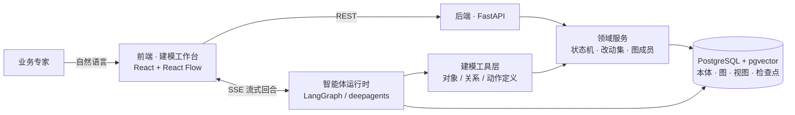

# OntoWeave

> 会话驱动的企业本体建模工具 —— 业务专家用自然语言讲业务，系统把「人话」抽象成
> 「对象 / 属性 / 关系」的类型图，团队在这张图上逐步沉淀出可被智能体消费的企业本体。

灵感来自 Palantir 的 Ontology。

## 它解决什么问题

企业想搭智能体，先得有「语义底座」：把业务里的对象、字段和它们之间的关系讲清楚。
可现实是 **懂业务的人不会建模，会建模的人不懂业务**，靠会议和文档对齐，成本高、还容易失真。

OntoWeave 换一条路：**建模就是聊天**。

- 业务专家只管把业务讲清楚，系统负责抽成结构化的对象 / 属性 / 关系。
- 每一条改动先落成 **草图**，由团队 **确认或撤销**，人始终握着最终解释权。
- **对象和关系放在共享池里**，不归某张图私有；跨图复用同一个对象，多张子图自然连成一张大图。

一句话：**把散落在对话里的业务知识，织成一张可被机器消费的本体图。**

## 核心概念

| 概念 | 说明 |
|---|---|
| 对象类型 Object Type | 业务里的「类别」，如客户、订单、产品。放在共享池。 |
| 属性 Property | 挂在对象类型上的字段，如客户等级、订单金额。 |
| 关系 Relation | 两个对象类型之间的连接，如「客户 —下单→ 订单」。放在共享池。 |
| 动作类型 Action Type | 一次「能做哪些改动」的定义：建 / 改 / 删对象，加 / 删链接。放在共享池。 |
| 动作参数 Parameter | 动作的输入：让用户选一个对象，或填一个值。 |
| 动作规则 Rule | 动作到底改了什么：改哪个对象的哪个字段，或加删哪条链接。 |
| 提交校验 Submission Criteria | 提交前必须成立的条件，不满足就拦住这次动作。 |
| 图 Graph | 共享池里的一个子集，也是「一次对话」的产物。 |
| 会话 Conversation | 用户看到的入口，和一张图一对一。 |
| 改动集 Changeset | 一次对话产出的增删改集合，负责版本与审计。 |
| 视图状态 View State | 图在界面上的布局、高亮、分组等，与本体内容完全解耦。 |
| 状态机 Status | 草案 `draft` → 已确认 `confirmed` → 已批准 `approved`。 |

两条贯穿全局的原则：**草图态与正式态永远视觉可分**；**撤销时记住被否掉的理解，避免下次又画错**。

## 它是怎么工作的



- **对话回合走 SSE**：`message.delta` / `tool.start` / `tool.end` / `interrupt` /
  `state.update` / `run.end` 等事件实时推给前端，工具调用、思考过程和正文都能边跑边看。
- **模型产出先成草图**：写入走改动集，**确认**才落正式态，**撤销**则回滚。
- **相似检索兜底**：建新对象前先查近邻，同名或高度相似就复用，避免把池子画满重复类型。

## 目录结构

```text
backend/                  FastAPI 后端（详见 backend/README.md）
  app/agent/              智能体：LLM 装配、工具层、deepagents 图、运行时与 SSE
  app/api/                按领域拆分的 REST 路由（统一挂在 /api/v1）
  app/services/           领域逻辑：本体、图、改动集、视图、会话
  app/models.py           SQLAlchemy 模型
  alembic/versions/       数据库迁移
  tests/                  pytest 测试
frontend/                 React + TypeScript 建模工作台（详见 frontend/README.md）
  src/features/modeling/  画布、对话、工具块等建模界面
  src/shared/             REST / SSE 客户端与共享类型
.github/workflows/        CI（后端 lint / 类型检查 / 测试）
```

## 快速开始

前置：Docker（跑数据库和后端）、Node.js 18+（跑前端）。

**1. 起后端（含数据库）**

```bash
cd backend
docker compose up -d --build
curl http://127.0.0.1:18000/health   # {"status":"ok"}
```

应用容器启动时会自动跑 `alembic upgrade head`，再起 uvicorn。
接口文档（Swagger）：<http://127.0.0.1:18000/docs>

> 宿主机 8000 常被别的项目占用，所以后端映射到 **18000**。

**2. 起前端**

```bash
cd frontend
npm install
npm run dev
```

打开 <http://127.0.0.1:5173>。首页 → 新建对话 → 进入三栏建模工作台，直接用中文描述你的业务即可。
Vite 会把 `/api` 代理到本机的 `18000` 端口。

**3. 配置模型（可选）**

没有配大模型 key 时，本体、改动集、视图等 REST 功能照常可用，只是**对话建模**不可用。
要跑智能体，复制配置并填 key：

```bash
cd backend
cp .env.example .env
```

| 组 | 变量 | 用途 |
|---|---|---|
| 数据库 | `DATABASE_URL` / `POSTGRES_*` | 本地默认值可直接用 |
| 对话模型 | `CHAT_BASE_URL` / `CHAT_API_KEY` / `CHAT_MODEL` | 智能体回合；OpenAI 兼容接口，私有化环境换成自建网关 |
| 嵌入模型 | `EMBEDDING_BASE_URL` / `EMBEDDING_API_KEY` / `EMBEDDING_MODEL` / `EMBEDDING_DIM` | 相似检索；不配则回落到本地 `HashingEmbedder` |

## 常用命令

| 场景 | 命令 |
|---|---|
| 后端本地开发 | `cd backend && docker compose up -d db && alembic upgrade head && uvicorn app.main:app --reload --port 18000` |
| 后端测试 | `cd backend && pytest -v` |
| 后端静态检查 | `cd backend && ruff check . && ruff format --check . && mypy app` |
| 前端开发 | `cd frontend && npm run dev` |
| 前端测试 | `cd frontend && npm test` |
| 前端构建 / Lint | `cd frontend && npm run build` · `npm run lint` |

> 测试库名必须以 `_test` 结尾，否则 pytest 直接拒绝启动，防止误清开发库。
> 详细说明见 [backend/README.md](backend/README.md)。

## 接口一览

业务接口都在 `/api/v1` 下，`/health` 不版本化。核心分组：

| 分组 | 路径前缀 | 说明 |
|---|---|---|
| 对象类型 | `/object-types` | 增改查，草案 → 已确认 |
| 图 | `/graphs` | 建图、加成员、读画布快照 |
| 会话 | `/conversations` | 建会话（同时建图）、改标题、读消息历史 |
| 动作 | `/actions` | 读动作定义（参数 / 规则 / 字段赋值 / 提交校验） |
| 改动集 | `/changesets` | 记录 / 确认 / 撤销一次对话的改动 |
| 视图状态 | `/graphs/{id}/view-state` | 读写当前用户布局 |
| 智能体 | `/conversations/{id}/messages` · `/resume` | 发消息、回答中断提问（返回 SSE 流） |

完整清单与改动集语义见 [backend/README.md](backend/README.md#接口)。

## 文档

- 后端细节（接口、智能体、踩坑）：[`backend/README.md`](backend/README.md)
- 前端细节：[`frontend/README.md`](frontend/README.md)
- 数据集成与 Agent 闭环路线图：[`docs/superpowers/ROADMAP.md`](docs/superpowers/ROADMAP.md)

## 路线图

| 阶段 | 状态 |
|---|---|
| 后端地基（本体 / 图 / 状态机） | ✅ 已完成 |
| 后端加固（P0–P2） | ✅ 已完成 |
| 会话、改动集与视图 | ✅ 已完成 |
| 智能体工具层与相似检索 | ✅ 已完成 |
| 智能体运行时与 SSE | ✅ 已完成 |
| 前端建模工作台与视图同步 | ✅ MVP 已完成 |
| 动作层（动作类型 / 参数 / 规则 / 提交校验） | ✅ 定义层已完成 |
| P1 数据进来（连接 / 同步 / 数据集版本） | ✅ 已完成 |
| P2 数据整理（可视化处理 / 构建 / 调度 / 来源追踪） | 🟡 技术设计中（算子范围已定） |
| P3 变成对象（对象与关系实例） | ⏳ 规划中 |
| P4 Agent 使用（动作执行 / 审计 / 闭环） | ⏳ 规划中 |
