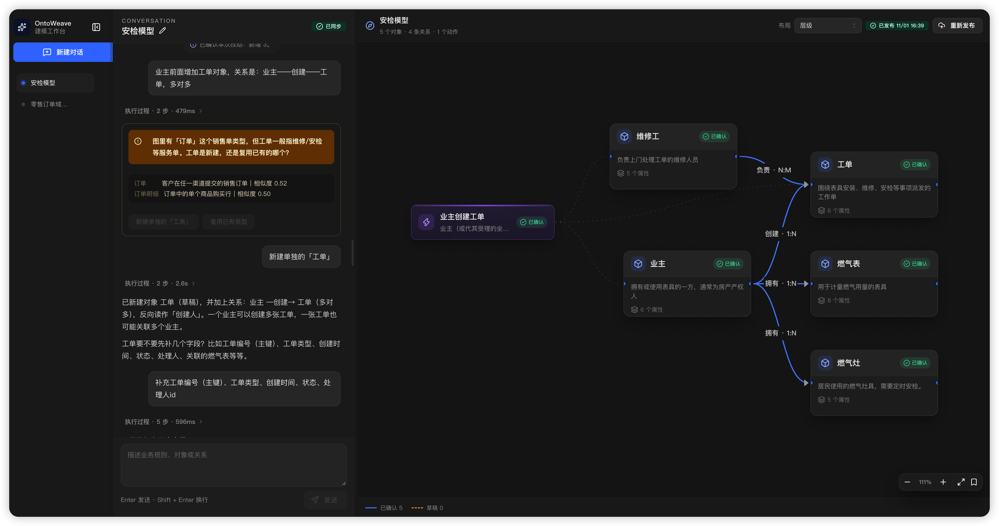
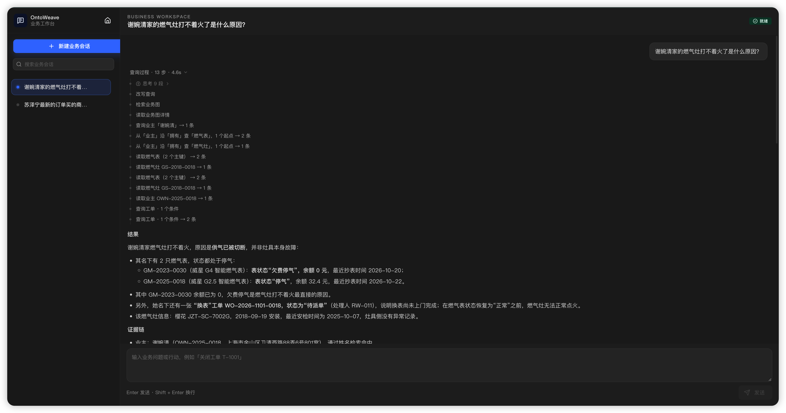
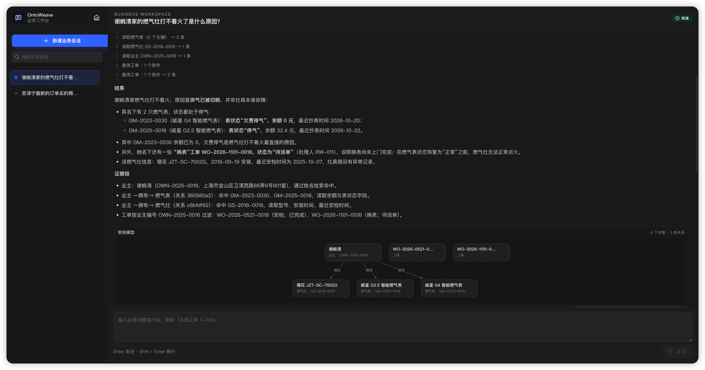
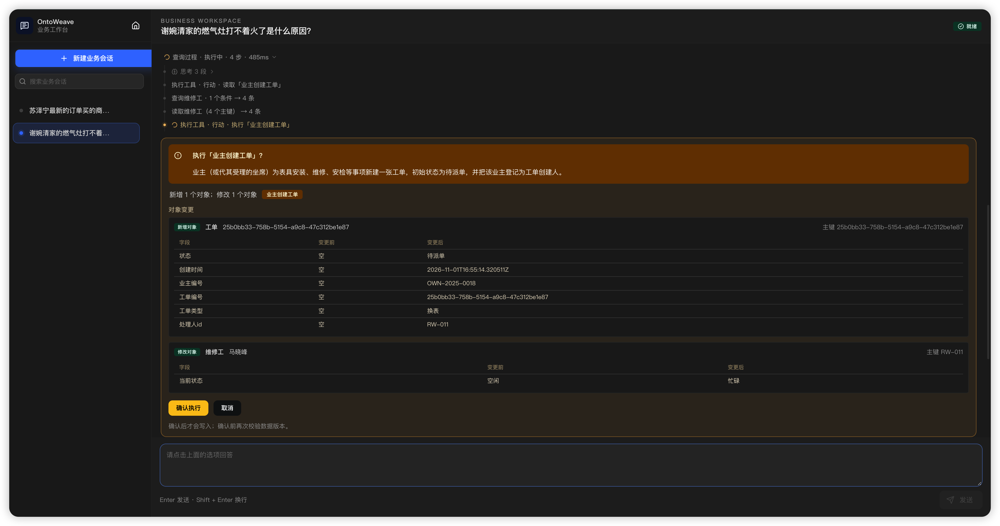
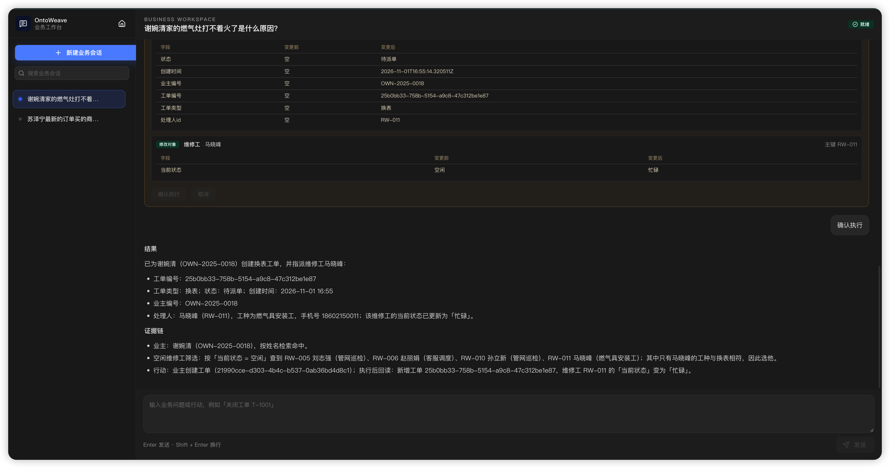
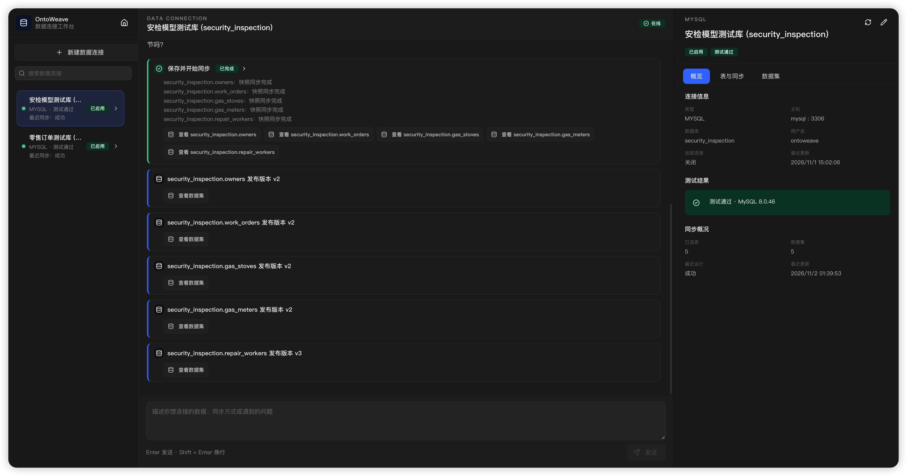
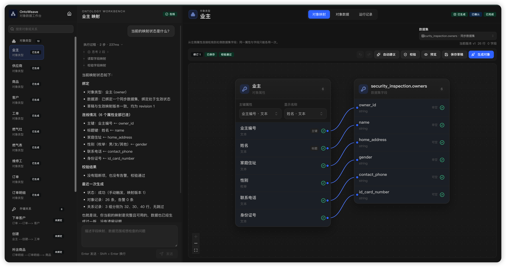
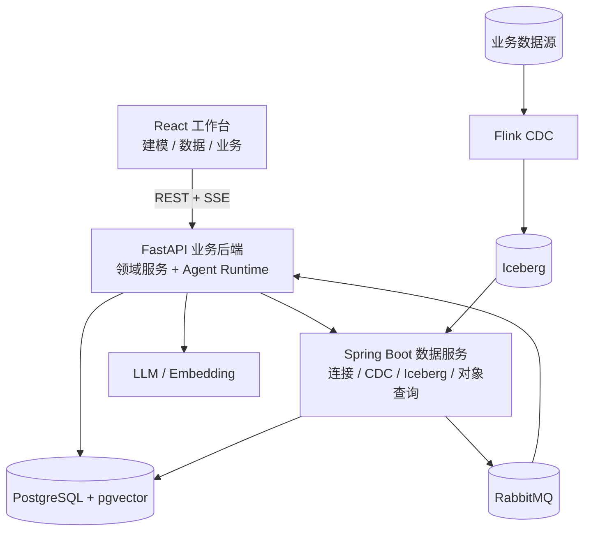

# OntoWeave

OntoWeave 用 Agent 把业务里的对象、属性、关系和动作建模，再让业务 Agent 按这套模型查数据和执行动作。

在燃气安检系统里，判断“业主家的燃气灶为什么打不着火”，需要从业主查到燃气表、燃气灶和工单。数据库里能看到的只有 `owner_id`、`meter_id` 这类外键和 `work_orders` 表；但“为什么停气”要靠余额、表状态、安检记录和历史工单一起判断，这些规则散在服务代码和业务人员的经验里。

OntoWeave 让业务人员在对话里把这类东西讲出来，Agent 把它整理成一张可确认的模型。这套模型就是项目里的本体：

- 业主、燃气表、燃气灶、维修工、工单是对象；
- 业主与燃气表/燃气灶之间是拥有关系，维修工与工单之间是负责关系；
- 业主创建工单是一个动作，执行后生成待派单工单，并把处理人改成忙碌。

确认后，这张模型会用于三件事：

- 接入数据源时，把 `security_inspection.owners`、`gas_meters` 等表映射到对象属性；
- 业务 Agent 查“燃气灶为什么打不着火”时，从业主出发查燃气表、燃气灶和工单，再结合余额与状态给出原因；
- 执行“业主创建工单”时，先预览新增工单和维修工状态变更，确认后再写入。

这三件事用的是同一份模型。

## 项目现在能做什么

- **对话建模**：在聊天里生成对象、属性、关系和动作。每次改动先进改动集，用户确认后才落正式态。
- **共享本体**：对象、属性、关系和动作放在共享池，图只引用其中一部分，跨图可以复用同一个对象。
- **数据接入**：从数据源同步到 Iceberg，支持 snapshot 和 CDC，每次同步生成一个不可变的数据集版本。
- **数据整理**：把数据集接成处理流程，支持预览、手动构建、定时构建和来源追踪。
- **对象化**：把数据集字段映射到对象属性和关系，整批生成对象/关系实例，完成后原子切换。
- **业务查询**：先按问题检索业务图，再查对象和关系，最后把查询过程整理成证据图。
- **业务动作**：动作执行前先预览变更，用户确认后重新校验、执行，再回读结果。
- **工程化**：FastAPI、Spring Boot、React 三端；SSE 流式回合、中断恢复、可选 Langfuse 追踪。

项目现在跑通的链路是：

```text
对话建模 → 本体确认 → 数据接入 → 对象实例 → 业务查询 → 动作执行
```

## 界面预览

截图以安检业务为例，覆盖建模、查询、动作确认和数据映射。

### 建模工作台



左边是对话列表，中间是对话区，显示 Agent 的工具调用和改动集，右边画布同步出现对象和关系，改动确认后才会生效。

### 业务查询




问题先命中安检图，再查业主、燃气表、燃气灶和工单，结果与证据链一起返回。

### 动作确认




预览里会列出新增工单和维修工状态变更；确认后写入，并回读结果。

### 数据接入与对象化




数据源同步到 Iceberg 后生成数据集版本；字段映射到业主等对象，生成对象/关系实例。

## 整体链路



从使用上看，就是先在建模工作台把业务讲清楚，确认本体；再把数据接进来，映射成对象；最后在业务工作台里提问或执行动作。没有数据也可以先建本体，数据接进来之后再补映射。

## 几个概念

| 概念 | 含义 |
|---|---|
| 对象类型 | 业务里的“类别”，比如业主、燃气表、工单 |
| 属性 | 挂在对象上的字段，比如燃气表余额、工单状态 |
| 关系 | 两个对象之间的连接，比如业主拥有燃气表、维修工负责工单 |
| 动作 | 参数、规则和提交校验放在一起，定义一次能改什么 |
| 图 | 共享本体里的一个子集，也是一次对话的产物 |
| 会话 | 用户看到的入口，和一张图对应 |
| 改动集 | 一轮对话产生的增删改，确认后生效，撤销可回滚 |
| 视图状态 | 画布布局、高亮、分组等，和本体内容分开存 |

## Agent 怎么拆

项目没有把所有工具塞给一个 Agent。每类会话有自己的 `AgentDefinition`，主 Agent 只拿当前场景需要的工具；视图和动作建模再按需拆成子 Agent。

- 建模 Agent：对象、属性、关系、动作定义。
- 视图子 Agent：只改画布布局，不碰本体。
- 动作建模子 Agent：补参数、规则、赋值和提交校验，不碰实例数据。
- 数据连接 Agent：看连接状态、发现源表、读表结构、排查同步问题。
- 数据整理 Agent：读写流程草稿、预览节点、构建流程。
- 对象映射 Agent：推荐映射、校验、预览，然后触发生成对象/关系实例。
- 业务 Agent：改写问题、检索业务图、查对象和关系，必要时执行动作。

这些 Agent 共用同一套运行时和本体，区别只在拿到的工具和上下文。

业务查询的路径大致是：

```text
改写问题 → 检索业务图 → 读取图详情
→ 查对象 / 沿关系查关联对象 → 更新证据
```

图向量只负责找候选图，实例数据还是走结构化查询，不会把整库塞进上下文。

### 模型怎么读图、选图

`graph_card` 是业务图发布时生成的一段文本，不是给页面展示的，而是给检索和 Agent 判断用的。它把一张图压成一份类型层摘要：

- 图名和对象类型；
- 每个对象的属性、主键和标题键；
- 关系的方向、基数和标签；
- 可执行动作的参数、影响范围和提交校验。

发布前会校验图里的对象、属性、关系和动作都已经确认或批准；有草稿元素时直接拦住，避免把没定稿的图拿去召回。

发布时会把整张图卡向量化，写入 `graph_embedding`。业务问题改写后，先用问题向量去比图向量，召回几张候选图；检索结果返回图 ID、相似度和 `graph_card`，Agent 读图卡判断哪张图能回答问题。选中后再读结构化的图详情，查对象实例。

所以模型读图分两步：先用图卡判断哪张图相关；选中后再用结构化详情确认对象、关系和动作，最后查实例。实例数据不进图卡，也不会把整库塞进上下文。

动作走的是另一条路径：

```text
读取动作详情 → 执行动作 → 生成变更预览 → 等待用户确认
→ 重新校验 → 应用变更 → 回读结果
```

执行动作时先生成变更预览，再等用户确认。确认后用同一个执行 ID 重算预览；如果重算结果和上次不一致，直接判为过期；一致才应用变更，最后回读生效后的对象和关系。

## 服务怎么拆

- `frontend/`：React 19、TypeScript、React Flow、Mantine、TanStack Query。负责建模画布、数据工作台、业务工作台，以及 REST/SSE 客户端。
- `backend/`：Python 3.12、FastAPI、SQLAlchemy、LangGraph/deepagents。负责本体、图、会话、改动集、动作等领域逻辑，以及 Agent 运行时和 SSE。
- `data-service/`：Java 17、Spring Boot 3.5、Flink 1.20、Iceberg 1.10。负责数据源连接、同步、Iceberg 版本、对象/关系实例、查询原语和动作编辑覆盖层。
- 基础设施：PostgreSQL 16 + pgvector、RabbitMQ、Flink、Iceberg；本地示例数据源见“快速开始”。

Java 服务贴着 JDBC、Flink、Iceberg 走；Python 负责 Agent、会话和流式输出；React 负责画布和确认交互。三端之间走内部 REST、token 和 RabbitMQ outbox，不共享进程内状态。

## 几个设计取舍

### 共享本体池

对象类型、属性、关系和动作都放在共享池里。图不复制这些定义，只记录自己用了哪些元素。这样同一个“业主”不会在每张图里各建一份。

视图状态单独存，画布怎么摆不影响本体。

### 改动集

Agent 的写工具不会直接改正式数据。它先往改动集里记一条操作；用户确认时做全量校验，再统一落正式态；撤销时删掉本次新建、还原修改，并把回执写回模型线程，避免下一轮继续引用已撤销内容。

工具里还有几道护栏：建新对象前先做相似检索，命中候选要 `ask_user` 让用户决定复用还是新建；更新只允许白名单字段；删除先标记不真删；工具异常返回结构化错误，让模型自己纠正。

### 数据链路

数据链路分两段：

```text
数据源 → Flink CDC → Iceberg → 不可变数据集版本
数据集版本 → 字段映射 → 对象/关系实例 → 原子切换
```

同步任务支持 snapshot 和 CDC，每次运行生成新的 Iceberg 表，失败不会覆盖当前版本。对象映射会校验字段类型、主键、标题键和关系端点；整批重建完成后一次性切换当前版本，失败保留旧版本可查。

## 快速开始

前置：Docker、Docker Compose；完整体验建议给 Docker 至少 8 GB 内存。

```bash
docker compose up -d --build
```

启动后：

| 入口 | 地址 |
|---|---|
| 前端 | <http://127.0.0.1:18080> |
| 后端 API / Swagger | <http://127.0.0.1:18000/docs> |
| Java 数据服务健康检查 | <http://127.0.0.1:18001/actuator/health> |
| Flink UI | <http://127.0.0.1:18081> |
| RabbitMQ 管理台 | <http://127.0.0.1:15673>（`ontoweave` / `ontoweave`） |

只做前端开发：

```bash
cd frontend
npm install
npm run dev
```

Vite 默认在 <http://127.0.0.1:5173>，`/api` 代理到 `18000`。

导入安检 mock 数据：

```bash
docker compose exec -T mysql mysql -uroot -proot < scripts/mock-security-inspection.sql
```

这套 mock 数据只用于本地演示。实际接入的数据源在数据工作台里配置。

### 配置模型

没有配置大模型 key 时，本体、改动集、数据连接等 REST 功能仍可用，但对话建模和业务 Agent 不可用。

```bash
cp backend/.env.example backend/.env
```

至少填写：

```dotenv
CHAT_BASE_URL=...
CHAT_API_KEY=...
CHAT_MODEL=...
```

嵌入模型不配置时会回落到本地 `HashingEmbedder`，开发可用，但语义检索质量不如真实模型。修改配置后重建后端：

```bash
docker compose up -d --force-recreate app
```

## 验证

后端：

```bash
cd backend
.venv/bin/python -m pytest -q
.venv/bin/ruff check .
.venv/bin/ruff format --check .
.venv/bin/mypy app
```

Java 数据服务：

```bash
cd data-service
./mvnw -B verify
```

前端：

```bash
cd frontend
npx tsc -b
npm run lint
npm test
npm run build
```

对象化性能验收：

```bash
P3_PERFORMANCE_ROWS=200000 ./scripts/p3-acceptance.sh performance
```

当前 CI 覆盖后端和 Java 数据服务；前端校验在本地执行。

## 目录结构

```text
backend/                  FastAPI 业务后端
  app/agent/              Agent 装配、工具层、运行时与 SSE
  app/api/                REST 路由（统一挂在 /api/v1）
  app/services/           本体、图、改动集、动作、数据连接等领域逻辑
  app/clients/            Java 数据服务客户端
  app/models/             SQLAlchemy 模型
  alembic/versions/       数据库迁移
  tests/                  pytest
data-service/             Spring Boot + Flink + Iceberg 数据服务
  src/main/java/          连接、同步、流水线、对象映射、查询、动作覆盖层
  src/test/java/          JUnit / Testcontainers
frontend/                          React + TypeScript 工作台
  src/features/data-connection/    数据连接与同步
  src/features/data-pipeline/      数据整理流程
  src/features/modeling/           建模画布、对话、改动集
  src/features/ontology-workbench/ 对象/关系映射
  src/features/business/           业务查询与动作确认
  src/shared/                      REST / SSE 客户端与共享类型
docs/                     设计稿、阶段记录、验收报告
scripts/                  验收脚本与 mock 数据
docker-compose.yml        本地全栈编排
```

## 文档

- 后端接口、Agent 运行时：[`backend/README.md`](backend/README.md)
- 前端结构与画布交互：[`frontend/README.md`](frontend/README.md)
- 数据服务、同步链路、内部接口：[`data-service/README.md`](data-service/README.md)
- 会话式本体建模设计：[`docs/superpowers/specs/2026-10-07-conversational-ontology-modeling-design.md`](docs/superpowers/specs/2026-10-07-conversational-ontology-modeling-design.md)
- 数据接入与 Agent 查询设计：[`docs/superpowers/specs/2026-10-17-data-integration-and-agent-loop-design.md`](docs/superpowers/specs/2026-10-17-data-integration-and-agent-loop-design.md)
- 业务 Agent 动作执行：[`docs/superpowers/specs/2026-10-31-business-agent-action-design.md`](docs/superpowers/specs/2026-10-31-business-agent-action-design.md)
- 对象化验收与性能证据：[`docs/checks/2026-10-23-p3-ontology-mapping-smoke.md`](docs/checks/2026-10-23-p3-ontology-mapping-smoke.md)

## 当前范围

当前版本聚焦单用户、单节点的完整链路，以下部分按当前实现边界处理：

- 多用户与权限：当前使用固定的 `DEFAULT_USER_ID`；
- 数据源连接器：已实现一种，新增类型需补对应适配；
- Flink 部署：单节点运行，暂未包含 savepoint 恢复与多节点编排；
- 性能验收：覆盖 20 万行 × 8 属性，更大规模暂未纳入当前范围。

产品形态参考了 Palantir 的 Ontology/AIP。当前不引入通用本体交换格式；图卡、对象、关系和动作按业务查询与执行的需要组织，减少上下文和实现复杂度。
