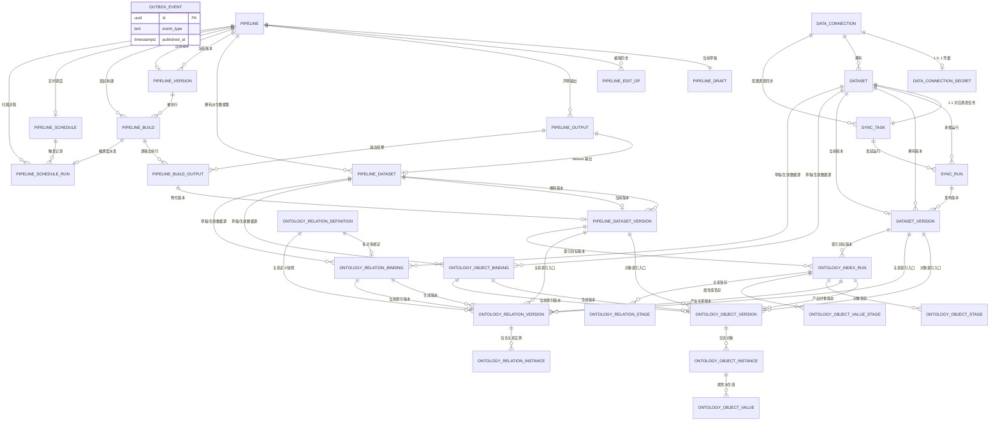

# data-service 数据库结构

> 依据：`data-service/src/main/resources/db/migration/V1__data_connection.sql` 至 `V10__ontology_index_performance.sql`。本文描述的是执行完全部 Flyway 迁移后的最终结构，不是某一版中间状态。

## 1. 总览

- PostgreSQL schema：`data`。
- 表：30 张；只读视图：2 个；序列：1 个（`data.sync_server_id_seq`）。
- 领域划分：
  - P1 数据接入：连接、同步任务、同步运行、同步数据集与版本。
  - P2 数据准备：流程、草稿、编辑历史、输出、派生数据集、版本、构建、调度。
  - P3 本体索引：对象/关系绑定、定义快照、索引运行、对象/关系版本、查询实例、运行暂存。
  - 基础设施：加密凭据、事务发件箱。
- `owner_id`、`conversation_id`、本体对象/属性/关系 ID 等来自 Python 侧 `app` schema 或其他服务，数据库不建跨 schema 外键。
- P3 的 `draft_dataset_kind + draft_dataset_id`、`source_dataset_kind + source_dataset_id`、`target_dataset_kind + target_dataset_version_id` 是**多态引用**：根据 kind 指向 `dataset` 或 `pipeline_dataset`；没有数据库外键。
- 下图中实线表示数据库外键或明确的 P1/P2 强关联；跨域多态引用在图中按“逻辑关系”展示。`run_id`、`current_index_version_id` 等 UUID 引用大多也未声明数据库外键，以支持清理和跨域解耦。

## 2. 完整 ER 图



### 2.1 跨域多态引用

| 来源字段 | 目标 | 说明 |
|---|---|---|
| `ontology_*_binding.draft_dataset_kind/id` | `dataset` 或 `pipeline_dataset` | 草稿绑定数据集；kind 为 `SYNC` / `PIPELINE` |
| `ontology_*_binding.active_dataset_kind/id/version_id` | 两类数据集的版本 | 已生效数据源及精确版本 |
| `ontology_*_version.source_dataset_kind/id/version_id/snapshot_id` | 两类数据集的 Iceberg 版本 | 生成该索引版本时冻结的输入 |
| `ontology_index_run.target_dataset_kind/version_id` | 两类数据集的版本 | 本次运行要读取的精确版本 |
| `pipeline.conversation_id` | Python `conversation.id` | 对话绑定，应用层校验 |
| `data_connection.conversation_id` | Python `conversation.id` | 对话绑定，应用层校验 |
| `*.owner_id`、`created_by`、`requested_by` 等 | Python 用户/会话体系 | 无跨 schema 外键 |

## 3. P1：数据接入与同步

### 3.1 `data.data_connection`

数据连接主表；保存非敏感连接配置，数据库密码等单独加密存放。当前 `kind` 仅支持 MySQL。

| 字段 | 类型 | 含义 |
|---|---|---|
| `id` | UUID PK | 连接 ID，应用生成 |
| `owner_id` | UUID | 连接所有者 |
| `name` | TEXT | 连接名称；同一所有者下唯一 |
| `kind` | TEXT | 连接器类型；当前仅 `mysql` |
| `config` | JSONB | 非敏感配置，如 host、port、database、username、SSL 参数 |
| `config_version` | INTEGER | 配置版本；配置或密钥变化时递增，用于缓存/测试结果失效 |
| `status` | TEXT | `draft` / `active`；测试成功后变为 active |
| `last_test_status` | TEXT | `untested` / `success` / `failed` |
| `last_test_at` | TIMESTAMPTZ | 最近一次连接测试时间 |
| `last_test_error` | TEXT | 最近一次测试失败的错误信息 |
| `last_test_details` | JSONB | 测试详情，如 binlog 能力、权限及前置检查结果（脱敏） |
| `conversation_id` | UUID | 绑定的 Python 对话 ID；全局唯一，跨 schema 逻辑引用 |
| `created_at` | TIMESTAMPTZ | 创建时间 |
| `updated_at` | TIMESTAMPTZ | 最后更新时间 |

关键约束：`(owner_id, name)` 唯一；`conversation_id` 唯一；`kind/status/last_test_status` 有 CHECK 约束。

### 3.2 `data.data_connection_secret`

数据连接密钥表，与主表一对一。

| 字段 | 类型 | 含义 |
|---|---|---|
| `connection_id` | UUID PK/FK | 对应 `data_connection.id`；级联删除 |
| `ciphertext` | TEXT | 加密后的凭据 JSON，例如密码 |
| `key_version` | INTEGER | 加密密钥版本，用于轮换和解密选择 |
| `updated_at` | TIMESTAMPTZ | 密钥最后更新时间 |

### 3.3 `data.outbox_event`

事务发件箱；业务事务内写事件，后台发布到 RabbitMQ，保证领域变更与消息投递最终一致。

| 字段 | 类型 | 含义 |
|---|---|---|
| `id` | UUID PK | 事件 ID，消费端据此幂等 |
| `aggregate_type` | TEXT | 聚合类型，如 dataset、pipeline |
| `aggregate_id` | UUID | 聚合根 ID |
| `event_type` | TEXT | 事件类型，如 `dataset.version.published` |
| `payload` | JSONB | 事件载荷 |
| `created_at` | TIMESTAMPTZ | 事件写入时间 |
| `published_at` | TIMESTAMPTZ | 成功投递时间；为空表示待发布 |

该表是基础设施表，不参与业务外键关系。

### 3.4 `data.dataset`

P1 同步数据集身份表；一个同步任务对应一个数据集，不含流程派生数据集语义。

| 字段 | 类型 | 含义 |
|---|---|---|
| `id` | UUID PK | 数据集 ID |
| `connection_id` | UUID FK | 所属数据连接 |
| `sync_task_id` | UUID FK | 对应同步任务；可空、唯一，与 `sync_task.dataset_id` 形成双向 1:1 |
| `name` | TEXT | 数据集名称；同一连接下唯一 |
| `active_iceberg_catalog` | TEXT | 当前版本所在 Iceberg catalog |
| `active_iceberg_namespace` | TEXT | 当前版本所在 Iceberg namespace |
| `active_iceberg_table` | TEXT | 当前版本所在 Iceberg 物理表 |
| `current_version_id` | UUID FK | 当前已发布版本；指向 `dataset_version.id` |
| `created_at` | TIMESTAMPTZ | 创建时间 |
| `updated_at` | TIMESTAMPTZ | 最后更新时间 |

### 3.5 `data.sync_task`

源表同步配置；一张源表一条任务，一个任务一个数据集。

| 字段 | 类型 | 含义 |
|---|---|---|
| `id` | UUID PK | 同步任务 ID |
| `connection_id` | UUID FK | 所属数据连接 |
| `dataset_id` | UUID FK UK | 对应数据集；唯一且非空 |
| `schema_name` | TEXT | 源库 schema |
| `table_name` | TEXT | 源表名 |
| `sync_mode` | TEXT | `snapshot` 全量 / `cdc` 增量 |
| `version_interval_seconds` | INTEGER | CDC 版本发布间隔；默认 86400 秒，最小 60 秒 |
| `primary_key_columns` | JSONB | 建任务时确认的源表主键列名数组 |
| `status` | TEXT | `enabled` / `disabled` |
| `created_at` | TIMESTAMPTZ | 创建时间 |
| `updated_at` | TIMESTAMPTZ | 最后更新时间 |

关键约束：`(connection_id, schema_name, table_name)` 唯一；`dataset_id` 唯一。

### 3.6 `data.sync_run`

一次同步运行；保存 Flink 作业、Iceberg 物理表、快照发布与停止/故障信息。

| 字段 | 类型 | 含义 |
|---|---|---|
| `id` | UUID PK | 运行 ID |
| `sync_task_id` | UUID FK | 所属同步任务 |
| `dataset_id` | UUID FK | 目标数据集 |
| `operation_id` | UUID | 客户端命令幂等 ID；与任务组合唯一 |
| `run_mode` | TEXT | 本次运行模式 `snapshot` / `cdc`，创建时从任务复制 |
| `status` | TEXT | `queued` / `preparing` / `submitted` / `running` / `stopping` / `succeeded` / `stopped` / `failed` |
| `flink_job_id` | TEXT | Flink Job ID |
| `flink_job_name` | TEXT | Flink 作业名；全局唯一，用于提交结果不确定时接管 |
| `flink_job_state` | TEXT | Flink 返回的原始作业状态 |
| `iceberg_catalog` | TEXT | 本次运行写入的 Iceberg catalog |
| `iceberg_namespace` | TEXT | 本次运行写入的 Iceberg namespace |
| `iceberg_table` | TEXT | 本次运行写入的 Iceberg 物理表；通常每次运行新建表 |
| `server_id_start` | BIGINT | CDC server-id 范围起点 |
| `server_id_end` | BIGINT | CDC server-id 范围终点 |
| `snapshot_expected_rows` | BIGINT | 初始快照预期行数，用于可靠性核对 |
| `snapshot_completed_at` | TIMESTAMPTZ | 初始快照完成时间 |
| `last_checkpoint_at` | TIMESTAMPTZ | 最近一次成功 checkpoint 时间 |
| `last_snapshot_id` | BIGINT | 最近观察到的 Iceberg snapshot ID |
| `last_published_snapshot_id` | BIGINT | 最近已发布版本对应的 snapshot ID，避免重复发布 |
| `version_interval_seconds` | INTEGER | 本运行版本发布间隔快照 |
| `next_version_due_at` | TIMESTAMPTZ | 下一次 CDC 版本发布时间 |
| `savepoint_path` | TEXT | 停止时生成的 Flink savepoint 路径 |
| `savepoint_request_id` | TEXT | 保存点请求 ID，用于轮询/去重 |
| `stop_requested_at` | TIMESTAMPTZ | 用户请求停止的时间 |
| `stop_operation_id` | UUID | 一次停止操作的幂等 ID |
| `error_code` | TEXT | 结构化失败码 |
| `error_message` | TEXT | 失败说明 |
| `dispatch_attempts` | INTEGER | 提交 Flink 的尝试次数 |
| `dispatched_at` | TIMESTAMPTZ | 最近一次派发时间 |
| `started_at` | TIMESTAMPTZ | 作业实际开始时间 |
| `finished_at` | TIMESTAMPTZ | 进入终态的时间 |
| `created_at` | TIMESTAMPTZ | 创建时间 |
| `updated_at` | TIMESTAMPTZ | 最后更新时间 |

关键约束：`(sync_task_id, operation_id)` 唯一；同一任务最多一个活跃运行（部分唯一索引）；`flink_job_name` 唯一。

### 3.7 `data.dataset_version`

P1 数据集不可变版本；每次成功发布新增一行，不覆盖历史版本。

| 字段 | 类型 | 含义 |
|---|---|---|
| `id` | UUID PK | 版本 ID |
| `dataset_id` | UUID FK | 所属数据集 |
| `version_number` | INTEGER | 数据集内递增版本号 |
| `iceberg_catalog` | TEXT | 版本所在 Iceberg catalog |
| `iceberg_namespace` | TEXT | 版本所在 Iceberg namespace |
| `iceberg_table` | TEXT | 版本所在物理表 |
| `iceberg_snapshot_id` | BIGINT | 版本对应的 Iceberg snapshot ID |
| `row_count` | BIGINT | 发布时行数 |
| `row_count_estimated` | BOOLEAN | 行数是否为估算值；CDC 通常为 true |
| `byte_size` | BIGINT | 版本数据文件总字节数 |
| `schema_json` | JSONB | 版本 schema（字段名、类型、可空性等） |
| `column_count` | INTEGER | 字段数量 |
| `committed_at` | TIMESTAMPTZ | Iceberg snapshot 提交时间 |
| `published_at` | TIMESTAMPTZ | 发布为数据集版本的时间；非空表示已发布 |
| `version_source` | TEXT | `snapshot_end` / `scheduled` / `stop` |
| `source_run_id` | UUID | 产生该版本的同步运行；逻辑引用 `sync_run.id` |
| `storage_path` | TEXT | Iceberg 表根存储路径 |

关键约束：`(dataset_id, version_number)` 唯一；`(dataset_id, iceberg_table, iceberg_snapshot_id)` 唯一。

## 4. P2：数据准备与流程构建

### 4.1 `data.pipeline`

流程元数据；MVP 只有 main 单分支，一条对话绑定一条流程。

| 字段 | 类型 | 含义 |
|---|---|---|
| `id` | UUID PK | 流程 ID |
| `owner_id` | UUID | 流程所有者 |
| `conversation_id` | UUID | 绑定的 Python 对话 ID；唯一，跨 schema 逻辑引用 |
| `name` | TEXT | 流程名称 |
| `status` | TEXT | `draft` / `active` / `archived` |
| `current_version_id` | UUID FK | 当前已发布流程版本；指向 `pipeline_version.id` |
| `archived_at` | TIMESTAMPTZ | 归档时间；非空表示已归档 |
| `created_at` | TIMESTAMPTZ | 创建时间 |
| `updated_at` | TIMESTAMPTZ | 最后更新时间 |

### 4.2 `data.pipeline_draft`

当前可编辑草稿；整幅流程图以 JSONB 保存，节点/连线不单独建表。

| 字段 | 类型 | 含义 |
|---|---|---|
| `pipeline_id` | UUID PK/FK | 对应流程；一对一 |
| `definition` | JSONB | 当前整图定义，含节点、连线、配置、输出声明及 schema 版本 |
| `revision` | BIGINT | 草稿语义修订号；写操作携带 `base_revision` 做乐观锁 |
| `updated_by_type` | TEXT | 最后修改者类型，如 user、agent |
| `updated_by_id` | UUID | 最后修改者 ID；Agent 修改时可为空 |
| `updated_at` | TIMESTAMPTZ | 最后修改时间 |

### 4.3 `data.pipeline_edit_op`

只追加的草稿编辑历史，用于审计、事件回放和按轮次撤销。

| 字段 | 类型 | 含义 |
|---|---|---|
| `id` | UUID PK | 编辑操作记录 ID |
| `pipeline_id` | UUID FK | 所属流程 |
| `revision` | BIGINT | 该操作产生/归属的草稿修订号 |
| `seq` | INTEGER | 同一修订号内的操作顺序 |
| `op_type` | TEXT | 操作类型，如新增/更新/删除节点、连线、输出 |
| `target_type` | TEXT | 目标对象类型，如 node、edge、output |
| `target_id` | UUID | 目标节点/连线/输出 ID |
| `before` | JSONB | 操作前内容；新增时可为空 |
| `after` | JSONB | 操作后内容；删除时可为空 |
| `actor_type` | TEXT | 操作者类型，如 user、agent |
| `actor_id` | UUID | 操作者 ID |
| `operation_id` | UUID | 命令幂等 ID |
| `turn_id` | UUID | Agent/对话轮次 ID，用于归组和撤销 |
| `created_at` | TIMESTAMPTZ | 操作时间 |

关键约束：`(pipeline_id, revision, seq)` 唯一；`(pipeline_id, turn_id)` 有查询索引。

### 4.4 `data.pipeline_output`

流程输出节点的通用声明；具体 dataset 配置由 `pipeline_dataset` 扩展。

| 字段 | 类型 | 含义 |
|---|---|---|
| `id` | UUID PK | 输出 ID |
| `pipeline_id` | UUID FK | 所属流程 |
| `node_id` | UUID | 画布输出节点 ID；同一流程内唯一 |
| `output_type` | TEXT | 输出类型；当前仅 `dataset` |
| `name` | TEXT | 输出名称 |
| `status` | TEXT | `active` / `archived` |
| `archived_at` | TIMESTAMPTZ | 归档时间 |
| `created_at` | TIMESTAMPTZ | 创建时间 |
| `updated_at` | TIMESTAMPTZ | 最后更新时间 |

### 4.5 `data.pipeline_dataset`

Pipeline 自己的派生数据集身份及 dataset 输出配置；不复用 P1 `dataset`。

| 字段 | 类型 | 含义 |
|---|---|---|
| `id` | UUID PK | 派生数据集 ID |
| `output_id` | UUID FK UK | 对应通用输出；一个 dataset 输出一对一 |
| `pipeline_id` | UUID FK | 所属流程 |
| `name` | TEXT | 数据集名称；同一流程内唯一 |
| `write_mode` | TEXT | 写入模式；MVP 仅 `snapshot` |
| `primary_key_columns` | JSONB | 输出主键列名数组 |
| `expectations` | JSONB | 数据期望规则数组，支持主键唯一、行数区间、取值集合、非空 |
| `current_version_id` | UUID FK | 当前已发布输出版本；指向 `pipeline_dataset_version.id` |
| `archived_at` | TIMESTAMPTZ | 归档时间 |
| `created_at` | TIMESTAMPTZ | 创建时间 |
| `updated_at` | TIMESTAMPTZ | 最后更新时间 |

### 4.6 `data.pipeline_version`

构建时冻结的不可变流程版本；成功发布后由 `pipeline.current_version_id` 指向。

| 字段 | 类型 | 含义 |
|---|---|---|
| `id` | UUID PK | 流程版本 ID |
| `pipeline_id` | UUID FK | 所属流程 |
| `version_number` | INTEGER | 流程内递增版本号 |
| `definition` | JSONB | 冻结的整图定义 |
| `outputs` | JSONB | 冻结的输出配置快照 |
| `definition_hash` | TEXT | 语义定义哈希，用于复用相同版本 |
| `input_refs` | JSONB | 输入声明，如 `{datasetKind, datasetId}`；不固定版本 |
| `source_draft_revision` | BIGINT | 生成该版本时使用的草稿 revision |
| `created_by` | UUID | 触发冻结的用户/主体 |
| `created_at` | TIMESTAMPTZ | 创建时间 |

关键约束：`(pipeline_id, version_number)` 唯一；`(pipeline_id, definition_hash)` 唯一。

### 4.7 `data.pipeline_build`

一次整体构建及编排状态；每个输出节点的具体执行结果在 `pipeline_build_output`。

| 字段 | 类型 | 含义 |
|---|---|---|
| `id` | UUID PK | 构建 ID |
| `pipeline_id` | UUID FK | 所属流程 |
| `pipeline_version_id` | UUID FK | 本次执行的不可变流程版本 |
| `status` | TEXT | `queued` / `running` / `succeeded` / `failed` / `canceled` |
| `stage` | TEXT | `resolving_inputs` / `submitting` / `running` / `checking_expectations` / `publishing` / `finished` |
| `trigger_type` | TEXT | `manual` / `schedule` |
| `operation_id` | UUID | 构建请求幂等 ID；同一流程内唯一 |
| `requested_by` | UUID | 发起人；定时触发可为空 |
| `resolved_inputs` | JSONB | 本次精确输入版本、schema hash 及历史展示快照 |
| `logic_hash` | TEXT | 流程定义哈希 + 输入版本 ID 的组合哈希，用于调度无变化判断 |
| `log_uri` | TEXT | 构建日志入口 |
| `error_code` | TEXT | 结构化失败码 |
| `error_message` | TEXT | 失败说明 |
| `stats` | JSONB | 行数、耗时等构建统计 |
| `heartbeat_at` | TIMESTAMPTZ | Worker 心跳时间 |
| `cancel_requested_at` | TIMESTAMPTZ | 取消请求时间 |
| `started_at` | TIMESTAMPTZ | 开始执行时间 |
| `finished_at` | TIMESTAMPTZ | 进入终态时间 |
| `created_at` | TIMESTAMPTZ | 创建时间 |
| `updated_at` | TIMESTAMPTZ | 最后更新时间 |

关键约束：`(pipeline_id, operation_id)` 唯一；同一流程最多一个 `queued/running` 构建。

### 4.8 `data.pipeline_build_output`

一次构建中单个输出节点的执行记录。

| 字段 | 类型 | 含义 |
|---|---|---|
| `id` | UUID PK | 输出执行记录 ID |
| `build_id` | UUID FK | 所属构建 |
| `output_id` | UUID FK | 对应通用输出 |
| `output_type` | TEXT | 输出类型；当前 `dataset` |
| `status` | TEXT | `queued` / `running` / `succeeded` / `failed` / `canceled` |
| `stage` | TEXT | 当前执行阶段，与构建阶段同一枚举 |
| `engine_job_id` | TEXT | Flink 等执行引擎的作业 ID |
| `log_uri` | TEXT | 该输出日志入口 |
| `result` | JSONB | 输出结果，含数据期望逐项结果等 |
| `error_code` | TEXT | 结构化失败码 |
| `error_message` | TEXT | 失败说明 |
| `stats` | JSONB | 输出行数、文件大小、耗时等统计 |
| `started_at` | TIMESTAMPTZ | 开始时间 |
| `finished_at` | TIMESTAMPTZ | 结束时间 |
| `created_at` | TIMESTAMPTZ | 创建时间 |
| `updated_at` | TIMESTAMPTZ | 最后更新时间 |

关键约束：`(build_id, output_id)` 唯一。

### 4.9 `data.pipeline_dataset_version`

Dataset 输出真正物化出的不可变 Iceberg 版本；只有整体构建成功才写 `published_at` 并切换当前版本。

| 字段 | 类型 | 含义 |
|---|---|---|
| `id` | UUID PK | 输出版本 ID |
| `dataset_id` | UUID FK | 所属派生数据集 |
| `build_output_id` | UUID FK UK | 产生该版本的输出执行记录；一对一 |
| `version_number` | INTEGER | 数据集内递增版本号 |
| `iceberg_catalog` | TEXT | Iceberg catalog |
| `iceberg_namespace` | TEXT | Iceberg namespace |
| `iceberg_table` | TEXT | Iceberg 物理表 |
| `iceberg_snapshot_id` | BIGINT | Iceberg snapshot ID |
| `schema_json` | JSONB | 输出 schema |
| `row_count` | BIGINT | 数据行数 |
| `byte_size` | BIGINT | 数据文件总字节数 |
| `storage_path` | TEXT | Iceberg 表根存储路径 |
| `committed_at` | TIMESTAMPTZ | Iceberg snapshot 提交时间 |
| `published_at` | TIMESTAMPTZ | 统一发布成功时间；为空表示尚未发布 |
| `created_at` | TIMESTAMPTZ | 记录创建时间 |

关键约束：`(dataset_id, version_number)` 唯一；`(dataset_id, iceberg_table, iceberg_snapshot_id)` 唯一；`build_output_id` 唯一。

### 4.10 `data.pipeline_schedule`

流程定时调度；一条流程最多一个调度，MVP 只支持时间触发。

| 字段 | 类型 | 含义 |
|---|---|---|
| `id` | UUID PK | 调度 ID |
| `pipeline_id` | UUID FK UK | 所属流程；唯一 |
| `name` | TEXT | 调度名称 |
| `status` | TEXT | `active` / `paused` |
| `trigger_type` | TEXT | 触发类型；当前仅 `time` |
| `cron_expression` | TEXT | 5 段 Unix cron 表达式 |
| `timezone` | TEXT | IANA 时区，如 `Asia/Shanghai` |
| `next_run_at` | TIMESTAMPTZ | 下次触发时间；active 时必填，paused 时为空 |
| `last_run_at` | TIMESTAMPTZ | 最近一次计划触发时间 |
| `paused_at` | TIMESTAMPTZ | 暂停时间 |
| `paused_by` | UUID | 暂停操作人 |
| `created_by` | UUID | 调度创建人 |
| `created_at` | TIMESTAMPTZ | 创建时间 |
| `updated_at` | TIMESTAMPTZ | 最后更新时间 |

### 4.11 `data.pipeline_schedule_run`

每次调度触发、无变化跳过或派发构建的记录。

| 字段 | 类型 | 含义 |
|---|---|---|
| `id` | UUID PK | 调度运行 ID |
| `schedule_id` | UUID FK | 所属调度 |
| `pipeline_id` | UUID FK | 所属流程，便于直接查询 |
| `status` | TEXT | `pending` / `dispatched` / `ignored` / `failed` |
| `trigger_type` | TEXT | 触发类型，当前 `time` |
| `scheduled_for` | TIMESTAMPTZ | 本次应触发的时间点 |
| `build_id` | UUID FK UK | 派发后生成的构建；未派发时为空 |
| `logic_hash` | TEXT | 本次评估的无变化判断哈希 |
| `resolved_inputs` | JSONB | 本次解析到的精确输入版本与展示快照 |
| `reason_code` | TEXT | 跳过/失败原因码，如 `NO_CHANGE` |
| `message` | TEXT | 可读原因或错误说明 |
| `started_at` | TIMESTAMPTZ | 派发时间 |
| `finished_at` | TIMESTAMPTZ | 跳过/失败结束时间 |
| `created_at` | TIMESTAMPTZ | 记录创建时间 |

关键约束：`(schedule_id, scheduled_for)` 唯一；同一调度最多一条 `pending`；`build_id` 唯一。

## 5. P3：本体映射与索引

### 5.1 `data.ontology_object_binding`

对象类型到数据集的映射绑定；保存草稿配置和已生效配置，一个对象类型最多一条。

| 字段 | 类型 | 含义 |
|---|---|---|
| `id` | UUID PK | 绑定 ID |
| `owner_id` | UUID | 所有者 |
| `object_type_id` | UUID | Python 本体对象类型 ID；唯一，跨服务逻辑引用 |
| `status` | TEXT | `ACTIVE` / `UNBOUND`；解绑后为 UNBOUND |
| `revision` | BIGINT | 草稿映射修订号，每次保存递增 |
| `draft_dataset_kind` | TEXT | 草稿数据源类型 `SYNC` / `PIPELINE` |
| `draft_dataset_id` | UUID | 草稿数据源 ID；按 kind 指向 `dataset` 或 `pipeline_dataset` |
| `draft_mapping` | JSONB | 草稿对象映射快照，含主键、标题键、属性列映射等 |
| `active_dataset_kind` | TEXT | 最近一次成功生成使用的数据源类型 |
| `active_dataset_id` | UUID | 最近一次成功生成使用的数据源 ID |
| `active_dataset_version_id` | UUID | 最近一次成功生成读取的精确数据集版本 |
| `active_mapping_revision` | BIGINT | 已生效映射对应的 revision |
| `current_index_version_id` | UUID | 当前可查询的 `ontology_object_version.id`；解绑时清空 |
| `validation_state` | TEXT | `OK` / `NEEDS_REPAIR` |
| `validation_error` | JSONB | 最近一次校验问题列表；通过时可为空 |
| `created_at` | TIMESTAMPTZ | 创建时间 |
| `updated_at` | TIMESTAMPTZ | 最后更新时间 |

关键约束：`object_type_id` 唯一；`draft_dataset_kind` 与 `active_dataset_kind` 只能是 `SYNC` / `PIPELINE`。

### 5.2 `data.ontology_relation_definition`

Python 本体关系定义在 Java 侧的只读快照，用于离线校验、生成和自动重建，避免运行时回查 Python。

| 字段 | 类型 | 含义 |
|---|---|---|
| `relation_id` | UUID PK | Python 关系 ID |
| `owner_id` | UUID | 所有者 |
| `source_type_id` | UUID | 源对象类型 ID |
| `target_type_id` | UUID | 目标对象类型 ID |
| `name` | TEXT | 关系名称 |
| `cardinality` | TEXT | `one_to_one` / `one_to_many` / `many_to_many` |
| `foreign_key_property_id` | UUID | 外键关系使用的源对象属性 ID；多对多时为空 |
| `foreign_key_datatype` | TEXT | 外键属性数据类型；多对多时为空 |
| `source_primary_key_attribute_id` | UUID | 源对象主键属性 ID |
| `source_primary_key_datatype` | TEXT | 源对象主键数据类型 |
| `target_primary_key_attribute_id` | UUID | 目标对象主键属性 ID |
| `target_primary_key_datatype` | TEXT | 目标对象主键数据类型 |
| `definition_revision` | BIGINT | Python 侧关系定义修订号 |
| `synced_at` | TIMESTAMPTZ | 最近一次同步到 Java 的时间 |

### 5.3 `data.ontology_relation_binding`

多对多关系到连接表数据集的映射绑定；字段结构与对象绑定对称。

| 字段 | 类型 | 含义 |
|---|---|---|
| `id` | UUID PK | 绑定 ID |
| `owner_id` | UUID | 所有者 |
| `relation_id` | UUID | Python 关系 ID；唯一，逻辑引用关系定义 |
| `status` | TEXT | `ACTIVE` / `UNBOUND` |
| `revision` | BIGINT | 草稿映射修订号 |
| `draft_dataset_kind` | TEXT | 草稿数据源类型 `SYNC` / `PIPELINE` |
| `draft_dataset_id` | UUID | 草稿连接表数据集 ID |
| `draft_mapping` | JSONB | 草稿关系映射：`fromKeyColumn/Datatype`、`toKeyColumn/Datatype` |
| `active_dataset_kind` | TEXT | 已生效数据源类型 |
| `active_dataset_id` | UUID | 已生效数据源 ID |
| `active_dataset_version_id` | UUID | 已生效精确版本 ID |
| `active_mapping_revision` | BIGINT | 已生效映射 revision |
| `current_index_version_id` | UUID | 当前可查询的 `ontology_relation_version.id` |
| `validation_state` | TEXT | `OK` / `NEEDS_REPAIR` |
| `validation_error` | JSONB | 校验问题列表 |
| `created_at` | TIMESTAMPTZ | 创建时间 |
| `updated_at` | TIMESTAMPTZ | 最后更新时间 |

关键约束：`relation_id` 唯一；只用于 `many_to_many` 关系；外键关系没有绑定行。

### 5.4 `data.ontology_object_version`

一次对象索引生成的不可变数据版本；实例数据按 `version_id` 分区式归属。

| 字段 | 类型 | 含义 |
|---|---|---|
| `id` | UUID PK | 对象版本 ID |
| `owner_id` | UUID | 所有者 |
| `binding_id` | UUID FK | 所属对象绑定；绑定删除时级联删除 |
| `object_type_id` | UUID | 对象类型 ID |
| `source_dataset_kind` | TEXT | 输入数据集类型 `SYNC` / `PIPELINE` |
| `source_dataset_id` | UUID | 输入数据集 ID，多态引用 |
| `source_dataset_version_id` | UUID | 输入精确版本 ID，多态引用 |
| `source_snapshot_id` | BIGINT | 输入 Iceberg snapshot ID |
| `mapping_snapshot` | JSONB | 生成时冻结的对象映射，含属性列、数据类型、必填项等 |
| `mapping_revision` | BIGINT | 冻结映射的 revision |
| `run_id` | UUID | 产生该版本的索引运行；逻辑引用 `ontology_index_run.id` |
| `status` | TEXT | `BUILDING` / `ACTIVE` / `RETIRED` / `FAILED` / `DISCARDED` |
| `row_count` | BIGINT | 成功写入的对象数；构建中可为空 |
| `warning_count` | INTEGER | 生成过程中的告警数 |
| `created_at` | TIMESTAMPTZ | 创建时间 |
| `activated_at` | TIMESTAMPTZ | 切换为当前版本的时间 |
| `retired_at` | TIMESTAMPTZ | 被新版本替换/解绑的时间 |
| `cleanup_started_at` | TIMESTAMPTZ | 后台清理开始时间 |
| `cleanup_completed_at` | TIMESTAMPTZ | 后台清理完成时间 |
| `cleanup_attempts` | INTEGER | 清理尝试次数 |

`mapping_snapshot` 的对象映射通常包含 `primaryKeyAttributeId`、`titleKeyAttributeId`、`attributes[]`、`requiredAttributeIds`、`revision`；关系专用的 `fromKeyColumn/fromKeyDatatype/toKeyColumn/toKeyDatatype` 在对象映射中为 `null`，这是正常结构。

### 5.5 `data.ontology_relation_version`

一次关系索引生成的不可变版本；既覆盖外键关系，也覆盖多对多关系。

| 字段 | 类型 | 含义 |
|---|---|---|
| `id` | UUID PK | 关系版本 ID |
| `owner_id` | UUID | 所有者 |
| `binding_id` | UUID FK | 多对多绑定 ID；外键关系为空，绑定删除时级联删除 |
| `relation_id` | UUID | 关系 ID；逻辑引用关系定义 |
| `relation_kind` | TEXT | `FK` / `MANY_TO_MANY` |
| `from_object_type_id` | UUID | 源对象类型 ID |
| `to_object_type_id` | UUID | 目标对象类型 ID |
| `from_object_version_id` | UUID | 参与本次关系的源对象版本 ID |
| `to_object_version_id` | UUID | 参与本次关系的目标对象版本 ID |
| `source_dataset_kind` | TEXT | 关系源数据的数据集类型；外键关系取源对象版本的输入类型 |
| `source_dataset_id` | UUID | 关系源数据集 ID；外键关系取源对象版本输入 |
| `source_dataset_version_id` | UUID | 关系源精确版本 ID |
| `source_snapshot_id` | BIGINT | 关系构建读取的 Iceberg snapshot ID |
| `mapping_snapshot` | JSONB | 冻结映射；多对多保存连接键映射，外键关系保存源对象映射 |
| `mapping_revision` | BIGINT | 冻结映射 revision |
| `run_id` | UUID | 产生该版本的索引运行 |
| `status` | TEXT | `BUILDING` / `ACTIVE` / `RETIRED` / `FAILED` / `DISCARDED` |
| `row_count` | BIGINT | 关系实例数 |
| `skipped_count` | BIGINT | 因空键、缺失端点或重复而跳过的数量 |
| `created_at` | TIMESTAMPTZ | 创建时间 |
| `activated_at` | TIMESTAMPTZ | 切换为当前版本时间 |
| `retired_at` | TIMESTAMPTZ | 退役时间 |
| `cleanup_started_at` | TIMESTAMPTZ | 清理开始时间 |
| `cleanup_completed_at` | TIMESTAMPTZ | 清理完成时间 |
| `cleanup_attempts` | INTEGER | 清理尝试次数 |

### 5.6 `data.ontology_index_run`

P3 统一索引运行队列与执行记录；`subject_kind + subject_id` 区分对象类型和关系。

| 字段 | 类型 | 含义 |
|---|---|---|
| `id` | UUID PK | 运行 ID |
| `owner_id` | UUID | 所有者 |
| `subject_kind` | TEXT | `OBJECT_TYPE` / `RELATION` |
| `subject_id` | UUID | 对象类型 ID 或关系 ID |
| `binding_id` | UUID | 对象绑定/多对多绑定 ID；外键关系或系统生成可为空 |
| `target_dataset_kind` | TEXT | 本次读取的数据集类型 `SYNC` / `PIPELINE` |
| `target_dataset_version_id` | UUID | 本次读取的精确数据集版本；多态引用 |
| `mapping_snapshot` | JSONB | 本次运行冻结的完整映射 |
| `mapping_revision` | BIGINT | 本次运行使用的映射 revision |
| `trigger_type` | TEXT | `MANUAL` / `DATASET_PUBLISHED` / `RETRY` |
| `status` | TEXT | `QUEUED` / `RUNNING` / `SUCCEEDED` / `FAILED` / `CANCELLED` / `SUPERSEDED` |
| `phase` | TEXT | `READING` / `VALIDATING` / `WRITING` / `SWITCHING`；未开始时为空 |
| `requested_at` | TIMESTAMPTZ | 入队/请求时间 |
| `started_at` | TIMESTAMPTZ | Worker 开始执行时间 |
| `heartbeat_at` | TIMESTAMPTZ | Worker 最近心跳 |
| `finished_at` | TIMESTAMPTZ | 进入终态时间 |
| `lease_owner` | TEXT | 当前持有租约的 Worker 标识 |
| `lease_expires_at` | TIMESTAMPTZ | 租约到期时间；过期可被判定 Worker 丢失 |
| `cancel_requested_at` | TIMESTAMPTZ | 取消请求时间；运行中取消为软取消 |
| `attempt` | INTEGER | 第几次尝试，从 1 开始 |
| `parent_run_id` | UUID | 重试/派生运行的父运行 ID |
| `error_code` | TEXT | 结构化失败码 |
| `error_message` | TEXT | 失败说明 |
| `error_details` | JSONB | 失败详情，如校验样本 |
| `stats` | JSONB | 读取/写入行数、耗时等运行统计 |
| `created_at` | TIMESTAMPTZ | 记录创建时间 |

关键约束：同一 `subject_kind + subject_id` 最多一条 `QUEUED`、最多一条 `RUNNING`（两个部分唯一索引）。

### 5.7 `data.ontology_object_instance`

对象实例主表；一行代表某对象版本中的一个对象。

| 字段 | 类型 | 含义 |
|---|---|---|
| `version_id` | UUID PK 部分 | 所属 `ontology_object_version.id` |
| `object_type_id` | UUID | 对象类型 ID |
| `primary_key_value` | TEXT PK 部分 | 主键统一字符串形式，也是实例身份 |
| `primary_key_num` | NUMERIC | 数值型主键的排序/比较影子列 |
| `primary_key_date` | DATE | 日期型主键的影子列 |
| `primary_key_ts` | TIMESTAMPTZ | 时间戳型主键的影子列 |
| `title_value` | TEXT | 标题展示值，用于列表和搜索 |
| `properties` | JSONB | 该对象的完整属性 JSON |

主键为 `(version_id, primary_key_value)`。`primary_key_num/date/ts` 只根据主键类型填充一个，用于正确排序；文本主键直接使用 `primary_key_value`。该表没有数据库外键，版本清理由应用层负责。

### 5.8 `data.ontology_object_value`

对象属性的类型化派生值表，用于筛选、排序和包含搜索；一个对象的一个已映射属性一行。

| 字段 | 类型 | 含义 |
|---|---|---|
| `version_id` | UUID PK 部分 | 对象版本 ID |
| `attribute_id` | UUID PK 部分 | 本体属性 ID |
| `primary_key_value` | TEXT PK 部分 | 对象主键统一字符串值 |
| `text_value` | TEXT | 文本/枚举/字符串属性值 |
| `num_value` | NUMERIC | 整数/小数属性值 |
| `date_value` | DATE | 日期属性值 |
| `ts_value` | TIMESTAMPTZ | 时间戳属性值 |
| `bool_value` | BOOLEAN | 布尔属性值 |

每行只应填充一个类型列；完整对象仍从 `ontology_object_instance.properties` 读取。文本值有 trigram GIN 索引，其余类型按列建 B-tree 索引。

### 5.9 `data.ontology_relation_instance`

关系实例表；一行代表某关系版本中的一条有向边。

| 字段 | 类型 | 含义 |
|---|---|---|
| `version_id` | UUID PK 部分 | 所属 `ontology_relation_version.id` |
| `relation_id` | UUID | 关系 ID |
| `from_object_type_id` | UUID | 源对象类型 ID |
| `from_primary_key` | TEXT PK 部分 | 源对象主键 |
| `to_object_type_id` | UUID | 目标对象类型 ID |
| `to_primary_key` | TEXT PK 部分 | 目标对象主键 |

主键为 `(version_id, from_primary_key, to_primary_key)`；源/目标主键分别有索引，用于双向关系查询。

### 5.10 `data.ontology_object_stage`

对象索引运行期间的临时对象暂存表；成功发布或失败后按 `run_id` 删除。

| 字段 | 类型 | 含义 |
|---|---|---|
| `run_id` | UUID | 所属索引运行；逻辑引用 `ontology_index_run.id` |
| `object_type_id` | UUID | 对象类型 ID |
| `primary_key_value` | TEXT | 主键字符串；构建过程中可空 |
| `primary_key_num` | NUMERIC | 数值型主键影子列 |
| `primary_key_date` | DATE | 日期型主键影子列 |
| `primary_key_ts` | TIMESTAMPTZ | 时间戳型主键影子列 |
| `title_value` | TEXT | 标题值 |
| `properties` | JSONB | 对象完整属性 |

无主键和额外唯一约束；通过 `run_id` 隔离并发运行。

### 5.11 `data.ontology_object_value_stage`

对象属性派生值的运行暂存表。

| 字段 | 类型 | 含义 |
|---|---|---|
| `run_id` | UUID | 所属索引运行 |
| `attribute_id` | UUID | 本体属性 ID |
| `primary_key_value` | TEXT | 对象主键字符串；暂存时可空 |
| `text_value` | TEXT | 文本/枚举值 |
| `num_value` | NUMERIC | 数值 |
| `date_value` | DATE | 日期 |
| `ts_value` | TIMESTAMPTZ | 时间戳 |
| `bool_value` | BOOLEAN | 布尔值 |

用于批量写入后统一校验再提升为正式版本。

### 5.12 `data.ontology_relation_stage`

关系实例的运行暂存表。

| 字段 | 类型 | 含义 |
|---|---|---|
| `run_id` | UUID | 所属索引运行 |
| `relation_id` | UUID | 关系 ID |
| `from_object_type_id` | UUID | 源对象类型 ID |
| `from_primary_key` | TEXT | 源对象主键；暂存时可空 |
| `to_object_type_id` | UUID | 目标对象类型 ID |
| `to_primary_key` | TEXT | 目标对象主键；暂存时可空 |

用于去重、缺失端点校验和批量提升；无主键约束。

## 6. 视图

### 6.1 `data.dataset_catalog`

统一暴露 P1 同步数据集和 P2 派生数据集的身份信息，供 P3 查询。

| 字段 | 含义 |
|---|---|
| `dataset_kind` | `sync` / `pipeline` |
| `dataset_id` | 两类数据集各自的 ID |
| `owner_id` | 经由连接或流程推导出的所有者 |
| `name` | 数据集名称 |
| `current_version_id` | 当前已发布版本 ID |
| `created_at` | 数据集创建时间 |
| `updated_at` | 数据集更新时间 |

### 6.2 `data.dataset_version_catalog`

统一暴露两类数据集已发布版本的元数据；只包含 `published_at IS NOT NULL` 的版本。

| 字段 | 含义 |
|---|---|
| `dataset_kind` | `sync` / `pipeline` |
| `dataset_id` | 数据集 ID |
| `version_id` | 版本 ID |
| `version_number` | 数据集内版本号 |
| `row_count` | 行数 |
| `schema_json` | 版本 schema |
| `published_at` | 发布时间 |

## 7. 关键状态与枚举

| 域 | 枚举/字段 | 取值 |
|---|---|---|
| 数据连接 | `kind` | `mysql` |
| 数据连接 | `status` | `draft`、`active` |
| 连接测试 | `last_test_status` | `untested`、`success`、`failed` |
| 同步任务 | `sync_mode` | `snapshot`、`cdc` |
| 同步任务 | `status` | `enabled`、`disabled` |
| 同步运行 | `status` | `queued`、`preparing`、`submitted`、`running`、`stopping`、`succeeded`、`stopped`、`failed` |
| 同步版本 | `version_source` | `snapshot_end`、`scheduled`、`stop` |
| 流程 | `status` | `draft`、`active`、`archived` |
| 构建 | `status` | `queued`、`running`、`succeeded`、`failed`、`canceled` |
| 构建 | `stage` | `resolving_inputs`、`submitting`、`running`、`checking_expectations`、`publishing`、`finished` |
| 构建 | `trigger_type` | `manual`、`schedule` |
| 调度 | `status` | `active`、`paused` |
| 调度运行 | `status` | `pending`、`dispatched`、`ignored`、`failed` |
| 本体绑定 | `status` | `ACTIVE`、`UNBOUND` |
| 本体绑定 | `validation_state` | `OK`、`NEEDS_REPAIR` |
| 本体关系 | `cardinality` | `one_to_one`、`one_to_many`、`many_to_many` |
| 关系版本 | `relation_kind` | `FK`、`MANY_TO_MANY` |
| 数据源 | `dataset_kind` / `source_dataset_kind` | `SYNC`、`PIPELINE` |
| 本体版本 | `status` | `BUILDING`、`ACTIVE`、`RETIRED`、`FAILED`、`DISCARDED` |
| 索引运行 | `subject_kind` | `OBJECT_TYPE`、`RELATION` |
| 索引运行 | `trigger_type` | `MANUAL`、`DATASET_PUBLISHED`、`RETRY` |
| 索引运行 | `status` | `QUEUED`、`RUNNING`、`SUCCEEDED`、`FAILED`、`CANCELLED`、`SUPERSEDED` |
| 索引运行 | `phase` | `READING`、`VALIDATING`、`WRITING`、`SWITCHING` |

## 8. 关键 JSONB 结构

### 8.1 对象映射 `draft_mapping` / `mapping_snapshot`

```json
{
  "primaryKeyAttributeId": "uuid",
  "titleKeyAttributeId": "uuid|null",
  "attributes": [
    {
      "attributeId": "uuid",
      "column": "source_column",
      "datatype": "text|integer|decimal|boolean|date|timestamp|enum",
      "required": true,
      "isArray": false,
      "enumValues": ["A", "B"]
    }
  ],
  "requiredAttributeIds": ["uuid"],
  "revision": 1,
  "fromKeyColumn": null,
  "fromKeyDatatype": null,
  "toKeyColumn": null,
  "toKeyDatatype": null
}
```

对象映射中四个 `from/toKey*` 字段为空是正常现象；它们只用于多对多关系映射。

### 8.2 关系映射 `draft_mapping` / `mapping_snapshot`

```json
{
  "fromKeyColumn": "source_id",
  "fromKeyDatatype": "text",
  "toKeyColumn": "target_id",
  "toKeyDatatype": "integer",
  "revision": 1
}
```

### 8.3 Pipeline 常用 JSONB

- `pipeline_draft.definition` / `pipeline_version.definition`：整幅 DAG，含节点、连线、节点配置和 schema 版本。
- `pipeline_version.outputs`：冻结的输出配置列表。
- `pipeline_version.input_refs`：输入声明 `{datasetKind, datasetId}`，不固定版本。
- `pipeline_build.resolved_inputs` / `pipeline_schedule_run.resolved_inputs`：精确输入版本 `{datasetKind, datasetId, datasetVersionId, schemaHash}`，可选带 `displaySnapshot`。
- `pipeline_dataset.expectations`：规则数组，类型包括 `PRIMARY_KEY_UNIQUE`、`ROW_COUNT_RANGE`、`VALUE_SET`、`NOT_NULL`。
- `pipeline_build_output.result`：执行结果及数据期望逐项结果。
- `pipeline_build.stats` / `pipeline_build_output.stats`：行数、字节数、耗时等统计。
- `ontology_*_binding.validation_error`：映射校验问题列表。
- `ontology_index_run.error_details` / `stats`：失败样本和运行统计。

## 9. 设计要点

1. **版本不可变、当前指针可切换**：P1 数据集、P2 派生数据集、P3 对象/关系索引都采用“历史版本保留 + 当前版本指针”的模式。
2. **P1 与 P2 数据集物理分表**：`dataset` 与 `pipeline_dataset` 不混用；通过 `dataset_catalog`、`dataset_version_catalog` 统一读取。
3. **P3 草稿与生效分离**：绑定表同时保存 `draft_*` 和 `active_*`，生成失败不覆盖正在服务的旧版本。
4. **P3 运行与版本分离**：`ontology_index_run` 负责队列、租约、阶段和失败信息；`ontology_*_version` 只保存可查询的数据版本。
5. **批量写入先暂存后切换**：`ontology_*_stage` 隔离运行期数据，校验通过后提升为正式版本，失败则按 run 清理。
6. **对象查询双层存储**：`ontology_object_instance.properties` 保留完整对象；`ontology_object_value` 按属性拆成类型化列，服务筛选、排序和文本搜索。
7. **跨域引用以应用层约束为主**：P3 的数据集引用、run/version 指针、Python 本体 ID 等大量使用 UUID 逻辑引用，避免跨域外键阻塞清理和演进。
