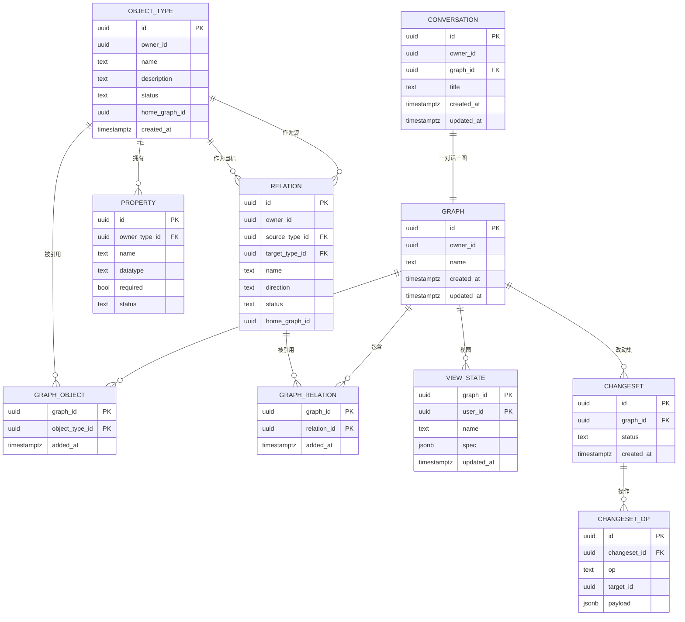

# 会话驱动的企业本体建模工具 · 设计文档

- 日期：2026-10-07
- 状态：已确认（实现计划见 `docs/superpowers/plans/2026-10-07-ontology-backend-foundation.md`）
- 工作目录：`/Users/haobenkun/WorkSpace/OntoWeave`

## 1. 背景与目标

这套系统的思想来源是 Palantir 的本体（Ontology）：把企业经营的知识沉淀成结构化的本体，作为 AI 系统的语义底座，进而搭建企业智能体。

本工具要解决的核心问题是：**业务专家懂业务、不懂建模。** 让他们用自然语言把业务讲清楚，系统负责把「人话」抽象成「对象 / 属性 / 关系」的类型图；团队在这张图上逐步沉淀，最终形成可被智能体消费的企业本体。

一句话定位：**一个会话驱动的企业本体建模工具。**

## 2. 范围

### 2.1 MVP 做

1. 对话驱动建模：从对话中抽取对象、属性、关系。
2. 实例陈述自动向上抽象为类型，抽象过程对用户可见。
3. 点边图渲染，草图态与正式态视觉可分。
4. 对话修改图：增、改、删走同一套「草图 + 确认 / 撤销」。
5. 跨图复用对象与关系，多张子图连成一张大图。
6. 会话列表，重开对话继续编辑原图；新对话即新建一张图。
7. 视图层：布局、高亮、分组、过滤、节点坐标持久化。
8. 图质量：新建时的轻拦截 + 独立的「本体体检」。
9. 状态机：草案 → 已确认 → 已批准。

### 2.2 MVP 不做（预留）

1. 动作层（Action）：数据模型预留，暂不填充。
2. 实例进图：实例只作为抽象证据存后台，不进图。
3. 实时同编：一张图内多人不同时操作。
4. 文档 / 会议记录输入：MVP 输入源只有对话。
5. 关系基数：数据模型预留，暂不做。
6. 图数据库：暂不引入，作为派生只读层预留。
7. 用户系统：用户相关 ID 先用固定默认值，下一期补上。

## 3. 核心概念

| 概念 | 说明 |
|---|---|
| 对象类型 Object Type | 业务里的「类别」，如客户、订单、产品。共享池实体。 |
| 属性 Property | 挂在对象类型上的字段，如客户等级、订单金额。 |
| 关系 Relation | 两个对象类型之间的连接，如客户—下订单→订单。共享池实体。 |
| 动作 Action | 业务能做什么，如下单、审批、发货。MVP 预留。 |
| 图 Graph | 共享池里的一个子集，也是「一次对话」的产物。 |
| 会话 Conversation | 用户看到的入口，与图一对一。 |
| 实例 Instance | 具体对象（张三、订单#1），作为抽象证据存后台，不进图。 |
| 改动集 Changeset | 一次对话产出的增删改操作集合，用于版本与审计。 |
| 视图状态 View State | 图在界面上的呈现方式，与本体内容完全解耦。 |
| 草图 Draft | 待确认的本体元素，用 `status` 区分，不是独立的表。 |

两条贯穿全局的原则：

- 草图态与正式态永远视觉可分。
- 撤销时系统要记住被否掉的理解，避免下次又画错一遍。

## 4. 数据模型

### 4.1 所有权模型

对象与关系放在**共享池**里，不归任何一张图私有。图只是池子里的一个子集，通过 `graph_object` 和 `graph_relation` 决定引用哪些。

这样设计的直接后果：多张子图因为共享同一个对象节点，天然连成一张大图；「全图」就是共享池的并集。**共享池就是企业本体的载体，每张子图是一块工地，复用对象就是两块工地接上了。**

### 4.2 ER 图



### 4.3 表说明

**conversation（会话）**

- `id`：主键。
- `owner_id`：创建人 ID。一期固定默认值，用户系统上线后换成真实用户。
- `graph_id`：绑定的图，唯一。一对话一图。
- `title`：会话列表里显示。

**graph（图）**

- `id`、`owner_id`、`name`。
- 图的元信息，不含本体内容。

**graph_object（图包含哪些对象）**

- `(graph_id, object_type_id)` 联合主键。
- 决定一张图引用共享池里的哪些对象。

**graph_relation（图包含哪些关系）**

- `(graph_id, relation_id)` 联合主键。
- 同一对对象之间，不同图可以引用不同的关系；A、B 之间可以同时在池子里躺着「下订单」和「供应」两条关系，图一引用前者、图二引用后者。

**object_type（对象类型，共享池）**

- `id`、`owner_id`、`name`、`description`、`status`。
- `home_graph_id`：最初在哪张图里创建，仅作溯源。
- 不挂 `graph_id`，因为它是池子里的实体，可被多张图引用。

**property（属性）**

- `owner_type_id` 指向所属对象类型。
- `datatype`、`required`、`status`。

**relation（关系，共享池）**

- `source_type_id`、`target_type_id` 指向两个对象类型，`name`、`direction`、`status`。
- 同样不挂 `graph_id`。

**view_state（视图状态）**

- `(graph_id, user_id)` 联合主键，每个用户每张图一条。
- `name`：用户在最终确认时填写的名称。
- `spec`：JSONB，存放坐标、布局、分组、高亮、过滤等，详见第 9 节。

**changeset（改动集）/ changeset_op（改动操作）**

- 记录一次对话产出的操作，用于版本历史与审计。
- 只记历史，**不承担「草稿与正式」的区分**——那个由 `object_type.status` 负责。

### 4.4 状态机

草案（draft） → 已确认（confirmed） → 已批准（approved）

- 日常小改：本人确认，`draft → confirmed`。
- 破坏性改动（删类型、改核心关系、合并）：需要另一个人批准，`confirmed → approved`。
- 一期没有用户系统，只跑前两态，「已批准」这一档先留着。

草稿不是「没入库」。**新建本体元素时立刻落库，`status='draft'`，当场拿到 ID**；用户确认是一次状态翻转（`update`），数据不搬家，视图层的坐标也不用动。撤销则删除该行，并清理视图层里对应的坐标项。

### 4.5 完整性约束

1. `graph_relation` 里的关系，其两端对象必须都已经在该图的 `graph_object` 里；否则会出现「边在图上、端点不在」的悬空关系。写入时校验，不靠自觉。
2. 所有读本体的地方都必须带 `status` 过滤：图渲染两种都画——正式元素实线、草稿元素虚线；但把本体内容当上下文喂给智能体、或对外导出时，默认只看 `confirmed`。
3. 一个 `conversation` 只能绑定一个 `graph`，一个 `graph` 只能被一个 `conversation` 绑定。

## 5. 交互模型

### 5.1 核心闭环

用户说一句话之后，系统要做的事可以拆成六件职责：判意图、抽取、判层次、抽象、对齐、组装与校验。**这六件是职责划分，不是固定执行顺序，也不是调用次数。**

1. **判意图**：加 / 改 / 删 / 问 / 闲聊。
2. **抽取**：抓实体提及、关系提及、隐含的属性线索，带原文位置和置信度。
3. **判层次**：判「类型」还是「实例」（「客户」对「张三」）。
4. **抽象**：实例统一向上归到类型；实例里的细节反推属性（「上周」→ 订单.下单时间，「两台」→ 数量）。
5. **对齐**：跟共享池比，决定复用已有还是新建。先用向量近邻，边界情况再让模型裁决。
6. **组装 + 校验**：拼成改动集，过 Pydantic 校验（关系两端存在、ID 不重、必填齐全）。这步是纯代码。

### 5.2 抽象卡片

抽象过程要展示给用户，做成一张「本次抽象」卡片，逐条列出映射，例如：

> 张三 → 客户（实例归为类型「客户」）
> 「下了一个订单」→ 关系：客户—下订单→订单
> 「两台」→ 订单可能有「数量」属性

这张卡片同时是纠错入口：用户看到映射不对可以直接改。**抽象卡片 = 解释 + 纠错 + 确认，三合一。**

### 5.3 草图与审批

- 每次提取产出一个改动集，先以草图态画到图上。
- 新增用虚线，删除进入「幽灵态」（变灰、划掉），和草图混在一起审。
- 收口给两个动作：确认（整批落定）、撤销（整批丢掉）。
- 撤销不只是删掉草图的点边，还要给这次「理解」打一个已拒绝的标记，避免下次重复画错。
- 最终确认时，前端弹输入框让用户给这张视图填名称。

### 5.4 歧义与确认的衔接

自动能确定的直接画进草图；拿不准的在草图中单独停下来问，最后统一给「确认 / 撤销」收口。不是同一个东西问两遍：**歧义即问是中途打断，草图审批是收口。**

## 6. 智能体架构

采用 **deep agent + 工具**的模式，而不是固定流水线。六件职责变成一个工具箱，由智能体按需调用。

### 6.1 循环

用户说话 → 智能体读上下文（对话 + 相关本体）→ 决定调哪些工具 → 拿结果继续 → 直到攒出一个改动集 → 出草图 → 用户确认 / 撤销。

### 6.2 主智能体（建模）

主智能体决定「图里有什么」。

| 工具 | 作用 | 关键约束 |
|---|---|---|
| `search_ontology(query, kinds)` | 语义 + 字面检索已有类型 / 关系 / 属性 | 走 pgvector，只读 |
| `get_subgraph(node_ids, depth)` | 取相关子图当上下文 | 只读。没有 graph_id 参数 |
| `list_types()` | 列出现有类型 | 只读 |
| `propose_type(name, desc, properties)` | 新建对象类型到草稿 | 内部强制先做相似检查 |
| `propose_property(owner_id, name, datatype, required)` | 给类型加属性 | owner 必须存在 |
| `propose_relation(source_id, target_id, name, direction)` | 加关系 | 两端必须存在；内部查重 |
| `update_element(id, patch)` | 改名、改属性值等 | 只动草稿 |
| `remove_element(id)` | 标记待删 | 返回将被牵连的关系，供重确认 |
| `ask_user(question, options, context)` | 中断去问用户 | 触发 interrupt，状态落 Postgres |
| `stage_summary()` | 生成抽象卡片内容 | 由草稿推导，非模型自由编 |

主智能体只负责**往草稿里写**（`propose_*` / `update_element` / `remove_element`），没有提交工具。把草稿变成正式图是用户点「确认」时走的 REST 接口，不是智能体的职责（见第 7.3 节）。

### 6.3 绘图子智能体（视图）

绘图子智能体决定「图怎么给人看」，对本体的写权限为零。

| 工具 | 作用 |
|---|---|
| `get_view_state()` | 读当前视图状态 |
| `get_ontology_slice(node_ids)` | 只读本体，用来知道 ID 和结构 |
| `set_layout(kind, options)` | 层次 / 力导向 / 按域分组 |
| `focus(node_ids)`、`fit_view(node_ids?)`、`reset_view()` | 视线控制 |
| `highlight(node_ids, style)`、`dim(node_ids)` | 强调与弱化 |
| `group(node_ids, label)`、`collapse(node_ids)`、`expand(node_ids)` | 结构控制 |
| `filter(predicate)` | 过滤显示，比如只看销售域 |
| `annotate(node_id, text)` | 加标注 |
| `save_view(name)`、`load_view(name)` | 视图存取 |

**子智能体只产出「声明式视图规格」，不产出像素坐标。** 它说「按域分组、把这几个高亮、折叠那两个」；真正的布局交给前端算。布局要随窗口大小反复重算，让模型算坐标既不准又浪费。

### 6.4 四条必须守住的规矩

1. **工具干确定性的活，智能体只做判断。** 写库、校验、算相似度都在工具里。
2. **关键不变量塞进工具内部，不靠智能体记得。** 比如 `propose_type` 内部先自动做相似检查；即使智能体忘了去重，也漏不掉。
3. **提交是一道自动闸门。** 不管智能体怎么调，草稿进正式图前统一过一次 Pydantic 校验。
4. **有界、可观测。** 循环设最大步数；每次工具调用都记 trace。

### 6.5 ID 的来源

ID 只能由工具返回，智能体绝不自己编：

- `search_ontology("客户")` 返回 `[{id: "t_customer", name: "客户"}]`，智能体拿这个 ID 去调 `get_subgraph(["t_customer"], depth=2)`。
- `list_types()` 可全量列举。
- UI 选中：用户在图上点了某个节点，ID 由前端注入上下文。

防错两条：工具内部校验 ID 是否存在，不存在就返回结构化错误让智能体重新检索；ID 用短的可读 slug（`t_customer`），或由 search 返回会话内短 handle，工具内部负责映射，别让模型抄长 UUID。

### 6.6 变更与视图的边界

- 本体形状（有哪些节点、边、属性）：主智能体，可写草稿。
- 呈现方式（布局、高亮、分组、过滤、视野）：绘图子智能体。
- 草图的虚线 / 幽灵态：由草稿状态自动派生，不归任何智能体。

## 7. 通信协议

**REST 管增删改查，SSE 管智能体的流式回合**，两条通道分开。

### 7.1 SSE 通道

客户端 → 服务端：

- `POST /threads/{thread_id}/messages`：用户说话。
- `POST /threads/{thread_id}/resume`：回答智能体的中断提问。

服务端 → 客户端事件流：

统一信封带版本号 `v`，每个事件带 `messageId`（服务端为这一轮助手回复分配的 id），
前端据此把事件归到同一条助手消息。

- `run.start`：`runId / conversationId / messageId`，一轮开始。
- `block.start` / `block.delta` / `block.end`：助手正文与思考过程的流式块，
  `kind` 为 `text` 或 `reasoning`。思考块结束后前端自动折叠。
- `tool.start`：`callId / name / args`，工具调用开始。
- `tool.end`：`callId / status / result / truncated / durationMs`，与 `tool.start` 配对。
- `interrupt`：智能体要问人，带 `question`、`options` 和 `freeText`。每个选项自带
  `answer`，就是回填给图的中断响应（提问是字符串，工具审批是 `decisions` 结构）；
  `freeText` 说明自由文本怎么回填，为 `null` 表示只能点选项。
- `state.update`：草稿改动集 / 视图规格更新，前端据此重画图。
- `run.error` / `run.end`：`run.end` 带 `paused`，区分「做完」和「卡在中途等人回答」。

助手的一轮回复在存储层是一串**有序内容块**（`conversation_message.blocks`）：
思考、正文、工具调用按发生顺序排列，`content` 仍保留正文纯文本供检索和旧逻辑使用。
因此刷新页面后重放历史，拿到的结构与流式时一致。

其中 `interrupt` 也是一种块：一轮停在等人回答时，问题与选项一并落库。前端刷新后
看最后一条助手消息的末尾是不是中断块，就能重建等待回答的状态，用户点选项或输入文字
即走 `POST /resume` 续跑，`answer` 直接透传为该选项的响应载荷、`text` 作为展示与入库的用户消息。

### 7.2 REST 通道

- 本体 CRUD、列表、查询。
- `PATCH /view-state`：拖拽后的坐标更新，debounce 后提交。
- `POST /changesets/{id}/confirm` 和 `/reject`：最终确认或撤销。

### 7.3 关键判断

**确认和撤销不走智能体，直接调 REST。** 「把草案状态翻成已确认」是确定性事务，不需要 LLM 参与，让智能体执行反而又慢又不可靠。坐标更新同理。

### 7.4 中断的往返

1. 客户端 POST 一条消息，服务端返回 SSE 流。
2. 流里冒出 `interrupt`，流结束。
3. 前端弹问题，用户回答。
4. 客户端 POST `/resume`，服务端从断点续跑，返回新的 SSE 流。

这正是 LangGraph 的线程模型，`interrupt()` 配 `Command(resume=...)` 正好对上。

### 7.5 备选

需要一条长连接承载整个会话时，可用 WebSocket，省掉「POST + 重新开流」的往返；代价是私有化环境要处理保活、代理升级、断线重连。SSE 走标准 HTTP，运维更省心。

## 8. 技术选型

| 层 | 选型 | 说明 |
|---|---|---|
| 后端 | Python + FastAPI | LLM 生态最顺 |
| 抽取编排 | LangChain 核心 + LangGraph | 有状态、可分支、可重试；`init_chat_model` 做模型抽象层，`with_structured_output` 做结构化输出 |
| 智能体模式 | deep agent + 工具 | 支持规划与子智能体 |
| 关系库 | Postgres | 唯一事实来源 |
| 相似检索 | pgvector | 语义近邻，扛去重与轻拦截 |
| 前端 | React + TypeScript + React Flow | 可编辑、自定义节点，正好承载草图态与幽灵态 |
| 部署 | Docker Compose 起步 | 全容器化，私有化自托管 |
| 模型 | 外部 API + 本地脱敏 / 混合 | 包一层模型抽象层，可换 |

### 8.1 私有化的坑

1. **LangSmith 是云服务**，私有化下用不了；要么自托管追踪，要么用本地 callback / OpenTelemetry 接自己的可观测性。
2. **版本要钉死**。LangChain 迭代快、API 常变，依赖里精确锁版本。
3. 以后换自托管模型，要先验证它对 structured output 的支持（vLLM 得开 guided decoding）。

### 8.2 图数据库

MVP 不引入图数据库。类型层节点量小，递归 CTE 够用。图库的真正价值出现在：图变大、要做多跳路径查询给智能体用、开始接真实数据之后。

届时的原则是：**Postgres 仍是唯一事实来源，图库作为派生只读层**，可随时从 Postgres 重建，永远不直接写。这样既拿到图遍历，又避开双事实来源的坑。候选有 Kuzu（嵌入式、MIT）、Apache AGE（Postgres 扩展、零双写）、Neo4j（最成熟、运维重）。

多跳路径查询（如「对象 A→B→C，查 A 与 C 的联系」）用变长路径表达；要配深度上限、路径排序剪枝、结果截断，否则路径会爆炸。

## 9. 视图层

### 9.1 定位

视图状态是**呈现方式**——布局、高亮、分组、过滤、坐标，跟本体内容无关，永远不进本体存储，也从来不需要用户确认。

三层要分清：

- 本体表管内容，草稿与正式靠 `status` 区分。
- 改动集管操作历史。
- 视图层只管坐标与呈现，引用的是本体表的 ID。

### 9.2 存储

`view_state` 一行存一个用户对一张图的视图，`(graph_id, user_id)` 联合主键，配置整体存在 `spec` JSONB 里。

```json
{
  "nodes": {
    "t_customer": {"x": 120, "y": 340},
    "t_order":    {"x": 400, "y": 340}
  },
  "layout": {"kind": "domain-grouped", "options": {}},
  "groups": [{"id": "g1", "label": "销售域", "nodeIds": ["t_customer", "t_order"]}],
  "collapsed": ["g1"],
  "highlight": [{"nodeIds": ["t_customer"], "style": "focus"}],
  "dim": ["t_legacy"],
  "filters": {"domains": ["sales"]}
}
```

为什么用 JSONB 而不拆关系表：视图配置的 schema 会一直变，永远是整体读、整体写，没人会做关系查询。JSONB 一个字段搞定；拆表只会让每次加功能都得改表结构。

### 9.3 坐标

- 坐标存在 `spec.nodes`，以节点 ID 为 key。
- **写入时机**：不要每帧写库，拖拽结束时 debounce 一次。
- **重排语义**：不做「钉住」；平时只增量放新节点，只有用户显式点「重新布局」时才全图重算，覆盖所有手工坐标。
- **相机（缩放、平移）不进库**，留前端；只有整体保存视图时才需要快照。

### 9.4 权限与并发

视图状态每人一份，天然无并发冲突，用不上改动集和审批机制。

## 10. 图质量

图会越画越大，业务专家说话又随性，很快会出现「客户 / 客户公司 / 客户信息」这类近义节点，或者同一个词在一处指销售订单、一处指采购订单。这类工具十有八九死在这里。

两道防线：

1. **轻拦截**：新建时与共享池比对，只在高相似度时提示一次「是不是已经有个『客户』了」。
2. **本体体检**：独立视图，把重复项、命名不一致、孤立节点、悬空关系列成清单，批量处理。

底层能力是 pgvector 的语义近邻；边界情况交模型裁决。

## 11. 协作与治理

- 一张图内多人不同时操作，改动是异步的。
- 每次对话产出改动集，确认后进正式图，带版本历史。
- 状态机：草案 → 已确认 → 已批准；破坏性改动需他人批准。
- 一期没有用户系统，「已批准」这一档先留着不启用。

## 12. 界面与信息架构

### 12.1 首页

首页是一个功能菜单页，用卡片陈列功能入口。目前只有「建模」一张卡片，后续扩展直接加卡片即可。

### 12.2 建模页

点击建模卡片进入建模路由，页面是左中右三栏：

- **左栏 · 会话列表**：顶部有「新建对话」；下面是历史会话，点进去继续编辑对应的图。整栏可以收起，收起后只留一条窄条。
- **中栏 · 对话框**：消息流加输入框。抽象卡片、确认 / 撤销按钮都在这一栏里。
- **右栏 · 图**：顶部工具条（布局、缩放、适应画面）和图例（已确认 / 草稿），下面是点边图画布。

配色上，正式元素用实线，草稿元素用虚线加提示色，和“草图态与正式态永远视觉可分”这条原则一致。

## 13. 后续演进

1. 用户系统：`owner_id` / `user_id` 从固定默认值换成真实用户，启用「已批准」审批档。
2. 动作层：在本体里补 Action，让智能体不只是「知道」还能「执行」。
3. 实例与真实数据接入：把实例和真实业务数据连进本体。
4. 图数据库：接多跳路径查询，作为派生只读层。
5. 文档 / 会议记录输入：扩展建模的知识来源。

## 附录 A：关键决策记录

| 议题 | 结论 |
|---|---|
| 定位 | 会话驱动的企业本体建模工具 |
| 目标用户 | 业务专家；建模术语全部隐藏 |
| 路线 | 先做轻量类型图，架构预留智能体消费 |
| 输入源 | MVP 只有对话 |
| 实例处理 | 永远抽象成类型；实例不进图，留溯源 |
| 意图 | 加 / 改 / 删 / 问 / 闲聊，五类 |
| 改删确认 | 与新增同一套「草图 + 确认 / 撤销」 |
| 协作模式 | 一张图内异步改；一对话一图；用户多图 |
| 所有权 | 对象与关系进共享池，图是子集；跨图复用连成大图 |
| 治理 | 草案 / 已确认 / 已批准三态 |
| 图质量 | 轻拦截 + 本体体检 |
| 智能体 | deep agent + 工具；主智能体 + 绘图子智能体 |
| 通信 | REST（增删改查）+ SSE（智能体回合） |
| 存储 | Postgres 唯一事实来源 + pgvector |
| 图库 | MVP 不引入，预留派生只读层 |
| 视图 | 每用户每图一条 JSONB，坐标在 spec 里 |
