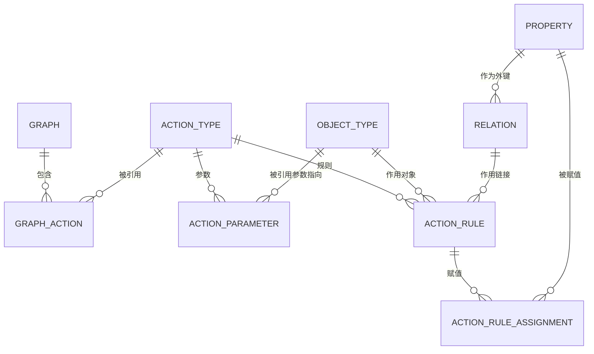

# 动作层设计规格

- 日期：2026-10-13
- 状态：已确认
- 工作目录：`/Users/haobenkun/WorkSpace/OntoWeave`
- 对应实现计划：`docs/superpowers/plans/2026-10-13-action-layer.md`

## 1. 背景与目标

语义层（对象类型 / 属性 / 关系）已完成，本体能描述「名词」。下一步补**动力学层**，让本体能描述「动词」——业务里能发生什么、改变哪些对象与关系。这一步的目标是让本体从「静态数据模型」变成「可被智能体消费的操作契约」。

决策依据（Palantir 官方文档原文，逐条见第 10 节）：

- Ontology = 语义元素（objects/properties/links）+ 动力学元素（actions/functions/dynamic security）。
- action 是单事务改对象/属性值/链接；action type 是其「定义」。
- action type 三要素：Parameters / Rules / Submission criteria。
- **actions can be automatically surfaced as tools for all types of agents**——这正是本产品「可被智能体消费」目标缺的那一环。

时序上也顺：刚做完的关系基数，正是动作「链接规则 vs 改外键」语义的落点。

## 2. 范围

### 2.1 本版做

1. **动作类型**作为一等共享池元素（草案 / 已确认 / 已批准、入图、向量复用检索）。
2. **参数**：值参数（复用属性数据类型）+ 对象引用参数（指向某个 object type）。
3. **规则**：`create_object` / `modify_object` / `delete_object` / `create_link` / `delete_link`。
4. **字段赋值**：值来源 = 参数 / 对象参数属性 / 静态值 / 当前用户 / 当前时间。
5. **关系补外键绑定**：`relation.foreign_key_property_id`（一对一 / 一对多靠外键存链接）。
6. **参数级约束**：必填、类型、枚举单选 / 多选。
7. 复用现有管线：改动集登记、确认落定、撤销回滚；agent 抽取工具；前端动作节点与编辑抽屉。

### 2.2 本版不做（下一版）

- 提交校验条件树（Submission criteria）。
- 副作用（notification / webhook / schedule）。
- `function rule`、`interface rules`、scenario。
- action log / metrics / monitor / revert 的运行时。
- **一切执行能力**：本版是纯定义层，不真跑动作、不碰实例数据。

### 2.3 与实例解耦

动作层分「定义」与「执行」两层。本版只做定义层，不依赖实例存储：动作类型可以定义参数、规则，但没有实例可供 apply。指向「某个具体对象」的部分（对象引用参数取值、运行时校验、按实例建删链）天然属于执行侧，留待实例层。

## 3. 核心概念

| 概念 | 说明 |
|---|---|
| 动作类型 Action Type | 「一次能做的一组改动」的定义。共享池实体，与 object_type / relation 同构。 |
| 参数 Parameter | 动作的输入，规则与外部应用之间的接口。分值参数与对象引用参数。 |
| 规则 Rule | 把参数变成「对本体的一次改动」。对象规则改对象，链接规则改链接。 |
| 字段赋值 Assignment | 对象规则里，「哪个属性 ← 哪个值来源」。 |
| 外键绑定 Foreign Key | 一对一 / 一对多关系里，哪条属性存对端主键，从而承载这条链接。 |

## 4. 数据模型

沿用共享池约定：带 `owner_id` / `status`(draft,confirmed,approved) / `home_graph_id` / `embedding`。



| 表 | 关键字段 |
|---|---|
| `action_type` | id, owner_id, name, description, status, home_graph_id, embedding, created_at, updated_at |
| `action_parameter` | id, action_type_id FK, name, kind(`value`\|`object_ref`), datatype, target_object_type_id, is_array, is_required, constraints(JSONB), default_value(JSONB), order_index |
| `action_rule` | id, action_type_id FK, rule_kind, order_index, target_object_type_id, target_relation_id |
| `action_rule_assignment` | id, rule_id FK, property_id FK, value_source, source_parameter_id, source_property_id, static_value(JSONB) |
| `graph_action` | graph_id + action_type_id（联合主键） |

`relation` 新增 `foreign_key_property_id`（nullable FK → `property`）。

枚举集中在 `app/vocabulary.py`：`ActionRuleKind`、`ParameterKind`、`AssignmentValueSource`、`ActionStatus`，供 models 的 CHECK 约束、service 校验、agent schema、前端下拉同源引用。

### 4.1 领域不变量

1. 对象规则必须有 `target_object_type_id`；链接规则必须有 `target_relation_id`。
2. `create_link` / `delete_link` 仅允许 `many_to_many` 关系；一对一 / 一对多改用 `modify_object` 改外键属性。
3. 参数名在同一动作内唯一；对象引用参数的 `target_object_type_id` 必须存在。
4. 赋值里的 `property_id` 必须属于该规则作用的对象类型；值来源与来源列一一对应。
5. `current_user` 值来源只落「枚举占位」，解析留到用户系统那期。
6. 删除对象类型 / 关系前，若被动作规则引用则**拒绝**，给出明确错误（同「删关系前校验图成员」的风格）。

## 5. 关系外键绑定

`relation.foreign_key_property_id` 的校验：

- 该属性必须属于关系两端之一（`one_to_many` 约定在「多」端，`one_to_one` 任一端）。
- 必须是单值、非数组属性，且与对端主键类型一致。
- `many_to_many` 时不允许设置（改走链接规则）。

## 6. 后端分层

```text
backend/app/
  vocabulary.py            # 新增动作枚举
  models.py                # 5 张新表 + relation.foreign_key_property_id
  services/
    element_kinds.py       # 元素种类注册表（见第 8 节）
    object_type.py         # 从 ontology.py 拆出
    property.py            # 从 ontology.py 拆出
    relation.py            # 从 ontology.py 拆出 + 外键校验
    action.py              # 动作类型 + 参数 + 规则的不变量与读写
    action_rules.py        # 规则与赋值的校验策略（对象规则 / 链接规则 / 外键）
    changeset.py           # 扩展注册表，覆盖 action_type / action_parameter / action_rule
    element_edit.py        # 动作也能从界面直改，登记进改动集
    graph_cleanup.py       # 扩展 graph_action 的清理范围
    embedding.py           # 动作类型也按 name+description 建向量
  api/actions.py           # /api/v1/actions 系列
  schemas/action.py
  agent/action_tools.py    # propose_action / update_action / remove_action / list_actions
```

`ontology.py` 退化为薄门面，对外函数签名不变，仅做转发，避免破坏现有调用方。

## 7. 前端

- 动作作为图上独立节点（与对象节点视觉区分），用 `involves` 边连到它作用的对象类型。
- `components/ActionNode.tsx`、`components/ActionDrawer.tsx`、`components/ActionRuleRow.tsx`（复用 `DrawerShell`）。
- 配置外置：`lib/actionConfig.ts` 放规则种类、参数种类、值来源、枚举选项、尺寸。
- 复用 `lib/status.ts` 的草案/正式态视觉规则。

## 8. 面对现有代码的重构

1. `services/ontology.py`（292 行、塞三类元素）拆为 `object_type.py` / `property.py` / `relation.py`；`ontology.py` 变门面。
2. `changeset.py`（514 行）目前靠 `_ELEMENT_MODELS` + `_RESTORABLE_FIELDS` 两张 dict 和 `_element_owner_id` 的 kind 分支，`element_edit.py` 也在加分支 → 收敛为 `element_kinds.py` 的**元素种类注册表**（kind → 模型 / 可还原字段 / owner 解析 / 校验器 / 删除策略）。新元素只登记，不改分派逻辑。
3. `shared/types/index.ts`、`shared/api/client.ts` 按域拆分再 re-export。
4. `ModelingPage.tsx`（988 行）的动作 UI 必须进独立组件 / hook，并把已有取数、状态抽成 hook。

以上 1、2 属行为不变的重构，先做并跑通测试，再叠加动作能力。

## 9. 状态与改动集流转

动作类型、参数、规则都走既有改动集：新建即落库为 `draft`，登记一条 `create` 操作；编辑登记 `update`（带 before 快照）；删除登记 `delete`。确认时把 `draft → confirmed`，撤销时按记录倒序回放。参数与规则作为「子元素」各自登记 kind，与 `property` 是 object_type 子元素的现状保持一致。

## 10. 来源与取舍

**文档事实**（均已核对原文）：

| 结论 | 来源 |
|---|---|
| Ontology = 语义层 + 动力学层 | `ontology/overview` |
| 动作自动成为 agent 工具 | `ontology/why-ontology` |
| action = 单事务改对象/属性/链接；action type = 定义 + 副作用 | `action-types/overview`、`object-link-types/type-reference` |
| 三要素 Parameters / Rules / Submission criteria | `parameter-overview`、`rules`、`submission-criteria` |
| 规则：object/link 增删改 + function rule + interface rules + 副作用 | `rules`、`explore-action-types` |
| 值来源四种 | `rules` |
| 一对一/一对多靠外键属性；多对多用链接规则 | `create-link-type`、`explore-action-types` |
| 链接双向、两个 side，不建反向 link type | `link-types-overview` |
| 对象需允许编辑才可被 action 改 | `allow-editing`、`getting-started` |
| action log 把成功提交建模成对象类型 | `action-log` |
| revert 仅 OSv2、仅本人、仅最近一次编辑、不回滚副作用 | `action-reverts` |

**本产品自有机制**（非 Palantir）：`draft → confirmed → approved` 状态机、草图/正式态视觉可分、改动集确认/撤销。Palantir 的对应物是保存审查、Global Branching + proposal、`Test run`、`Action reverts`——我们借其精神，机制是自己的。摘要底稿见 `docs/palantir/docs-summary/`。
