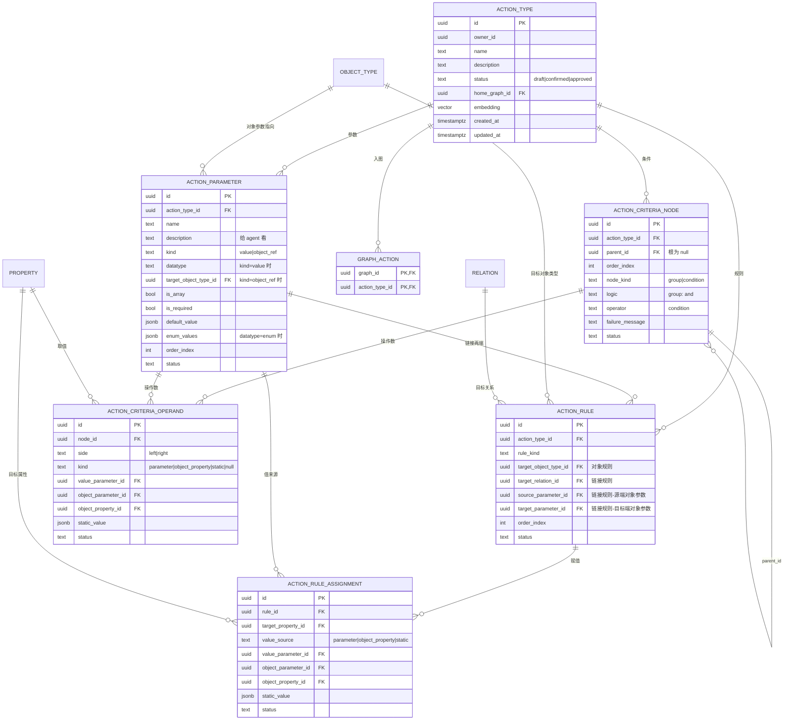

# 动作层设计规格（重做版）

- 日期：2026-10-16
- 状态：已确认
- 分支：`codex/action-layer`
- 工作目录：`/Users/haobenkun/WorkSpace/OntoWeave`
- 对应实现计划：`docs/superpowers/plans/2026-10-16-action-layer.md`
- 取代：`docs/superpowers/specs/2026-10-13-action-layer-design.md`（旧版已回退，仅作格式参考）

## 1. 背景与目标

语义层（对象类型 / 属性 / 关系）已完成，本体能描述「名词」。本版补**动力学层**，让本体能描述「动词」：业务里能发生什么、会改变哪些对象与关系、什么条件下才允许发生。

目标：本体从「静态数据模型」变成**可被智能体消费的操作契约**——这正是 Palantir 把 action type 自动暴露为 agent 工具的那一环。

## 2. 范围

### 2.1 本版做

1. **动作类型 Action Type**：一等共享池元素（草案 / 已确认 / 已批准、入图、向量复用检索）。
2. **参数**：值参数（复用属性数据类型，含新增的 `enum`）+ 对象引用参数（指向 `object_type`，支持数组）；必填、静态默认值、值参数静态枚举、参数描述。
3. **规则**：`create_object` / `modify_object` / `delete_object` / `create_link` / `delete_link`。
4. **字段赋值 Assignment**：值来源 3 种 = 参数 / 对象参数属性 / 静态值。
5. **提交校验 Submission criteria**：邻接表条件树；v1 只放行「一个 `and` 根 + 扁平 condition 子节点」。
6. **新增数据类型 `enum`**：进共享词表 `PropertyDatatype`，属性与值参数共用。
7. **复用既有管线**：改动集登记、确认落定、撤销回滚；agent 工具；前端动作节点与编辑抽屉。

### 2.2 本版不做（留口子）

- **一切执行能力**：纯定义层，不跑动作、不碰实例数据、不做运行时校验。
- **副作用**（notification / webhook / schedule）：结构上留位，不建表、不实现。
- `function rule`、`interface rules`、`scenario`、`action log`、`revert`。
- 值来源「当前用户 / 当前时间」；`matches`（正则）与 `contains` 运算符。
- 嵌套条件树（`or` / 多层 group）：DB 结构已支持，v1 校验不放行。
- 参数与规则的手动排序（`order_index` 就位，v1 不做拖拽）。
- 数组对象参数参与 `object_property` 取值与规则引用。

## 3. 概念模型

| 概念 | 说明 |
|---|---|
| 动作类型 | 「一次能做的一组改动」的定义。四要素：参数 / 规则 / 提交校验 / 副作用（本版不做）。 |
| 参数 Parameter | 动作的输入接口。**值参数**（`value`）复用属性数据类型；**对象引用参数**（`object_ref`）指向某个对象类型，可数组。 |
| 规则 Rule | 把参数变成「对本体的一次改动」。5 种：对象增删改、链接增删。 |
| 字段赋值 Assignment | 对象规则里「哪个属性 ← 哪个值来源」。 |
| 提交校验 | 条件树，决定这次提交能不能成立。 |
| 外键绑定 | 一对一 / 一对多关系用一条外键属性承载链接，改链接 = `modify_object` 改该属性；**多对多**才用 `create_link` / `delete_link`。 |

规则种类与列组合：

| rule_kind | 作用对象 | 必填列 |
|---|---|---|
| `create_object` | 新建对象 | `target_object_type_id`；主键属性**允许留空 = 自动生成** |
| `modify_object` | 改已有对象 | `target_object_type_id` + 一个对象参数作对象来源 |
| `delete_object` | 删已有对象 | 同上 |
| `create_link` | 建链接 | `target_relation_id` + `source_parameter_id` / `target_parameter_id`（关系两端的对象参数） |
| `delete_link` | 删链接 | 同 `create_link` |

值来源与列对应（`action_rule_assignment`）：

| value_source | 用到的列 |
|---|---|
| `parameter` | `value_parameter_id` |
| `object_property` | `object_parameter_id` + `object_property_id` |
| `static` | `static_value` |

## 4. 数据模型

### 4.1 ER 图



共 7 张新表（`action_type` / `action_parameter` / `action_rule` / `action_rule_assignment` / `action_criteria_node` / `action_criteria_operand` / `graph_action`）。

### 4.2 条件树的取用

`action_criteria_node` 是**邻接表**：`parent_id` 自引用成树，`order_index` 定同级顺序，`node_kind` 区分 group（`logic`）与 condition（`operator` + `failure_message`）。条件的两侧操作数放 `action_criteria_operand`，用 `side`（`left` / `right`）区分，左右共用一张表。

一条完整条件 = 一个 node + 它的 left 操作数（+ 可选的 right 操作数）；整棵树 = 按 `parent_id` 自底向上拼装（一次查出该 action_type 的全部 node 与 operand，在内存里组装）。

示例（`amount > 1000 AND status = 'open'`）：

```text
node A (root, group, and)
├── node B (condition, operator=">",  failure_message="金额需大于 1000")
│     ├── operand(left,  parameter, value_parameter_id=amount)
│     └── operand(right, static,    static_value=1000)
└── node C (condition, operator="is", failure_message="工单必须为未关闭")
      ├── operand(left,  object_property, object_parameter_id=ticket, object_property_id=status)
      └── operand(right, static,          static_value="open")
```

### 4.3 元素种类登记表

新元素种类全部登记进 `backend/app/services/element_kinds.py` 的 `REGISTRY`，`changeset.py` / `element_edit.py` 不再各自维护分支（现有 3 类已登记，本版扩到 9 类）。

| kind | 模型 | restorable_fields | delete_phase | promote |
|---|---|---|---|---|
| `action_rule_assignment` | `ActionRuleAssignment` | `target_property_id` `value_source` `value_parameter_id` `object_parameter_id` `object_property_id` `static_value` | 0 | draft→confirmed |
| `action_criteria_operand` | `ActionCriteriaOperand` | `side` `kind` `value_parameter_id` `object_parameter_id` `object_property_id` `static_value` | 0 | 同上 |
| `action_rule` | `ActionRule` | `rule_kind` `target_object_type_id` `target_relation_id` `source_parameter_id` `target_parameter_id` `order_index` | 1 | 同上 |
| `action_criteria_node` | `ActionCriteriaNode` | `parent_id` `order_index` `node_kind` `logic` `operator` `failure_message` | 1 | 同上 |
| `action_parameter` | `ActionParameter` | `name` `description` `kind` `datatype` `target_object_type_id` `is_array` `is_required` `default_value` `enum_values` `order_index` | 2 | 同上 |
| `relation` | `Relation` | （不变） | 3 | 同上 |
| `property` | `Property` | 增加 `enum_values` | 3 | 同上 |
| `object_type` | `ObjectType` | （不变） | 4 | 同上 |
| `action_type` | `ActionType` | `name` `description` | 4 | 同上 |

`delete_phase` 语义 = 「引用方先删」，数字小的先删。**唯一需要改造老功能的地方**：现有 `object_type=2 / property=1 / relation=0` 的相位要整体重排成上表，因为动作子元素把自己插到了更低相位。

同一相位内、`action_criteria_node` 是自引用邻接表，需按树深度**倒序**删除（子先于父）。

## 5. 不变量与校验

**参数**

- `name` 与 `order_index` 在同一个 action type 内唯一。
- `kind` 决定列：`value` 用 `datatype`（+ `enum_values` 当 `datatype=enum`），`object_ref` 用 `target_object_type_id`；两组互斥，另一组必须为空。
- `enum_values`：非空字符串、去重、至少 2 项；只在 `datatype=enum` 时允许。
- `default_value` 必须能通过该参数的类型校验。

**规则**

- 每种 `rule_kind` 的列组合固定互斥：对象规则有 `target_object_type_id`、无 `target_relation_id`；链接规则反之。
- `modify_object` / `delete_object` 必须引用一个 `object_ref` 参数，且 `is_array=false`（v1 不支持批量），其对象类型 = `target_object_type_id`。
- 链接规则的两个参数必须是**该关系两端**的对象类型，且该关系基数必须是 `many_to_many`（一对一 / 一对多走外键 + `modify_object`）。
- `create_object` 的主键属性赋值可以留空 = 自动生成。

**赋值**

- 只有 `create_object` / `modify_object` 可以有赋值；`delete_object` / 链接规则没有赋值。
- `target_property_id` 必须属于该规则作用的对象类型。
- `value_source` 与来源列一一对应（见第 3 节表）；`object_property` 来源的 `object_property_id` 必须属于 `object_parameter_id` 指向的对象类型。
- 类型兼容：值参数 / 目标属性 / 静态值的类型要能对上；类型为 `enum` 时 `enum_values` 必须完全一致。

**条件树**

- 恰好一个根节点，且根必须是 group。
- 无环（`parent_id` 链不回到自己）。
- v1：根 `and` + 一层扁平 condition；condition 恰好一个 `left`、至多一个 `right`。
- 若出现 `or` 或多层嵌套 → 报「v1 不支持」。

**运算符兼容矩阵**

| 运算符 | 适用类型 |
|---|---|
| `is` / `is not` | 全部（含 `enum`） |
| `is null` / `is not null` | 全部；只需 `left` |
| `<` `<=` `>` `>=` | `integer` / `decimal` / `date` / `timestamp` |
| `matches` / `contains` | v1 不做 |

**删除保护**

- `object_type` / `relation` / `property` / `action_parameter` 被引用即**拒绝删除**（记录删除 op 时就失败，错误信息带引用方清单）。
- `action_type` 删除 = 级联删全部子元素（对每个子元素各记一条 delete op，按 `delete_phase` 倒序回滚可恢复）。

## 6. 改动集与生命周期

- 动作类型与它全部子元素都走既有改动集：新建落 `draft` + 记 `create`；编辑记 `update`（带 before 快照）；删除记 `delete`。
- 撤销 = 按 op 记录倒序回滚（create 删掉、update 还原 before、delete 重建）。
- 与老机制交接的唯一改动：`delete_phase` 重排（第 4.3 节），顺序保证撤销 / 确认时不会先删父后被引用。
- `graph_cleanup.py` 的清理范围要覆盖 `graph_action`（删图后动作类型同样按 `graph-only` / `graph-and-drafts` / `graph-and-unreferenced` 处理）。
- 动作类型按 `name + description` 建向量，供复用检索（与 object_type 同路径）。

## 7. REST

读：

- `GET /api/v1/actions`：列表（可选 `q`、`status`），给检索与调试用。
- `GET /api/v1/actions/{action_type_id}`：详情 = 基本信息 + parameters + rules（含 assignments）+ criteria（树）。
- `GET /api/v1/graphs/{graph_id}/snapshot`：新增 `actions` **brief** —— `{id, name, description, status, involves[]}`；`involves` 由服务层从参数与规则推导（涉及哪些对象类型 / 关系），全量定义走详情接口。

写：**不新开写接口**，复用 `POST /api/v1/graphs/{graph_id}/edits` 的判别联合：

- `schemas/changeset.py` 的 `ElementKind` 扩到全部 9 种（`update` / `delete` 通用）。
- 新增 op：`create_action_type`（只需 name，description 可后补）、`add_action_parameter`、`add_action_rule`（assignments 内联）、`set_action_criteria`（整棵替换）。
- `schemas/action.py` 放读模型 + `AssignmentIn` / `ConditionIn` / `OperandIn`。

## 8. Agent

**组织方式 = 子智能体 + 工具包按域分目录**（沿用 `tools/<域>/{ops,binding}` 的既有分层）：

- 动作工具收进 `backend/app/agent/tools/action/{__init__.py, ops.py, args.py, binding.py}`。
- 做成子智能体 `action_modeler`（deepagents 子智能体 = 按需加载：主智能体只看到名字与描述，用到才加载工具），与 `view_designer` 同一先例。
- 主智能体的「工具分类」= 子智能体目录（对象建模 / 视图 / 动作）+ 少量只读检索工具；`list_types` / `list_actions` 并入 `search`（不传 `query` 即列出全部），不再各自一个工具。
- 工具清单：`search_actions` / `get_action` / `propose_action` / `reuse_action` / `propose_action_parameter` / `propose_action_rule`（assignments 内联）/ `set_action_criteria`（入参是扁平条件列表，内部包一个 `and` 根）；另加只读的 `get_object_type`——规则赋值与校验条件要落到属性 id，`get_subgraph` 给不出来。
- 嵌套入参用 pydantic 模型放 `args.py`，`Field(description=...)` 写法与 `tools/view/registry.py` 对齐。
- `prompts.py` 补：建动作前先 `search_actions` 看是否已有可复用；规则引用的对象类型 / 关系 / 属性必须已存在；一对一 / 一对多走 `modify_object` 改外键、只有多对多才用链接规则；`create_object` 主键可留空。

**最小输入**（写进 prompt 的行为规矩）：

- 能落草稿：只要有**动作名**。
- 值得跟用户确认：至少**名字 + 一条规则**，且规则引用的对象类型已存在。
- 参数不是必需（可以后补）。
- 对话里用户最少要说清「谁 → 做什么 → 对什么」。
- 信息分不清才 `ask_user`，不要猜。

## 9. 前端

- **创建动作只走对话**，界面不提供「新建动作」按钮；编辑时点击动作节点开抽屉。
- 抽屉四块：基本信息 / 参数 / 规则 / 提交校验。组件：`ActionNode.tsx`、`ActionDrawer.tsx`、`ActionParameterRow.tsx`、`ActionRuleRow.tsx`、`ActionCriteriaEditor.tsx`（共享 `DrawerShell`）。
- `lib/flow.ts`：新增动作节点 + `involves` 边（自动生成，不可手动连 / 删，视觉弱化）；新增 `selectedActionId`。
- 配置外置 `lib/actionConfig.ts`（规则种类、参数种类、值来源、运算符矩阵、尺寸、文案）；纯函数放 `lib/actionDetails.ts`（草稿模型 + `buildActionEdits` + 实时校验）。
- 引用失效（规则引用了被删的参数）→ 前端实时校验 + 行内标红 + 禁用保存。
- 切换规则种类时**直接清空**不相关字段（不弹确认）；参数 / 规则 v1 不做手动排序。
- 编辑粒度：新增参数、新增规则各发一条 create edit；提交校验整棵替换；改名与删除复用现有 `update` / `delete` op。
- `shared/types` 按域拆分（`action.ts` / `objectType.ts` / ...，`index.ts` 只 re-export；已有类型一并拆）；`shared/api/client.ts` 同步按域拆。
- `ModelingPage.tsx`（1006 行）重构：拆 `useConversations` / `useWorkspace` / `useAgentRun` / `useCanvasSelection` / `usePaneLayout` / `useActionDetail` + Context；服务端状态用 TanStack Query；**不引全局 store**（Zustand / Redux）；派生数据用 `useMemo` 不进 state。**顺序：先完成重构再叠动作 UI。**
- 新组件一律先拆子组件 + 状态管理（自定义 hook / `useReducer`），不写大段内联 JSX 与堆砌式实现。

## 10. 来源与取舍

**文档事实**（Palantir 官方文档，已核对原文，非仅摘要）：

| 结论 | 来源 |
|---|---|
| Ontology = 语义层 + 动力学层 | `ontology/overview` |
| 动作可自动成为各类 agent 的工具 | `ontology/why-ontology` |
| action = 单事务改对象 / 属性 / 链接；action type = 定义 + 副作用 | `action-types/overview` |
| 四要素：Parameters / Rules / Submission criteria / Side effects | `parameter-overview`、`rules`、`submission-criteria` |
| 规则：对象增删改 + 链接增删 + function rule + interface rules | `rules`、`explore-action-types` |
| 值来源：参数 / 对象参数属性 / 静态值 / 当前用户与时间 | `rules` |
| 一对一 / 一对多靠外键属性承载，改链接 = 改外键属性；多对多用链接规则 | `create-link-type`、`explore-action-types` |
| 链接双向、两个 side，不建反向 link type | `link-types-overview` |
| 对象需允许编辑才可被 action 改 | `allow-editing` |

**本产品自有机制**（非 Palantir）：`draft → confirmed → approved` 状态机、草图 / 正式态视觉可分、改动集确认与撤销、`involves` 边。摘要底稿见 `docs/palantir/docs-summary/`。

## 11. 待定与延后

- 副作用的最小结构（要不要先占一张 `action_side_effect` 表）。
- `contains` / `matches` 运算符、嵌套条件树（`or` / 多层 group）。
- 数组对象参数参与取值与规则引用。
- 值来源「当前用户 / 当前时间」；function rule；interface rules。
- `order_index` 手动排序的交互。
- 执行层（实例、apply、action log、revert）——独立版本，本版只留接口形状。
