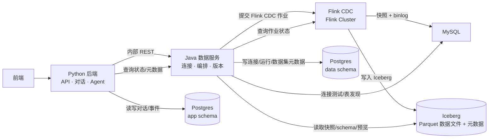
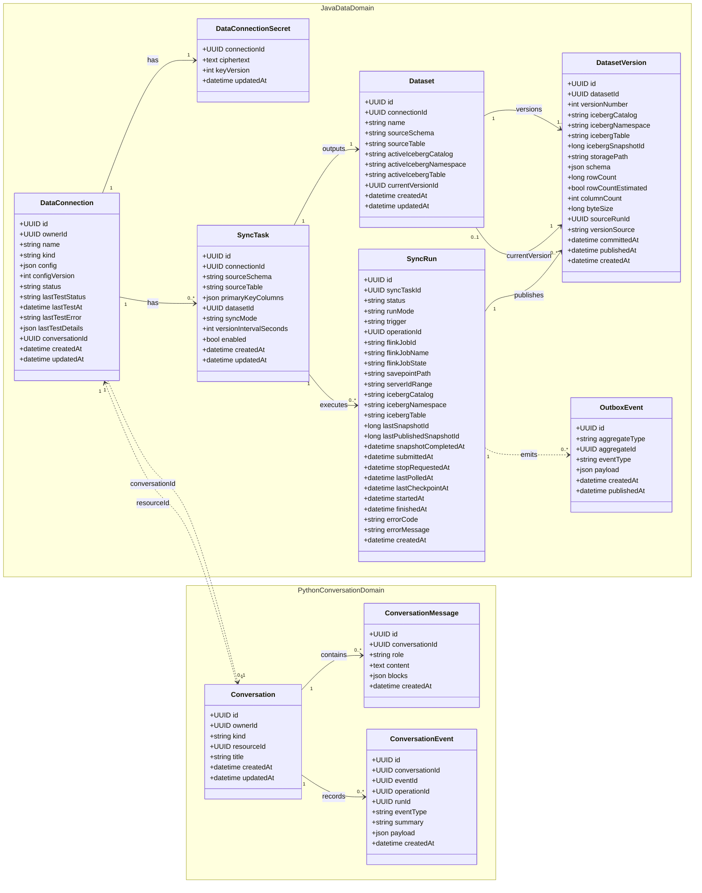
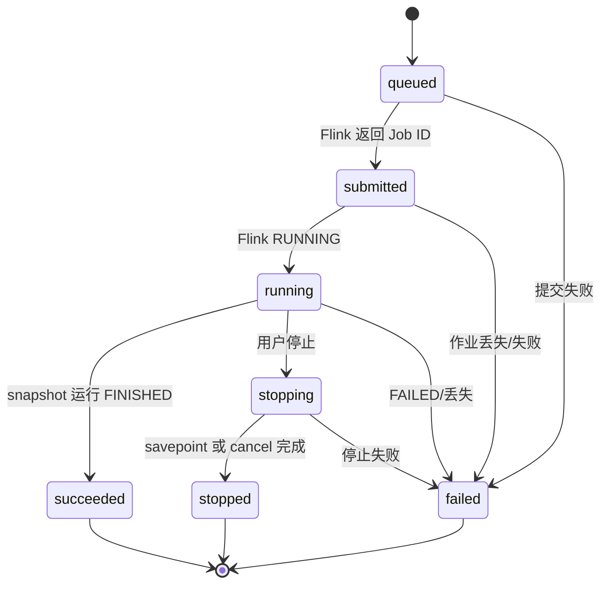
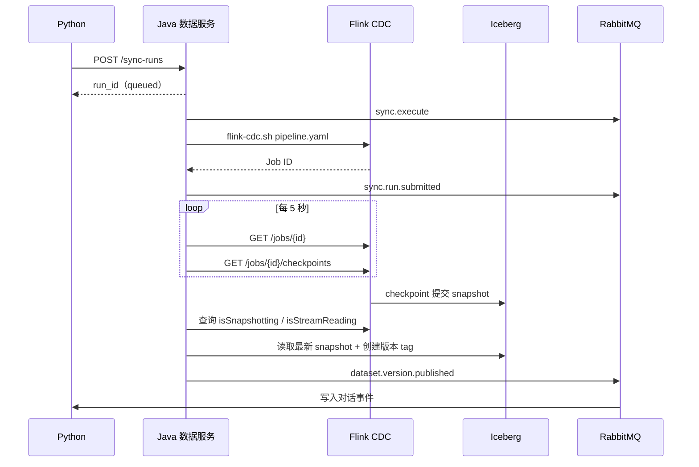

# 数据连接与同步技术设计

- 日期：2026-10-17
- 状态：设计完成；第二阶段数据连接、第三阶段 Flink CDC + Iceberg 同步链路、第四阶段
  Python 同步 API / 事件 / 数据连接 Agent 已实施
- 范围：MySQL 数据连接、连接测试、表发现、多表选择、全量/增量同步、Iceberg 当前数据集快照、对话事件、前端三栏交互
- 不含：可视化处理、构建、调度、对象映射、动作执行
- 上游依据：`2026-10-17-data-integration-and-agent-loop-design.md`

## 1. 目标与架构约束

第一版要打通一条最小链路：

`前端 → Python API/Agent → Java 数据服务 → Flink CDC → MySQL → Iceberg → 数据集`

架构约束：

- Python 后端只负责面向前端的接口、对话、Agent 和流程编排。
- 数据连接、同步和计算相关任务放到独立的 Java 后端。
- 前端只调用 Python；Java 只提供内部接口，不直接暴露给前端。
- 数据搬运由 Flink CDC 完成；Java 只生成并提交 Flink CDC 作业、跟踪状态、读取 Iceberg 元数据和发布数据集版本。
- 密码只在右侧表单填写，不进入对话，也不通过接口回显。
- 每个数据连接绑定一个对话；右侧关键操作由后端写成结构化事件进入对话。
- 本文不讨论可视化处理；该能力等连接与同步完成后再设计。



## 2. 服务职责提案

| 服务 | 负责 | 不负责 |
|---|---|---|
| Python 后端 | 前端 API、对话与消息、对话事件、Agent 工具、调用 Java、把 Java 结果转成用户可读内容 | MySQL 驱动、Flink/Iceberg、数据搬运、重计算 |
| Java 数据服务 | 连接配置与凭据、连接测试、CDC 前置检查、表发现、同步任务与运行、生成并提交 Flink CDC 作业、跟踪 Flink 状态、跟踪 Iceberg 快照、更新数据集当前版本 | 对话、Agent、前端接口、数据搬运 |
| Flink CDC | MySQL 快照读取、binlog 增量读取、schema 变更、写入 Iceberg | 数据集版本、产品元数据、对话事件 |
| Iceberg | Parquet 数据文件、manifest、快照、时间旅行和 schema 演进 | 连接配置、作业调度、产品版本号 |
| Postgres | 同一实例，分 `app` 和 `data` 两个 schema；各自只写自己的 schema | 跨 schema 直接写 |
| 数据集存储 | Iceberg warehouse，可放本地共享卷或对象存储；Flink 写入，Java 读取元数据和预览 | Python 直接写数据集文件 |

## 3. 技术设计议题

按依赖顺序推进，一次只确认一个议题：

1. 服务边界与职责
2. 领域模型与状态机
3. 跨服务契约（REST/MQ/幂等/错误码）
4. 凭据加密与连接测试
5. 表发现与多表选择
6. 同步执行与失败隔离
7. 数据集落盘与版本发布
8. Python API、对话事件与 Agent 集成
9. 前端三栏交互
10. 测试与部署

## 4. 议题一：服务边界与职责

状态：已完成。

### 4.1 提议

- Python 对前端提供数据连接相关接口，但这些接口只做校验、编排和结果转换，实际动作转发给 Java。
- Java 拥有数据连接和同步的完整领域：连接配置、加密密码、测试、CDC 前置检查、表发现、同步任务、运行记录、Iceberg 快照和数据集当前版本。
- Python 拥有对话和对话事件；Java 不直接写对话表。同步运行状态通过消息队列通知 Python，由 Python 写入事件。
- 两边共用同一个 Postgres 实例，但使用独立 schema；禁止跨 schema 直接写。
- 数据文件由 Flink CDC 写入 Iceberg，Iceberg 默认以 Parquet 保存；Java 只读取 Iceberg 元数据和快照来发布版本、做预览，不自己读取源库、不自己写 Parquet；Python 查询元数据和预览时调用 Java。

### 4.2 跨服务通信

- Python → Java 使用内部 REST，带内部服务令牌。
- 连接测试、表发现、创建同步任务、触发同步是同步调用；同步执行本身异步。
- 触发同步后 Java 落一条 `queued` 运行记录并返回 `run_id`，同时把执行命令投递到消息队列。
- Java worker 消费执行命令，生成 Flink CDC pipeline YAML，通过官方 `flink-cdc.sh` 提交一张表对应的一条作业；之后由 `SyncRunSupervisor` 通过 Flink REST 跟踪状态，由 `IcebergSnapshotTracker` 跟踪 Iceberg 当前快照。
- 作业提交、运行状态变化和数据集版本发布后，Java 把状态事件投递到消息队列；Python 消费事件并写入对话事件。
- 消息至少投递一次；Python 用 `event_id` 去重，保证重复消费不重复记录；`operation_id` 用于归组同一次命令。
- Java 返回结构化错误码和脱敏后的错误信息；Python 负责转成用户可读文案。

### 4.3 为什么命令走 REST、执行和状态走 MQ

- REST 适合短、同步、需要立即反馈的命令：测试连接、表发现、创建同步任务、触发同步。参数错误、权限错误和重复任务可以在请求里直接返回，前端表单能马上显示。
- MQ 适合长耗时、异步、需要可靠通知的执行和状态：同步任务提交、开始/成功/失败/停止、数据集版本发布。HTTP 请求不用一直挂着，Java worker 可以按自己的节奏消费。
- 触发同步是两者组合：REST 只负责受理，返回 `run_id`；真正的执行和后续状态走 MQ。
- 如果全部走 REST：大表同步会让请求超时；Python 轮询会增加延迟和无效请求，还可能漏掉短暂状态；Python 重启时状态通知会丢。
- 如果全部走 MQ：简单的测试和查询也要做异步回执、关联请求和超时处理，前端错误处理会复杂很多；第一版不划算。
- 这样拆分后，Java 只发布领域事件，不需要知道对话怎么展示；Python 只消费事件并写对话，不需要知道 MySQL 怎么同步；真正的快照读取、binlog 增量读取和 Parquet 写入由 Flink CDC + Iceberg 完成。

### 4.4 Postgres schema 分离说明

“同一个 Postgres 实例”指同一台数据库服务器、同一个数据库；schema 是数据库里的命名空间，类似两个互不影响的文件夹。

| schema | 归属 | 主要表 |
|---|---|---|
| `app` | Python | `conversation`、`conversation_message`、`conversation_event`、`graph` 等 |
| `data` | Java | `data_connection`、`sync_task`、`sync_run`、`dataset`、`dataset_version` 等 |

- Python 使用 `app` 账号，只能写 `app.*`；Java 使用 `data` 账号，只能写 `data.*`。
- 跨服务不直接读写对方表：Python 查连接状态调 Java 内部接口；Java 要写对话事件时发消息，由 Python 消费后写 `app.conversation_event`。
- 好处是表归属清楚、迁移互不影响，以后可以把 `data` 单独迁到另一个数据库；成本是跨服务查询要走接口，不能一条 SQL 直接 join。
- 这不是强安全隔离；需要强隔离时再拆成两个数据库或实例。第一版建议同实例分 schema，部署和排障最简单。

### 4.5 结论

- Java 拥有数据连接与同步的完整领域，包括连接元数据和加密凭据。
- 前端只调用 Python，Java 只提供内部接口。
- 同实例分 `app` / `data` 两个 schema，禁止跨 schema 读写。
- 使用 RabbitMQ；命令走内部 REST，执行和状态事件走消息队列。
- 同步的数据搬运交给 Flink CDC，Iceberg 负责 Parquet 文件；Java 不实现 JDBC 读取循环、binlog 解析和 Parquet 写入。

## 5. 议题二：领域模型与状态机

状态：已完成。

### 5.1 领域模型图



实线表示同一 schema 内的数据库关系；虚线表示跨服务引用，不做数据库外键。`OutboxEvent` 是可靠投递用的基础设施表，不属于业务聚合。

### 5.2 Java 领域实体

| 实体 | 关键字段 | 约束与关系 |
|---|---|---|
| `DataConnection` | `id`、`owner_id`、`name`、`kind`、`config`、`config_version`、`status`、`last_test_status`、`last_test_at`、`last_test_error`、`last_test_details`、`conversation_id`、时间戳 | `(owner_id, name)` 唯一；`conversation_id` 唯一；`kind` 决定 `config` 的校验规则，主表不写任何数据库类型专属字段；`last_test_details` 保存 binlog 能力和脱敏后的前置检查结果。 |
| `DataConnectionSecret` | `connection_id`、`ciphertext`、`key_version`、`updated_at` | 与 `DataConnection` 一对一；加密后的 JSON，接口永不回显。 |
| `SyncTask` | `id`、`connection_id`、`source_schema`、`source_table`、`primary_key_columns`、`dataset_id`、`sync_mode`、`version_interval_seconds`、`enabled`、时间戳 | `(connection_id, source_schema, source_table)` 唯一；`dataset_id` 唯一；一张表一条任务、一个数据集；`sync_mode` 为 `snapshot` 或 `cdc`；`version_interval_seconds` 默认 86400（一天一次），且不能短于 checkpoint 间隔；两种模式都要求源表有主键，`primary_key_columns` 保存建任务时确认的主键列。 |
| `SyncRun` | `id`、`sync_task_id`、`status`、`run_mode`、`trigger`、`operation_id`、`flink_job_id`、`flink_job_name`、`flink_job_state`、`savepoint_path`、`server_id_range`、`iceberg_catalog`、`iceberg_namespace`、`iceberg_table`、`last_snapshot_id`、`last_published_snapshot_id`、`snapshot_completed_at`、`submitted_at`、`stop_requested_at`、`last_polled_at`、`last_checkpoint_at`、`started_at`、`finished_at`、`error_code`、`error_message`、`created_at` | `(sync_task_id, operation_id)` 唯一；`flink_job_name` 唯一；`(iceberg_namespace, iceberg_table)` 唯一；同一任务最多一个活跃运行（`queued/submitted/running/stopping`），用部分唯一索引保证；`run_mode` 在创建时从 `SyncTask.sync_mode` 复制，后续任务改模式不影响历史运行。 |
| `Dataset` | `id`、`connection_id`、`name`、`source_schema`、`source_table`、`active_iceberg_catalog`、`active_iceberg_namespace`、`active_iceberg_table`、`current_version_id`、时间戳 | `(connection_id, source_schema, source_table)` 唯一；`current_version_id` 指向当前版本；`active_iceberg_*` 指向当前版本所在的物理表，在新运行首次发布版本时切换。 |
| `DatasetVersion` | `id`、`dataset_id`、`version_number`、`iceberg_catalog`、`iceberg_namespace`、`iceberg_table`、`iceberg_snapshot_id`、`storage_path`、`schema`、`row_count`、`row_count_estimated`、`column_count`、`byte_size`、`source_run_id`、`version_source`、`committed_at`、`published_at`、`created_at` | `(dataset_id, version_number)` 唯一；每次成功发布插入新行，不覆盖旧版本；`Dataset.current_version_id` 指向最新成功版本；`source_run_id` 指向产生该版本的运行。 |
| `OutboxEvent` | `id`、`aggregate_type`、`aggregate_id`、`event_type`、`payload`、`created_at`、`published_at` | 与领域变更同事务写入；发布器把未发布事件投递到 RabbitMQ。 |

连接类型专属配置放在 `config`，密钥放在独立的加密表。第一版只实现 MySQL，但主表不写死 MySQL 字段：

| `kind` | `config` 示例 | `secret` 示例 |
|---|---|---|
| `mysql` | `host`、`port`、`database`、`username`、`useSsl` | `password` |
| `postgresql` | `host`、`port`、`database`、`schema`、`username`、`sslMode` | `password` |
| `hive` | `host`、`port`、`database`、`username`、`authMechanism` | `password` |
| `mongodb` | `hosts`、`database`、`username`、`authSource`、`tls` | `password` |
| `kafka` | `bootstrapServers`、`topic`、`securityProtocol`、`groupId` | `saslPassword` |

新增连接器只需要新增配置校验器和连接器实现，不改 `DataConnection` 表结构。第一版 MySQL 表单可以固定；后续可以由配置 schema 驱动动态表单。

### 5.3 Python 对话模型

| 实体 | 关键字段 | 约束与关系 |
|---|---|---|
| `Conversation` | `id`、`owner_id`、`kind`、`resource_id`、`title`、时间戳 | `(kind, resource_id)` 唯一；建模对话 `resource_id = graph.id`，数据连接对话 `resource_id = data_connection.id`；不再保留 `graph_id`。 |
| `ConversationEvent` | `id`、`conversation_id`、`event_id`、`operation_id`、`run_id`、`event_type`、`summary`、`payload`、`created_at` | `event_id` 唯一；`run_id` 可为空；`summary` 给卡片和 Agent 用；`payload` 只存脱敏字段。 |

### 5.4 关系与约束

- 一个 `DataConnection` 有多条 `SyncTask`；一条 `SyncTask` 对应一个 `Dataset`；一条 `SyncTask` 有多条 `SyncRun`。
- 一次全量同步或一次 CDC 启动都会新建一张 Iceberg 物理表，表名在运行创建时确定并写入 `SyncRun.iceberg_*`。
- 一条 `SyncRun` 只写自己那张 Iceberg 表；`snapshot` 模式在结束时发布一个版本，`cdc` 模式在初始化快照完成后按 `version_interval_seconds` 持续发布版本。
- 一个 `DataConnection` 对应一条 `DataConnectionSecret`；密钥单独存储，避免普通连接查询把密文一起带出来。
- 一个 `Dataset` 有多条 `DatasetVersion` 记录；`Dataset.current_version_id` 指向最新成功版本，`Dataset.active_iceberg_*` 指向当前版本所在的 Iceberg 表。
- 一个 `DataConnection` 通过 `conversation_id` 绑定一个 `Conversation`；一个 `Conversation` 有多条 `ConversationEvent`。
- 一个对话只用一个 `kind + resource_id` 指向业务对象：建模对话指向图，数据连接对话指向连接；以后新增对话类型只增加 `kind`，不再加字段。
- 现有 `graph_id` 迁移到 `resource_id`：老数据回填 `kind='modeling'`、`resource_id=graph_id`，然后删除 `graph_id`；按图查对话改为按 `(kind='modeling', resource_id=graph_id)`。
- 表发现结果第一版不单独落库；每次“发现表”实时查询 MySQL。已选表由 `SyncTask` 体现，字段结构记录在 `DatasetVersion.schema`。
- `SyncRun.iceberg_*` 是这次运行的写入位置；`DatasetVersion.iceberg_* + iceberg_snapshot_id` 是该版本指向的物理位置和快照。
- 发布版本时在对应 Iceberg snapshot 上创建 tag；已发布版本不会因 snapshot 过期被删除。旧运行表保留给旧版本，删除策略后续单独设计。
- `conversation_id`、`resource_id` 是跨服务引用，不做数据库外键；两边通过内部接口校验归属。

### 5.5 状态机

- 连接状态：`draft` → `active`；测试状态单独记录为 `untested` / `success` / `failed`，保存不代表测试成功。
- 同步任务状态：`enabled` / `disabled`，只表示定义是否启用，不表示正在运行。
- 同步运行状态：`queued` → `submitted` → `running` → `succeeded` / `stopping` → `stopped` / `failed`。`queued` 表示已落库、等待提交；`submitted` 表示 Flink 已返回 Job ID；`running` 表示作业已运行；`succeeded` 只用于有限快照运行正常结束；`stopped` 只用于用户主动停止的运行；`failed` 表示作业失败、丢失或重试耗尽。
- 数据集当前版本：`Dataset.current_version_id` 指向最新成功版本；`snapshot` 运行结束时发布一次，`cdc` 运行在初始化快照完成后按 `version_interval_seconds` 发布，正常停止时补一次最终发布。历史版本保留，可回看。
- 事件状态：`OutboxEvent` 未发布 → 已发布；Python 消费后写 `ConversationEvent`，重复消费按唯一键忽略。



### 5.6 幂等约定

- Python 为每次用户命令生成一个 `operation_id`；一次批量同步多张表时，这些运行共享同一个 `operation_id`。
- Java 用 `(sync_task_id, operation_id)` 唯一约束保证同一命令重试不会给同一张表重复建运行。
- Java 为每条 `SyncRun` 生成 `run_id`，为每个状态事件生成 `event_id`；事件同时携带 `operation_id`、`run_id` 和 `event_id`。
- Java 用固定的 `flink_job_name = ontoweave-run-{run_id}` 提交；提交超时后先通过 Flink REST `/jobs/overview` 按名称查询，确认不存在再重试，避免重复提交。
- Java 为每条运行分配唯一的 `server_id_range`；同一 MySQL 实例上的并发 CDC 作业不能复用 server id，即使快照模式也分配，避免连接器初始化时冲突。
- 每条运行分配的 Iceberg 表名唯一：`ds_<dataset_short>_r<run_short>`；当前版本引用其中一张表，不同运行不写同一张表。
- `DatasetVersion` 用 `(dataset_id, version_number)` 唯一；发布时插入新行并切换 `Dataset.current_version_id`，旧版本行保留。
- Python 用 `event_id` 唯一约束去重；RabbitMQ 重复投递直接忽略。
- Java 在同一事务里写 `SyncRun` 和 `OutboxEvent`，避免“运行记录已写、事件没发出去”。
- 批量同步多张表时，一次命令生成多条独立 `SyncRun`，共享 `operation_id`，每条有自己的 `run_id`，单表失败互不影响。

### 5.7 Agent 如何看到 ConversationEvent

`ConversationEvent` 是操作账本，但 LangGraph checkpointer 是另一套存储，模型默认读不到事件表。必须显式桥接：

1. 每轮运行前，Python 的上下文构建器读取两部分：Java 接口返回的当前状态（连接、已选表、最近同步、Flink 作业状态、初始化快照是否完成、数据集当前版本），以及 `app.conversation_event` 里最近 N 条事件。
2. 生成一段紧凑的“当前数据连接状态”摘要，追加到本轮 system prompt。摘要不写入 checkpointer，避免重复和陈旧。
3. 提供 `get_connection_events` 工具，模型需要更早历史时按需查询。
4. 当前状态以 Java 接口为准，事件用于解释“发生了什么”。即使 MQ 消费有延迟，下一轮上下文也不会错。
5. 不把事件写进 checkpointer：事件是结构化领域事实，不是聊天消息；写进去会污染线程，重复投递时还会重复。

### 5.8 结论

- `DataConnection` 只保留公共字段，类型配置放 `config` JSONB，密钥单独加密存储。
- 一张源表对应一条 `SyncTask` 和一个 `Dataset`。
- `operation_id` 表示一次用户命令，`run_id` 表示一次单表执行，`event_id` 表示一条事件。
- 每个数据集保留历史版本；`DatasetVersion` 随每次发布追加，`Dataset.current_version_id` 指向最新成功版本。
- 每次全量或 CDC 启动都写新 Iceberg 表；新版本发布时原子切换 `Dataset.active_iceberg_*`，旧表保留给旧版本。
- `Conversation` 统一用 `kind + resource_id`，删除 `graph_id`，不建隐藏图。
- Agent 上下文桥接：每轮注入当前状态和最近事件摘要，提供 `get_connection_events` 工具，不把事件写进 checkpointer。
- 表发现结果不单独持久化；主键列随 `SyncTask.primary_key_columns` 保存，字段结构记录在 `DatasetVersion.schema`。

## 6. 议题三：跨服务契约

状态：已完成。

### 6.1 内部 REST

- 基础路径 `/internal/v1`，只允许内网访问；请求头带 `X-Internal-Token`。
- 统一错误体：`{ "code": "...", "message": "...", "details": {...}, "traceId": "..." }`。
- 连接测试失败属于业务结果，返回 HTTP 200，响应里给 `status=failed`、错误码和耗时；只有协议/服务错误才用 4xx/5xx。
- 密码只放在 `secret` 字段，Java 收到后立即加密；日志和响应都不回显。
- 新建连接顺序：Python 先建 `kind=data_connection` 的对话草稿（`resource_id` 为空），调 Java 创建连接成功后回填 `resource_id`；Java 失败则删除草稿。

| 方法 | 路径 | 用途 |
|---|---|---|
| `POST` | `/data-connections` | 新建连接，带 `conversation_id`、`owner_id`、`name`、`kind`、`config`、`secret` |
| `PATCH` | `/data-connections/{id}` | 修改连接配置或密钥 |
| `POST` | `/data-connections/{id}/test` | 测试连接，返回成功/失败、耗时、脱敏错误 |
| `GET` | `/data-connections/{id}/tables` | 列出源库的表 |
| `GET` | `/data-connections/{id}/tables/{schema}/{table}` | 查看表字段 |
| `POST` | `/data-connections/{id}/sync-tasks` | 保存选中的表及 `syncMode`，创建或复用任务，不执行 |
| `POST` | `/data-connections/{id}/sync-runs` | 对选中的表触发同步；带 `operation_id`，返回运行列表 |
| `POST` | `/sync-runs/{id}/stop` | 停止运行；CDC 运行优先 stop-with-savepoint，快照运行直接 cancel |
| `GET` | `/data-connections/{id}/state` | 返回连接、任务、最近运行和数据集状态，供 Agent 上下文使用 |
| `GET` | `/sync-runs/{id}` | 查询单次运行状态、Flink 作业状态、初始化快照是否完成，作为消息延迟时的兜底 |
| `GET` | `/datasets/{id}` | 数据集详情和当前版本 |
| `GET` | `/datasets/{id}/preview?version_id=&limit=100&live=false` | 按版本读取前 N 行；`live=true` 读取最新未发布 snapshot |

### 6.2 RabbitMQ

- 命令交换机 `ontoweave.data.commands`（direct），队列 `sync.execute`，Java worker 消费。
- 事件交换机 `ontoweave.data.events`（topic），队列 `python.conversation-events`，Python 消费。
- 路由键：`connection.tested`、`sync.run.queued`、`sync.run.submitted`、`sync.run.started`、`sync.run.snapshot_completed`、`sync.run.succeeded`、`sync.run.stopped`、`sync.run.failed`、`dataset.version.published`。
- 消息至少投递一次；Java 用 Outbox 发布，Python 手动 ack，失败进死信队列。

事件信封：

```json
{
  "schemaVersion": 1,
  "eventId": "uuid",
  "eventType": "sync.run.failed",
  "occurredAt": "2026-10-17T10:04:00+08:00",
  "operationId": "uuid",
  "conversationId": "uuid",
  "connectionId": "uuid",
  "syncTaskId": "uuid",
  "runId": "uuid",
  "flinkJobId": "uuid",
  "summary": "customers 同步失败：源库不可用",
  "payload": {
    "errorCode": "SOURCE_UNAVAILABLE",
    "errorMessage": "连接源库失败",
    "snapshotCompleted": false
  }
}
```

- `runId`、`flinkJobId` 在连接测试这类非运行事件里可以为空。
- `payload` 只放脱敏字段，不放密码、Token、完整连接串。

### 6.3 错误码

| HTTP | 错误码 | 场景 |
|---|---|---|
| 400 | `VALIDATION_ERROR` | 参数缺失、配置格式不对 |
| 404 | `NOT_FOUND` | 连接、任务、运行或数据集不存在 |
| 409 | `CONFLICT` | 连接名重复、同一任务已有活跃运行 |
| 409 | `PRIMARY_KEY_CHANGED` | 运行前发现源表主键与任务记录不一致 |
| 400 | `TABLE_WITHOUT_PRIMARY_KEY` | 源表没有主键，Flink CDC Iceberg Sink 不支持 |
| 400 | `BINLOG_DISABLED` | CDC 模式要求 MySQL 开启 binlog |
| 400 | `BINLOG_FORMAT_UNSUPPORTED` | CDC 模式要求 `binlog_format=ROW` |
| 400 | `BINLOG_ROW_IMAGE_UNSUPPORTED` | CDC 模式要求 `binlog_row_image=FULL` |
| 403 | `REPLICATION_PERMISSION_DENIED` | 账号缺少 `REPLICATION SLAVE` / `REPLICATION CLIENT` |
| 503 | `UPSTREAM_UNAVAILABLE` | Java 服务不可用 |
| 500 | `INTERNAL_ERROR` | 未预期错误 |

连接测试失败用 200 + `status=failed`，由 Python 转成用户可读提示；原始 SQL 错误不直接暴露。

### 6.4 幂等

- 新建连接：`conversation_id` 唯一；同一对话重试返回已有连接。
- 触发同步：`(sync_task_id, operation_id)` 唯一；同一命令重试返回已有运行。
- 提交 Flink：`flink_job_name` 唯一；提交结果不确定时先按作业名查 `/jobs/overview`，查到就接管，查不到才重试。
- 发布当前版本：`DatasetVersion` 用 `(dataset_id, version_number)` 唯一；`SyncRun.last_published_snapshot_id` 防止同一个 snapshot 重复发布。
- 事件消费：`event_id` 唯一；重复投递直接忽略。
- 连接测试：重复测试无副作用，不做命令级幂等。

### 6.5 结论

- 同步触发使用统一的批量接口 `POST /data-connections/{id}/sync-runs`。
- 连接测试失败返回 HTTP 200 + `status=failed`。
- 事件信封和路由键按 6.2 节执行。
- 停止运行使用 `POST /sync-runs/{id}/stop`，返回 202；状态先进入 `stopping`，完成后再进入 `stopped`。
- 数据集预览默认按当前版本固定的 Iceberg 表 + snapshot 读取，返回 JSON 行数据，不返回文件 URL。
- `live=true` 时读取最新运行的 Iceberg 最新 snapshot，标记为未发布实时预览，不生成版本。

## 7. 议题四：凭据加密与连接测试

状态：已完成。

### 7.1 加密方案

- 使用 AES-256-GCM，密钥从 `ONTOWEAVE_SECRET_KEY` 读取，密钥版本从 `ONTOWEAVE_SECRET_KEY_VERSION` 读取；本地放 `.env`，生产放 KMS 或 Vault。
- 整个密钥 JSON 一起加密，例如 `{"password": "..."}` 或 `{"saslPassword": "..."}`；数据库只存 `ciphertext` 和 `key_version`。
- AAD 使用 `connection_id + kind`，防止把一条连接的密文复制到另一条连接上还能解开。
- 只在 Java 连接器真正建立连接前解密，解密后不缓存、不打日志，用完尽量清空缓冲区。
- 支持密钥轮换：按 `key_version` 找旧密钥解密，新写入统一用当前版本；更新连接时再加密。
- Python 不持久化明文，只用 `SecretStr` 承接表单值并通过内网 TLS 转发；Java 请求 DTO 设为只写，响应只返回 `secretConfigured: true/false`。
- 密钥单独放 `data_connection_secret`，列表和详情查询默认不 join 这张表。

### 7.2 连接测试

- 接口：`POST /internal/v1/data-connections/{id}/test`，请求带 `operation_id`。
- 流程：读取连接配置 → 解密密钥 → 建立短连接 → 执行 `SELECT 1` → 读取 MySQL 版本、binlog 开关/格式/row image/保留时间、复制权限 → 关闭连接 → 记录结果。
- 复制能力检查：用 `SHOW MASTER STATUS`（8.4+ 用 `SHOW BINARY LOG STATUS`）验证 `REPLICATION CLIENT`，用 `SHOW GRANTS` 检查 `REPLICATION SLAVE`；检查结果写入 `last_test_details`，不在响应里返回授权语句。
- 测试超时单独设置，建议连接 5 秒、读取 5 秒；同步任务使用另一套超时配置。
- 错误统一映射为 `AUTH_FAILED`、`HOST_UNREACHABLE`、`TIMEOUT`、`DATABASE_NOT_FOUND`、`TLS_ERROR`、`UNKNOWN`，原始驱动错误只进内部日志，不返回给前端。
- 成功或失败都更新 `last_test_status`、`last_test_at`、`last_test_error`、`last_test_details`，并在同一事务写 `connection.tested` Outbox 事件。
- 响应固定为 HTTP 200，字段包括 `status`、`latencyMs`、`errorCode`、`message`、`testedAt`、`details`；`details` 只返回脱敏后的能力检查结果。
- 测试不改变连接状态 `draft / active`，测试结果单独维护。
- 配置或密钥发生变化时，把测试状态重置为 `untested`；只改名称不重置。
- 测试不创建 `SyncRun`，重复测试没有副作用。

### 7.3 安全边界

- 密码、Token、完整连接串不进入日志、事件、对话和错误响应。
- 错误信息先经过脱敏器，再用固定错误码返回；避免把 JDBC URL 或账号密码带出去。
- 连接测试接口只允许内网访问，并受内部服务令牌保护。
- MySQL 的 `useSsl` 控制是否启用 TLS；证书校验和 CA 配置留到连接器增强阶段。

### 7.4 结论

- 使用 AES-256-GCM + `key_version` + `connection_id/kind` AAD。
- 连接测试使用 5 秒连接、5 秒读取超时。
- 连接测试同时记录 MySQL 版本、binlog 能力和复制权限，供创建任务和运行前置检查使用。
- 配置或密钥变化后把测试状态重置为 `untested`。
- 密钥更新采用“不传表示不变，传了整体替换”。

## 8. 议题五：表发现与多表选择

状态：已完成。

### 8.1 发现范围

- 第一版只发现连接配置中指定 database 的普通表（`BASE TABLE`）；视图、跨库和手写 SQL 暂不支持。
- 能看到哪些表由 MySQL 只读账号的权限决定，不额外读取系统库。
- 不缓存发现结果；每次打开表选择器实时查询 `information_schema`。已选表由 `SyncTask` 体现，字段结构记录在 `DatasetVersion.schema`。
- 源库不可用时，表选择器返回错误；已有的 `SyncTask` 和 `Dataset` 仍然可见。

### 8.2 读取内容

- 表列表：`TABLE_SCHEMA`、`TABLE_NAME`、`TABLE_TYPE`、`TABLE_COMMENT`、`TABLE_ROWS`，并聚合出 `hasPrimaryKey`。
- 字段：`COLUMN_NAME`、`ORDINAL_POSITION`、`DATA_TYPE`、`COLUMN_TYPE`、`IS_NULLABLE`、`COLUMN_DEFAULT`、`COLUMN_KEY`、`EXTRA`、`COLUMN_COMMENT`。
- 主键：用 `COLUMN_KEY='PRI'` 标记，按 `ORDINAL_POSITION` 聚合为 `primaryKeyColumns`；后续写 `SyncTask`、映射对象和 Flink CDC 前置检查都直接使用。
- MySQL 8.x 的 `TABLE_ROWS` 是估算值，界面标注为“约”。

### 8.3 多选与任务创建

- 请求体：`tables: [{schema, table, syncMode, versionIntervalSeconds}]`；Java 先按 `schema + table` 去重；`syncMode` 省略时默认 `cdc`，只允许 `snapshot` / `cdc`；`versionIntervalSeconds` 省略时默认 86400（一天一次），且不能短于 checkpoint 间隔。
- 先校验所有选中的表都存在、都是普通表且都有主键；任意一张不合法就返回 400 和逐表错误，不创建任何任务。
- 无主键表在表选择器中标记为不可同步，原因固定为 `TABLE_WITHOUT_PRIMARY_KEY`：Flink CDC 的 Iceberg Pipeline Sink 明确不支持无主键表。
- `snapshot` 模式不要求 binlog 开启；`cdc` 模式在创建任务和运行前都要求 binlog 开启且格式正确。
- 校验通过后，每张表创建或复用一条 `SyncTask` 和一个 `Dataset`；唯一约束防止重复。
- 已存在的任务直接复用；如果它是 `disabled`，选中后重新启用。
- 已存在任务的 `syncMode` 与本次请求不同时，更新任务模式；不改写历史运行。
- 取消勾选不删除任务和数据集，避免误删历史数据；删除能力后续单独设计。
- 数据集默认名称用 `database.table`，避免同名冲突。
- 创建任务不执行同步；同步由后续的 `sync-runs` 接口触发。
- 第一版 `sync-runs` 只使用任务保存的模式，不在触发时临时改模式；要切换模式先更新任务。

### 8.4 接口与返回

- `GET /data-connections/{id}/tables`：返回表列表，字段为 `schema`、`name`、`type`、`comment`、`estimatedRows`、`hasPrimaryKey`。
- `GET /data-connections/{id}/tables/{schema}/{table}`：返回字段列表，包含字段名、顺序、源类型、是否可空、是否主键、默认值、注释，以及聚合后的 `primaryKeyColumns`。
- `POST /data-connections/{id}/sync-tasks`：返回本次创建或复用的任务和数据集。
- `GET /data-connections/{id}/state`：返回已选任务、最近运行和数据集状态，供 Agent 上下文使用。

### 8.5 错误处理

- 源库不可达：`SOURCE_UNAVAILABLE`。
- 没有可见表或权限不足：返回空列表并附带 `NO_VISIBLE_TABLES` 警告，不把它当成服务错误。
- 表在发现后消失：返回 `TABLE_NOT_FOUND`，并在错误里列出具体表。
- 选中的对象不是普通表：`UNSUPPORTED_TABLE_TYPE`。
- 选中的表没有主键：`TABLE_WITHOUT_PRIMARY_KEY`。
- 原始 SQL 错误只进日志，不返回前端。

### 8.6 结论

- 第一版只做指定 database 的普通表，视图后续再加。
- 不缓存表发现结果，每次都实时查 `information_schema`。
- 多选采用全有或全无策略；取消勾选不删除任务，重新选中会启用已有任务。
- 数据集默认名称用 `database.table`。
- 无主键表第一版直接拒绝，不做“只快照不增量”的例外；该结论已确认。

## 9. 议题六：同步执行与失败隔离

状态：已完成。

### 9.1 选型结论

数据搬运交给 Flink CDC，数据落盘交给 Iceberg；Java 不实现 JDBC 读取循环、binlog 解析和 Parquet 写入。

| 组件 | 结论 | 判断依据 |
|---|---|---|
| Flink CDC 3.7.0 | 采用 | MySQL Source 原生支持快照和 binlog 增量；`scan.startup.mode=initial` 先快照再持续读 binlog，`snapshot` 只读快照后退出；Iceberg Pipeline Sink 支持自动建表、schema 同步、批/流写入 |
| Apache Iceberg | 采用 | 数据文件默认使用 Parquet；每次提交产生不可变 snapshot，支持时间旅行和 schema 演进 |
| Apache SeaTunnel | 不再采用 | 已由 Flink CDC + Iceberg 替代 |
| Airbyte / NiFi | 不采用 | 组件更多，且第一版只需要 MySQL 到 Iceberg 的单表链路 |

版本固定规则：

- Flink CDC 固定 `3.7.0`。
- Flink 固定 `1.20.x`，与 3.7 文档的 `iceberg-flink-runtime-1.20` 对齐。
- Iceberg 使用 `iceberg-flink-runtime-1.20`，具体 patch 版本在兼容性验证中固定；禁止直接写 `latest`。
- MySQL 支持 `5.7`、`8.0.x`、`8.4+`，与 Flink CDC MySQL Source 官方支持范围一致。
- 实施前先做一次冒烟验证：MySQL → Flink CDC → Iceberg → Java 读取。验证通过后才锁定三个版本号。

必须写清的能力边界：

- Iceberg Pipeline Sink 要求源表必须有主键，无主键表不支持。
- 不是 exactly-once，而是 at-least-once + 主键幂等写入；对用户表述为“最终一致，主键去重，不承诺端到端恰好一次”。
- 第一版只承诺新增列（add column）的 schema 同步；删列、改类型、改主键不承诺，失败时运行失败、当前版本不变。

### 9.2 职责边界

| 组件 | 负责 | 不负责 |
|---|---|---|
| Java 数据服务 | 前置检查、生成 pipeline YAML、提交 Flink CDC 作业、跟踪 Flink REST/指标、读取 Iceberg 元数据、发布数据集版本、停止作业 | 读 MySQL 数据、解析 binlog、写 Parquet、自己实现同步 |
| Flink CDC | MySQL 快照读取、binlog 增量读取、schema 变更传递、写 Iceberg | 数据集版本、产品元数据、对话事件 |
| Iceberg | Parquet 文件、manifest、snapshot、tag、时间旅行 | 连接配置、作业调度、产品版本号 |

连接测试和表发现仍由 Java 通过 JDBC 完成，因为它们只读元数据和连通性，不搬运数据。

### 9.3 两种运行模式

| 模式 | Flink CDC 配置 | 运行方式 | 版本产出 |
|---|---|---|---|
| `snapshot` | `scan.startup.mode=snapshot`，`execution.runtime-mode=BATCH` | 有限作业，快照读完即结束 | 成功结束后发布一个版本 |
| `cdc` | `scan.startup.mode=initial`，`execution.runtime-mode=STREAMING` | 先初始化快照，再持续读 binlog | 初始化快照完成后按间隔发布版本，正常停止时补最终版本 |

- 两种模式都要求源表有主键。
- 运行前重新读取主键；如果和 `SyncTask.primary_key_columns` 不一致，拒绝运行并返回 `PRIMARY_KEY_CHANGED`，避免 upsert 语义悄悄变化。
- 两种模式都按 Flink CDC 官方要求使用具备 `SELECT`、`SHOW DATABASES`、`REPLICATION SLAVE`、`REPLICATION CLIENT` 的账号；`cdc` 额外要求 MySQL 开启 binlog、`binlog_format=ROW`、`binlog_row_image=FULL`。
- `cdc` 运行前检查 binlog 保留时间；必须覆盖最长初始化快照和停机窗口，否则大表快照期间 binlog 被清理会导致作业失败。
- 大表快照前检查 MySQL 的 `interactive_timeout` / `wait_timeout`；过短会导致快照读取连接中断。
- 第一版不做 `latest-offset` 的“只增量”模式；它会在停机期间丢数据，不适合作为数据集同步语义。
- `SyncTask.sync_mode` 决定默认模式；`SyncRun.run_mode` 在创建时复制，历史运行不受后续任务改模式影响。

### 9.4 每次运行写一张新 Iceberg 表

全量快照只产生“当前存在的行”的插入事件，不会为源库中已经不存在的行产生删除事件。如果重跑全量直接写回旧表，upsert 只会更新和插入，旧行会残留，数据集就不是源库的当前状态。

因此第一版采用“每次运行一张新表”：

- 运行创建时分配 Iceberg 目标表：namespace 为 `ontoweave_conn_<connection_short>`，表名为 `ds_<dataset_short>_r<run_short>`；`short` 取对应 UUID 的前 12 位十六进制，降低碰撞概率。
- 通过 Flink CDC pipeline 的 `route` 把源表重写到这张目标表；Iceberg Sink 自动建表。
- 运行内所有版本共享这张表；不同运行绝不写同一张表。
- 某个运行首次发布当前版本时，在同一数据库事务里切换 `Dataset.active_iceberg_catalog/namespace/table` 和 `current_version_id`。
- 旧运行表不能立即删除，因为历史版本可能引用；旧表保留和清理策略后续单独设计。
- 这样全量刷新是“新表构建完成后再切指针”，不会出现半新半旧的数据集，也不需要覆盖写旧表。

### 9.5 作业生成与提交

Java 按连接类型实现 `CdcPipelineBuilder`，第一版只有 MySQL。`snapshot` 模式示例：

```yaml
source:
  type: mysql
  hostname: 10.0.0.10
  port: 3306
  username: readonly_user
  password: 只在内存和临时文件中出现
  tables: shop\.orders
  server-id: 6100-6103
  server-time-zone: Asia/Shanghai
  scan.startup.mode: snapshot

sink:
  type: iceberg
  catalog.properties.type: hadoop
  catalog.properties.warehouse: /data/iceberg/warehouse
  table.properties.format-version: 2
  table.properties.write.format.default: parquet
  table.properties.write.parquet.compression-codec: snappy
  table.properties.history.expire.max-snapshot-age-ms: 2592000000

route:
  - source-table: shop\.orders
    sink-table: ontoweave_conn_a1b2c3d4e5f6.ds_a1b2c3d4e5f6_r9c0d1e2f3a4

pipeline:
  name: ontoweave-run-{run_id}
  parallelism: 2
  execution.runtime-mode: BATCH
```

`cdc` 模式只改三处：`scan.startup.mode: initial`、`execution.runtime-mode: STREAMING`，并增加 checkpoint：

```yaml
pipeline:
  name: ontoweave-run-{run_id}
  parallelism: 2
  execution.runtime-mode: STREAMING
  flink-conf:
    execution.checkpointing.interval: 5min
    execution.checkpointing.timeout: 10min
    execution.checkpointing.min-pause: 30s
    execution.checkpointing.max-concurrent-checkpoints: 1
    restart-strategy.type: fixed-delay
    restart-strategy.fixed-delay.attempts: 3
    restart-strategy.fixed-delay.delay: 10s
    state.backend.type: hashmap
    state.checkpoints.dir: file:///data/flink/checkpoints
    state.savepoints.dir: file:///data/flink/savepoints
```

- 库名、表名必须做正则转义后再写入 `tables` 和 `route.source-table`，禁止把用户输入直接拼进正则。
- `route.sink-table` 使用 `<namespace>.<table>` 两段式 Table ID；Iceberg 侧如何映射到 namespace/table 在兼容性冒烟中确认。
- `server-id` 从 Postgres 序列按运行分配连续区间，长度至少为并行度 + 2；同一 MySQL 实例上的运行不能复用。
- 提交命令由 Java 用 `ProcessBuilder` 调用 `flink-cdc.sh`，不经过 shell：

```text
flink-cdc.sh --flink-home /opt/flink \
  --jar /opt/flink-cdc/lib/iceberg-flink-runtime-1.20-<version>.jar \
  --jar /opt/flink-cdc/lib/flink-shaded-hadoop-2-uber-2.8.3-10.0.jar \
  /dev/shm/ontoweave/run-<run_id>.yaml
```

- YAML 写入容器内 tmpfs，权限 `0600`，提交命令退出后立即删除；Java 不把 YAML 内容写日志。
- 第一版不采用“上传 JAR 到 Flink REST 再运行”的方式：Flink CDC CLI 已经负责 pipeline 解析和 connector 打包，子进程路线更直接。
- Java 容器内置 Flink 1.20 客户端和 Flink CDC 3.7 CLI，`flink-conf.yaml` 指向 `flink-jobmanager:8081`；CLI 只负责提交，作业实际运行在 Flink 集群。
- 提交超时或连接中断时，先按 `flink_job_name` 查 `/jobs/overview`；查到就接管，查不到才重试。

### 9.6 作业生命周期与状态跟踪

- `SyncRunSupervisor` 定时扫描数据库中的 `queued/submitted/running/stopping` 运行，Java 重启后不依赖内存状态。
- `IcebergSnapshotTracker` 独立扫描运行中的 Iceberg 表，把最新已提交 snapshot 发布成交互层可见的“当前版本”；它不依赖 Flink 作业内存，并用数据库 advisory lock 保证同一数据集同一时刻只有一个发布者。
- worker 消费 `sync.execute` 后做前置检查、分配 server id 和 Iceberg 表、生成 YAML、提交作业；成功拿回 Job ID 后进入 `submitted`。
- `SyncRunSupervisor` 每 5 秒查一次 Flink REST `/jobs/{jobId}` 和 `/jobs/{jobId}/checkpoints`，把原始状态写入 `flink_job_state`，并更新 `last_checkpoint_at`；Iceberg snapshot 从 catalog 单独刷新。
- 每 30 秒查一次 Flink 指标 `<database>.<table>.isSnapshotting` 和 `<database>.<table>.isStreamReading`。
- `isSnapshotting` 从 1 变为 0 且 `isStreamReading=1` 时，记录 `snapshot_completed_at`，并发出 `sync.run.snapshot_completed` 事件。
- `snapshot_completed_at` 只表示源端快照读完；Iceberg 的数据要靠 checkpoint 提交，因此当前版本发布必须等到 `last_checkpoint_at > snapshot_completed_at`，避免把快照阶段中途提交的不完整 snapshot 暴露出去。
- 如果指标不可用，降级为“只在运行结束或停止时发布当前版本”，不在运行中发布，避免把未完成初始化的快照暴露给用户。

| Flink 状态 | `SyncRun` 状态 | 处理 |
|---|---|---|
| `INITIALIZING` / `CREATED` / `RECONCILING` | `submitted` | 等待进入 RUNNING |
| `RUNNING` | `running` | 更新 `last_polled_at`、`last_checkpoint_at`、`last_snapshot_id` |
| `RESTARTING` | `running` | 记录告警；Flink 内部重启，不新建运行 |
| `CANCELLING` | `stopping` | 等待 savepoint/cancel 完成 |
| `FINISHED` | `succeeded`（snapshot） / `failed`（cdc 非主动停止） | 快照模式发布当前版本；CDC 意外结束标记失败 |
| `CANCELED` | `stopped`（主动停止） / `failed`（非主动） | 主动停止时补最终版本 |
| `FAILED` / `SUSPENDED` | `failed` | 记录脱敏错误，不发布当前版本 |
| 查询不到作业 | `failed`（超过阈值） | `FLINK_JOB_LOST` |



- 同一任务最多一个活跃运行；同一连接默认只跑一个运行；Java 全局并发默认 4。队列和并发用数据库锁控制，不靠进程内计数器。
- 停止接口 `POST /sync-runs/{id}/stop`：CDC 运行调用 Flink stop-with-savepoint（失败则退回 cancel），记录 `savepoint_path`，完成后进入 `stopped`；快照运行直接 cancel。
- 第一版不提供“从 savepoint 恢复”的前端入口；savepoint 只记录，供后续恢复和排障。重新同步会创建新运行、新表，重新做初始快照。
- 失败不自动重新提交；用户手动触发新运行，生成新的 `operation_id` 和新的 `SyncRun`。

### 9.7 当前版本发布

- 每个数据集可以有多条 `DatasetVersion`；`Dataset.current_version_id` 指向最新成功版本，历史版本保留，可按版本查看字段和预览。
- `snapshot` 运行 `FINISHED` 后，读取该运行 Iceberg 表的最新 snapshot，发布一个版本。
- `cdc` 运行在 `snapshot_completed_at` 后的第一个完成的 checkpoint 后发布首个版本；之后按 `version_interval_seconds`（默认 86400 秒，即一天一次，可配置，不能短于 checkpoint 间隔）发布。正常停止时补一次最终版本。
- 如果 `snapshot_completed_at` 之后还没有完成过 checkpoint，就等待下一次 checkpoint；停止时也不发布未满足该条件的快照。
- 首个版本以初始化快照完成后的 checkpoint 为准，不额外等待 binlog 完全追平；后续版本继续追平。
- 运行失败不发布版本；当前版本保持不变。
- 发布前先 `table.refresh()`，读取最新 snapshot；如果和 `last_published_snapshot_id` 相同就跳过。
- 当前版本读取的是最近一次已提交的 Iceberg snapshot，最多滞后一个发布间隔；不额外查询源库确认实时性。
- 版本元数据从 Iceberg snapshot 获取：
  - `row_count` 取 summary 的 `total-records`；CDC 模式标记 `row_count_estimated=true`，因为物理文件里可能仍包含待合并的删除记录。
  - `byte_size` 取 `total-file-size-in-bytes`。
  - `schema` 按 snapshot 的 `schema-id` 取对应 schema；`column_count` 从该 schema 计算。
  - `committed_at` 取 snapshot 时间；`storage_path` 取表 location；`published_at` 取 Java 写入版本的时间。
- `version_source` 取值：`snapshot_end`（快照运行结束或 CDC 初始快照完成）、`scheduled`（CDC 到达发布间隔）、`stop`（停止时补发）。
- 发布顺序：锁 `Dataset` 行 → 计算下一个 `version_number` → 在 Iceberg snapshot 上创建 tag `ontoweave-version-<dataset_id>-<version_number>` → 插入新的 `DatasetVersion` → 切换 `Dataset.current_version_id` 和 `active_iceberg_*` → 写 Outbox `dataset.version.published`。
- tag 创建失败则本次发布失败，不插入版本、不切换当前版本；如果 tag 已创建但后续数据库写入失败，清理刚创建的 tag，重试沿用同一版本号。
- 已发布版本由 tag 保护，Iceberg snapshot 过期不会删除 tag 引用的 snapshot；未发布的中间 snapshot 按 `history.expire.max-snapshot-age-ms` 过期。
- 旧运行表保留给旧版本；清理策略后续单独设计，不能直接删除仍被 `DatasetVersion` 引用的表。
- 空表：如果 Iceberg 表还没有 snapshot，Java 创建一个空 append snapshot，再发布 0 行版本；预览返回空数组。
- 数据集预览按所选 `DatasetVersion.iceberg_table + iceberg_snapshot_id` 读取；默认打开当前版本。
- 实时预览按数据集最近运行的 `iceberg_table` 读取最新 snapshot；最新运行还没有 snapshot 时回退到更早的运行。响应带 `live=true`、`version_id=null`，不产生 `DatasetVersion`。
- 历史版本可查看字段和预览，但不支持版本对比、回滚和跨版本合并。
- 与 Palantir 官方行为的关系：官方文档说明每次写入生成 snapshot、snapshot 映射为数据集事务，并提供 snapshot 过期维护；本项目用 Iceberg tag 固定已发布版本，保留历史版本。

### 9.8 失败、停止与重试

- 失败隔离以表/运行为单位；同一批多张表各自一条运行，单表失败不影响其他表。
- 失败运行保留审计信息；如果该运行还没发布过任何版本，Java 尽力删除它新建的 Iceberg 表，避免孤儿表。
- 已经发布过版本的 CDC 运行失败时，保留表和历史版本；当前版本停在最后一次成功发布的版本。
- 用户停止 CDC 运行：优先 savepoint；如果初始化快照尚未完成，不发布版本，并删除该运行的新表。
- 用户停止快照运行：直接 cancel，不发布版本，并删除该运行的新表。
- 提交失败、作业失败、作业丢失、停止超时都只影响当前运行，不改变当前版本。
- 第一版 Flink 集群重启后不自动恢复历史作业；Java 将丢失的作业标记为失败，用户重新触发新运行和新表。
- 错误码：`FLINK_UNAVAILABLE`、`FLINK_SUBMIT_FAILED`、`FLINK_JOB_FAILED`、`FLINK_JOB_LOST`、`FLINK_JOB_ENDED_UNEXPECTEDLY`、`SYNC_STOP_TIMEOUT`、`ICEBERG_COMMIT_FAILED`、`ICEBERG_TAG_FAILED`、`TABLE_WITHOUT_PRIMARY_KEY`、`PRIMARY_KEY_CHANGED`、`BINLOG_DISABLED`、`BINLOG_FORMAT_UNSUPPORTED`、`BINLOG_ROW_IMAGE_UNSUPPORTED`、`REPLICATION_PERMISSION_DENIED`、`SOURCE_UNAVAILABLE`、`AUTH_FAILED`、`TABLE_NOT_FOUND`、`PERMISSION_DENIED`、`UNKNOWN`。

### 9.9 凭据、安全与日志

- 密码只在 Java 提交作业时从密文解密到内存，并写入 tmpfs 上的临时 YAML；不写入 `SyncRun`、任务表、事件、响应或 Java 日志。
- YAML 文件权限 `0600`，提交结束立即删除；Java 的进程输出、异常和审计日志统一脱敏。
- Flink 的 JobGraph 运行时会持有数据源凭据，这是 Flink CDC 的固有边界；第一版通过内网隔离、限制 Flink UI/REST 访问、只读源账号来降低风险，不承诺“凭据只存在 Java 内存”。
- Flink Web UI、REST、JobManager 和 TaskManager 只在内网暴露；Java 与 Flink REST 之间使用内网地址。
- 源库使用只读账号，至少具备 `SELECT`、`SHOW DATABASES`、`REPLICATION SLAVE`、`REPLICATION CLIENT`；不授予写权限。
- Iceberg warehouse 只允许 Flink TaskManager 写、Java 读写元数据；Python 和前端不直接访问文件。

### 9.10 Docker 部署与存储

第一版基础设施和应用全部用 Docker Compose 起，本机不安装 MySQL、Postgres、RabbitMQ 或 Flink 原生服务。新增项目级 `docker-compose.yml`；现有 `backend/docker-compose.yml` 保留给纯后端本地开发。

| 服务 | 镜像/构建 | 关键配置 | 持久化 |
|---|---|---|---|
| `mysql` | `mysql:8.4` | 挂载 `cdc.cnf`：`server-id=1`、`log-bin`、`binlog-format=ROW`、`binlog-row-image=FULL`、`binlog-expire-logs-seconds=604800`；初始化 `demo` 源库、有主键示例表和只读 CDC 账号 | `mysql-data` |
| `postgres` | `pgvector/pgvector:pg16`（沿用现有） | 同一库分 `app` / `data` schema；初始化两个 schema 和对应账号 | `ontoweave_db` |
| `rabbitmq` | `rabbitmq:3.13-management` | 内部 vhost 和账号；5672/15672 只绑 `127.0.0.1` | `rabbitmq-data` |
| `flink-jobmanager` | 官方 Flink 1.20 镜像，`.env` 的 `FLINK_IMAGE` 固定实际 patch | REST/UI 8081 只绑 `127.0.0.1`；checkpoint/savepoint 目录 | `flink-checkpoints`、`flink-savepoints` |
| `flink-taskmanager` | 同上 | `taskmanager.numberOfTaskSlots=4`；挂 Iceberg warehouse 和 checkpoint/savepoint | 同上 |
| `java-data` | 自建镜像，基于同一个 Flink 1.20 镜像 | 内置 Flink 客户端 + Flink CDC 3.7.0 CLI；挂 Iceberg warehouse；提供内部 REST | 无 |
| `python-api` | 现有 `backend/Dockerfile` | 连 Postgres `app` schema、RabbitMQ、Java 内部 REST；宿主机沿用 18000 | 无 |
| `frontend` | 现有前端构建 | 只暴露前端端口，`/api` 代理到 Python | 无 |

- 所有服务加入同一个 bridge network；MySQL、Postgres、RabbitMQ 管理端、Flink REST/UI 只映射到 `127.0.0.1`，不暴露公网。
- MySQL binlog 参数放在挂载的 `deploy/mysql/conf.d/cdc.cnf`，初始化脚本用 `.sh` 从 `.env` 读取密码，创建源库、示例表和 CDC 只读账号。
- CDC 只读账号授予 `SELECT`、`SHOW DATABASES`、`REPLICATION SLAVE`、`REPLICATION CLIENT`；初始化脚本同时插入几条示例数据，供冒烟验证。
- Postgres 初始化脚本创建 `app` / `data` schema 和账号；Python 只用 `app` 账号，Java 只用 `data` 账号。
- Flink 镜像用 `.env` 的 `FLINK_IMAGE` 固定 patch 版本；`java-data` 镜像使用同一个 Flink 版本和 Flink CDC `3.7.0` CLI，避免客户端/服务端版本漂移。
- `java-data` 通过 `flink-cdc.sh` 把作业提交到 `flink-jobmanager:8081`，自身不运行 TaskManager。
- 共享卷：`iceberg-warehouse` 同时挂 Flink TaskManager 和 `java-data`；`flink-checkpoints` / `flink-savepoints` 挂 JobManager 和 TaskManager。
- 启动顺序：MySQL/Postgres/RabbitMQ healthy → Flink JobManager → TaskManager → `java-data` → `python-api` → `frontend`。
- 第一版 Iceberg catalog 使用 Hadoop catalog，warehouse 为 `/data/iceberg/warehouse`；Hadoop catalog 下每张表只有一个 Flink 写入者，Java 只在发布版本时创建 tag，冲突重试。
- 第一版单机部署；扩展到多节点时必须换成 Iceberg REST catalog + MinIO/S3，不能依赖节点本地盘。
- `IcebergCatalogClient` 作为 Java 侧抽象，第一版实现 Hadoop catalog；以后换 REST catalog 不改版本发布逻辑。
- 数据集物理命名不直接使用源库表名，避免不同连接同名冲突和非法字符；源库表名只作为产品名称和元数据保存。
- 第一版 Iceberg 表不分区；大表分区后续通过 pipeline 的 `partition.key` 单独设计。
- `.env` 只用于本地开发，不提交真实密码；生产密钥仍走 KMS/Vault。

### 9.11 测试与验收

- Docker 冒烟：`docker compose up -d` 后 MySQL/Postgres/RabbitMQ 健康检查通过，MySQL binlog 参数生效，Flink UI/REST 可访问，`java-data` 能提交作业。
- 兼容性冒烟：固定 Flink CDC 3.7.0 + Flink 1.20.x + Iceberg runtime，跑通 MySQL → Iceberg，再验证 Java 能读到 snapshot。
- 快照模式：空表、普通表、大表；成功生成 0 行/多行版本；重复运行不污染旧版本。
- CDC 模式：插入、更新、删除；初始化快照完成后才出现首个版本；停止后补最终版本；默认一天发布一次。
- 失败场景：MySQL 断开、Flink 作业被杀、提交超时、Java 重启、停止超时；当前版本始终不变。
- 约束场景：无主键表被拒绝；binlog 关闭/格式不对被拒绝；无复制权限被拒绝。
- schema 场景：新增列能同步；删列/改类型失败时运行失败且当前版本不变。
- 安全验收：检索 Java/Flink 日志和 REST 响应，确认没有明文密码；临时 YAML 在提交后不存在。

### 9.12 结论

- 同步引擎采用 Flink CDC 3.7.0，数据以 Parquet 写入 Iceberg，Java 不再自研数据搬运。
- 一条运行对应一张源表、一条 Flink CDC 作业、一张新 Iceberg 表。
- `snapshot` 是有限快照；`cdc` 是初始化快照 + 持续 binlog。
- Iceberg Sink 要求主键，语义是 at-least-once + 主键幂等，不承诺 exactly-once。
- 版本由 Iceberg snapshot 物化；发布时创建 tag，首次发布版本时切换数据集当前表指针。
- 默认每 24 小时发布一个版本；已发布版本由 tag 保护，历史版本可回看。
- 失败不发布版本；停止优先 savepoint；第一版不支持从 savepoint 恢复。

## 10. 议题七：Python API、对话事件与 Agent 集成

状态：已完成。

### 10.1 边界

- 前端只调用 Python；Python 不直接读写 Java 的 `data` schema，统一通过 Java 内部 REST 获取连接、任务、运行和数据集状态。
- Python 对前端按资源拆 REST：连接、表发现、同步任务/运行、数据集、对话/事件；不做万能接口。
- 所有写接口接受可选 `operation_id`；前端重试时复用原值，不传则由 Python 生成。Python 只写 `app` schema 的对话和事件。
- Agent 每轮注入 Java 当前状态摘要和最近 N 条事件；需要更早历史时调用 `get_connection_events`。事件不写入 LangGraph checkpointer。
- 对话事件只由 Python 消费 Java 的 MQ 事件后写入；前端没有写事件接口。
- `Conversation` 统一使用 `kind + resource_id`，数据连接对话为 `kind=data_connection`、`resource_id=data_connection.id`。

### 10.2 接口清单

以下均为 Python 对前端的 `/api/v1` 接口；Java 内部接口见 6.1。

| 方法 | 路径 | 用途 |
|---|---|---|
| `POST` | `/data-connections` | 创建草稿连接和对应对话，返回 `conversation_id` |
| `GET` | `/data-connections?limit=&offset=` | 连接列表 |
| `GET` | `/data-connections/{id}` | 连接详情 |
| `PATCH` | `/data-connections/{id}` | 修改名称、`config` 或 `secret`；`secret` 只写不读 |
| `POST` | `/data-connections/{id}/test` | 测试已保存的连接 |
| `GET` | `/data-connections/{id}/state` | 连接、任务、最近运行、数据集和缺失步骤，供界面与 Agent 使用 |
| `GET` | `/data-connections/{id}/tables` | 源库表列表 |
| `GET` | `/data-connections/{id}/tables/{schema}/{table}` | 表字段和主键 |
| `POST` | `/data-connections/{id}/sync-tasks` | 保存本次选中的表，创建或复用任务 |
| `GET` | `/data-connections/{id}/sync-tasks` | 已选任务列表 |
| `POST` | `/data-connections/{id}/sync-runs` | 触发选中的任务，返回 `202` 和运行列表 |
| `GET` | `/data-connections/{id}/sync-runs?limit=20` | 最近运行 |
| `GET` | `/sync-runs/{id}` | 单次运行状态 |
| `POST` | `/sync-runs/{id}/stop` | 停止运行，返回 `202` |
| `GET` | `/data-connections/{id}/datasets` | 连接下的数据集 |
| `GET` | `/datasets/{id}` | 数据集详情和当前版本 |
| `GET` | `/datasets/{id}/versions?limit=&offset=` | 版本列表 |
| `GET` | `/datasets/{id}/versions/{version_id}` | 单版本详情 |
| `GET` | `/datasets/{id}/preview?version_id=&limit=100&live=false` | 预览指定版本；`live=true` 预览最新未发布 snapshot |
| `GET` | `/conversations/{id}/events?after_event_id=&limit=100` | 事件历史和增量拉取 |
| `GET` | `/conversations/{id}/events/stream?after_event_id=` | SSE 推送新事件卡片 |

> 实施说明（2026-10-19）：Java 已提供 `/datasets/{id}/preview`，默认读取当前版本，
> 可选 `version_id` 或 `live=true`，`limit` 范围为 1–500；Python 透传为
> `GET /api/v1/datasets/{id}/preview`。版本分页与单版本接口仍未提供，数据集详情继续返回
> 当前版本和全部版本。同步任务替换语义已实现：未选中的旧任务置为 `disabled`，重新选中恢复
> `enabled`。

`POST /conversations/{id}/messages` 和 `/resume` 沿用现有 Agent SSE，不改协议。

### 10.3 请求与响应字段

`DataConnectionCreate`

```text
name?: string
kind: "mysql"
config?: object
secret?: object
```

`DataConnectionUpdate`

```text
name?: string
config?: object
secret?: object
```

`secret` 不传表示不变，传了整体替换；响应永远不返回 `secret`。

`DataConnectionRead`

```text
id, conversation_id, name, kind, status, config, config_version,
last_test_status, last_test_at, last_test_error, created_at, updated_at
```

`ConnectionTestRead`

```text
status: "success" | "failed"
latency_ms: int
server_version?: string
error_code?: string
error_message?: string
```

`TableRead`

```text
schema, name, type, comment, estimated_rows, has_primary_key
```

`ColumnRead` 和 `TableDetailRead`

```text
columns: [{ name, ordinal_position, data_type, column_type, nullable, default, is_primary_key, comment }]
primary_key_columns: string[]
```

`SyncTaskSaveRequest`

```text
tables: [{
  schema: string,
  table: string,
  sync_mode?: "cdc" | "snapshot",
  version_interval_seconds?: int
}]
```

`tables` 表示本次完整选择；未选中的已有任务置为 `enabled=false`，不删除任务和数据集。

`SyncTaskRead`

```text
id, dataset_id, source_schema, source_table, primary_key_columns,
sync_mode, version_interval_seconds, enabled, created_at, updated_at
```

`SyncRunTriggerRequest`

```text
sync_task_ids: UUID[]
operation_id?: UUID
```

`SyncRunRead`

```text
id, sync_task_id, status, run_mode, trigger, operation_id,
flink_job_state, snapshot_completed_at, last_checkpoint_at,
started_at, finished_at, error_code, error_message
```

`DatasetSummaryRead`

```text
id, name, source_schema, source_table, current_version_number, row_count, updated_at
```

`DatasetDetailRead`

```text
id, name, connection_id, source_schema, source_table,
current_version, version_count, created_at, updated_at
```

`DatasetVersionRead`

```text
id, version_number, schema, row_count, row_count_estimated,
column_count, byte_size, source_run_id, version_source,
committed_at, published_at
```

不向前端返回 `iceberg_catalog`、`iceberg_namespace`、`iceberg_table` 和 `storage_path`；预览按 `version_id` 由 Java 解析物理位置。

`PreviewRead`

```text
columns: [{ name, type, nullable }]
rows: list[dict]
row_count: int
truncated: bool
```

`ConversationRead`

```text
id, kind, resource_id, title, created_at, updated_at
```

`ConversationEventRead`

```text
id, event_id, operation_id, run_id, event_type, summary, payload, created_at
```

`DataConnectionStateRead`

```text
connection, tasks, recent_runs, datasets, missing_steps, last_event_id
```

`missing_steps` 使用固定枚举：`SAVE_CONNECTION`、`TEST_CONNECTION`、`SELECT_TABLES`、`CREATE_SYNC`、`RUN_SYNC`；前端和 Agent 只负责把枚举转成文案。

### 10.4 对话事件与 Agent

- Java 用 Outbox 把事件投递到 RabbitMQ；Python 消费后按 `event_id` 去重写入 `app.conversation_event`，再通过 SSE 推给打开该对话的前端。
- SSE 地址为 `GET /conversations/{id}/events/stream?after_event_id=`；连接时先补发 `after_event_id` 之后的事件，再持续推送。
- SSE 帧格式：`event: conversation.event`，`data` 为 `ConversationEventRead`；另有 `event: heartbeat` 保活。
- SSE 断开后，前端用 `GET /conversations/{id}/events?after_event_id=` 补拉；不依赖内存中的推送状态。
- 增量游标按 `(created_at, id)` 排序；`after_event_id` 由 Python 解析成该游标，不能直接用 UUID 比较大小。
- Agent 只提供只读工具：`get_data_connection_state`、`get_connection_events`、`list_source_tables`、`get_source_table_schema`。
- Agent 不提供写工具，也不直接读取数据预览；测试连接、保存、选表、同步和停止都由用户点击右侧按钮触发。

### 10.5 Agent 运行时复用

状态：已确认，2026-10-18 已按本方案实现并通过全量校验。

数据连接 Agent 与建模 Agent 共用运行时，不共用领域能力。`Conversation.kind` 决定装配哪个 `AgentDefinition`，不决定使用哪套 SSE、会话、检查点或工具调用实现。

#### 10.5.1 唯一扩展点

新增 `AgentDefinition`，只暴露与一轮运行有关的能力：

| 能力 | 职责 |
|---|---|
| `kind` | 与 `Conversation.kind` 对应，用于从注册表选择定义。 |
| `visible_subagents` | 声明哪些子智能体的内部过程对前端可见；通用运行时只消费该集合。 |
| `prepare_run` | 校验会话归属与资源，构造领域运行上下文；建模在这里保证有打开的改动集，数据连接在这里确定 `data_connection_id`。 |
| `build_graph` | 组装模型、提示词、工具、子智能体和中断配置。 |
| `build_state_update` | 生成一轮结束时的状态载荷；建模返回改动集与视图，数据连接返回连接状态。 |

`stream_run` 只依赖这个接口，通过定义调用 `prepare_run / build_graph / build_state_update`，不再直接调用模块级 `prepare_run` 或 `build_agent_for_run`，也不直接读取 `changeset` 或 `view_state`。API 边界只校验会话存在、归属与是否有可用定义，不在 HTTP 请求里创建领域状态。

#### 10.5.2 运行上下文拆分

```python
@dataclass(frozen=True, kw_only=True)
class AgentRunContext:
    conversation_id: UUID
    owner_id: UUID
    kind: str
    resource_id: UUID


@dataclass(frozen=True, kw_only=True)
class OntologyRunContext(AgentRunContext):
    graph_id: UUID
    changeset_id: UUID


@dataclass(frozen=True, kw_only=True)
class DataConnectionRunContext(AgentRunContext):
    data_connection_id: UUID
```

通用上下文只放跨 Agent 都成立的字段。领域字段放在具体子类里，禁止用 `graph_id: UUID | None` 这类可空字段凑成一个大上下文。

工具上下文同样分层：

```python
@dataclass(frozen=True, kw_only=True)
class ToolContext:
    session: Session
    owner_id: UUID
    lock: threading.Lock

    def invoke(self, call: Callable[[], Any]) -> Any:
        ...


@dataclass(frozen=True, kw_only=True)
class OntologyToolContext(ToolContext):
    graph_id: UUID
    changeset_id: UUID
    embedder: Embedder


@dataclass(frozen=True, kw_only=True)
class DataConnectionToolContext(ToolContext):
    data_connection_id: UUID
    java_client: DataServiceClient
```

`invoke()` 的串行化与异常兜底留在通用 `ToolContext`，所有领域工具共用。

#### 10.5.3 复用与隔离边界

| 能力 | 处理方式 | 说明 |
|---|---|---|
| SSE 协议与流式编排 | 复用 | `stream_run`、`TurnBuilder`、事件协议、断线与中断处理共用。 |
| 会话、消息、checkpointer | 复用 | 一条会话一个 LangGraph 线程，检查点表不按 Agent 类型拆分。 |
| `ask_user` 中断 | 复用 | 抽成共享工具，建模与数据连接都使用同一套中断恢复流程。 |
| 工具调用展示与错误兜底 | 复用 | `ToolContext.invoke()`、`ToolStart/ToolEnd` 事件共用。 |
| 模型创建与观测 | 复用 | `llm.build_chat_model` 与 Langfuse 回调共用。 |
| 建模提示词、工具、子智能体 | 隔离 | 只在 `OntologyAgentDefinition` 中装配。 |
| 建模改动集与视图状态 | 隔离 | 不再出现在通用运行时和 API 层。 |
| 数据连接提示词、只读工具 | 隔离 | 只在 `DataConnectionAgentDefinition` 中装配。 |
| 数据连接 Java 客户端 | 隔离 | 只由数据连接工具和状态摘要使用。 |

目标目录结构：

```text
backend/app/agent/
  definitions/
    base.py
    registry.py
    ontology.py
    data_connection.py
  runtime/
    stream.py            # 通用，不认识 graph / changeset
    runs.py              # 通用 thread_config / validate_conversation
  tools/
    context.py           # 通用 ToolContext
    common.py            # ask_user 等共享工具
    ontology/            # 现有建模工具与上下文
    data_connection/     # 只读工具、上下文与 Java 客户端
```

依赖规则：

- `runtime/*` 不导入 `tools/ontology`、`tools/data_connection`、`services/changeset`、`services/view_state`。
- `definitions/ontology.py` 是运行时与建模能力的唯一桥接层。
- `definitions/data_connection.py` 是运行时与数据连接能力的唯一桥接层。
- 数据连接工具不导入建模工具；建模工具也不依赖数据连接状态。

#### 10.5.4 数据连接 Agent 行为

- 提示词每轮由 `DataConnectionAgentDefinition` 动态生成：固定规则 + Java 当前状态摘要 + 最近 N 条事件。摘要不写入 checkpointer。
- 只有用户发消息才运行模型；事件到达只更新操作卡片，不自动触发 LLM。
- 失败卡片上的“让 Agent 解释”由用户点击后发送一条普通对话消息，仍走 `POST /conversations/{id}/messages` 的同一 SSE 入口。
- 工具只读：`get_data_connection_state`、`get_connection_events`、`list_source_tables`、`get_source_table_schema`。
- 不接触密码、不调用写接口、不读取数据预览。保存、测试、选表、同步和停止仍由用户点击右侧表单或按钮触发。

#### 10.5.5 测试约束

- 用假 `AgentDefinition` 覆盖通用流式编排：事件顺序、消息落库、中断恢复、错误兜底和结束状态。
- 现有建模测试保持行为不变，只调整装配入口。
- 数据连接工具测试用假 Java 客户端，不启动 Java 服务。
- 增加依赖方向测试：通用运行时不得导入具体领域工具或服务。

#### 10.5.6 前置迁移

`Conversation` 从 `graph_id` 迁移为 `kind + resource_id`：老数据回填 `kind='modeling'`、`resource_id=graph_id`，然后删除 `graph_id`。建模对话仍一对一关联图，但通用运行时只认 `kind + resource_id`。

### 10.6 状态码与字段约定

- 创建连接返回 `201`；触发同步和停止返回 `202`；连接测试返回 `200` + `status=failed` 表示业务失败。
- 参数错误 `400`，资源不存在 `404`，同一任务已有活跃运行或连接名冲突 `409`，Java 不可用 `502/503`。
- 前端字段统一 snake_case，和现有 `Conversation`、`ConversationMessage` 一致；Java 内部 camelCase 字段由 Python 映射。
- 现有 `ConversationRead.graph_id` 改为 `kind + resource_id`；前端类型和按图查对话的查询同步迁移。
- `DataConnection.status` 取 `draft` / `active`；`last_test_status` 取 `untested` / `success` / `failed`。
- `SyncRun.status` 取 `queued` / `submitted` / `running` / `succeeded` / `stopping` / `stopped` / `failed`。

### 10.7 结论

- Python 对前端提供资源化 API，连接、任务、运行、数据集和事件都通过 Python 访问。
- `operation_id` 可选，前端重试复用，Python 不传时生成；所有写操作只写 `app` schema。
- 对话事件由 MQ 驱动写入，通过 SSE 推送，断线用 `after_event_id` 补拉。
- Agent 只读状态、事件和表结构，不直接执行写操作，也不直接读数据预览。
- 数据连接 Agent 是独立定义，复用通用流式、会话、检查点、中断和工具调用底座；建模与数据连接的提示词、工具和上下文互相隔离。

### 10.8 实施记录（2026-10-18）

- 新增 `app.conversation_event`：按 `event_id` 幂等写入，`(created_at, id)` 作为增量游标；
  `event_id` 来自 Java Outbox，`run_id` / `operation_id` 可选。
- RabbitMQ 消费者与 Python 应用同进程启动，绑定 topic exchange `ontoweave.data.events`；
  事件到达后写库并通过进程内 `ConversationEventBus` 唤醒 SSE，断线补拉仍以数据库为准。
- Python 对前端提供数据连接、表发现、同步任务/运行、数据集、事件历史和 SSE 接口；
  Java 不可用时映射为 `503`，Java 的 `400/404/409` 映射为 Python 同名领域错误。
- `DataConnectionAgentDefinition` 每轮注入 Java 当前状态摘要与最近 10 条事件，只装配
  `get_data_connection_state`、`get_connection_events`、`list_source_tables`、
  `get_source_table_schema` 和共享 `ask_user`，不提供任何写工具。
- `AgentDefinition.build_state_update` 增加 `settings` 参数，数据连接会话在
  `state.update` 中返回 `dataConnection` 摘要；建模会话行为不变。

## 11. 议题九：前端三栏交互

状态：已确认（右侧面板细节由设计直接定稿，后续按实现反馈调整）。

### 11.1 页面骨架

入口为首页“数据连接”按钮，进入 `/data-connections`。页面复用建模工作台的三栏骨架：

| 区域 | 内容 | 职责 |
|---|---|---|
| 左侧连接列表 | 搜索、新建连接、连接列表 | 切换当前连接；显示名称、类型、连接状态、最近测试状态和最近同步结果。 |
| 中间对话区 | 用户消息、Agent 回复、操作卡片、输入框 | 复用现有会话流；操作卡片和消息按时间统一排序。 |
| 右侧上下文面板 | 当前步骤的表单、概览、表选择、同步状态和数据集详情 | 只展示当前连接或数据集，不承担全局导航。 |

桌面端左侧固定约 `280px`，中间自适应，右侧默认 `480px`、可在 `420px–640px` 内拖动调整。右侧内容过宽时（数据集预览）使用“放大”按钮打开弹窗，不挤压对话区。

### 11.2 右侧上下文面板

面板由固定头部、页签/内容区和底部操作栏组成。头部显示连接名称、`MYSQL` 类型、连接状态、测试状态和缺失步骤；正文按连接状态切换：

- **草稿连接**：不显示页签，只显示“连接配置”表单。
- **正式连接**：显示“概览 / 表与同步 / 数据集”三个页签。
- **数据集详情**：从“数据集”页签或同步成功事件卡片进入，显示返回按钮和“放大”按钮。

右侧面板的数据以 `GET /data-connections/{id}/state` 为准，SSE 事件到达后重新拉取状态；前端不自行计算缺失步骤，也不把右侧本地状态当成第二份事实来源。

#### 11.2.1 连接配置表单

| 字段 | 规则 |
|---|---|
| 连接名称 | 必填，默认取数据库名；同名冲突时提示修改。 |
| 主机、端口、数据库、用户名 | 必填；端口默认 `3306`，范围 `1–65535`。 |
| 密码 | 新建时必填；编辑时留空表示不修改；只存在组件内存，不写入全局状态、日志或对话。 |
| 加密连接 | 布尔值，默认关闭；开启时提示目标 MySQL 需支持 SSL。 |

底部操作栏：

- 新建连接：主按钮“保存并测试”，依次执行 `PATCH` 和 `POST /test`，共用同一个 `operation_id`；失败时保留表单内容，显示测试错误。
- 已有连接：主按钮“保存”；配置或密码变化后测试状态重置为 `untested`；“测试连接”在保存成功后可用。
- 请求进行中禁用按钮并显示进度；用户切换连接时丢弃未保存表单，不跨连接复用密码。

#### 11.2.2 概览页签

按顺序展示：

1. 连接信息：类型、主机、端口、数据库、用户名、加密连接；密码永远不显示。
2. 测试结果：成功时显示延迟和 MySQL 版本；失败时显示脱敏错误和重试入口。
3. 同步概况：已选表数量、最近一次运行状态、数据集数量、最近更新时间。
4. 下一步：根据 `missing_steps` 展示一个明确的主操作，例如“测试连接”“选择数据表”“创建同步”或“开始同步”。

#### 11.2.3 表与同步页签

页面分为“选择数据表”和“同步任务”两段：

- 表列表支持按表名搜索、手动刷新、显示预估行数、注释和主键标记。
- 无主键表置灰，并显示“第一版仅支持有主键表”；不能勾选。
- 支持多选；默认同步方式为 `cdc`，每张表可展开高级设置切换为 `snapshot`。
- `cdc` 显示版本发布间隔，默认 `86400` 秒（一天一次），不能小于 checkpoint 间隔；`snapshot` 不显示该字段。
- 点击表名进入字段详情子视图，显示字段名、类型、是否可空、默认值、主键和注释；返回后保留勾选状态。
- 底部操作栏提供“仅保存选择”和“保存并开始同步”。开始同步时先保存 `sync-tasks`，再用同一个 `operation_id` 调用 `sync-runs`。
- 已选表下方展示同步任务和最近运行：状态、模式、开始/结束时间、行数、错误摘要；活跃 CDC 运行提供“停止”按钮。

#### 11.2.4 数据集页签

数据集列表显示名称、来源表、当前版本、行数、更新时间和最近同步状态。点击数据集进入详情：

- 基本信息：来源连接与源表、当前版本、版本数量、行数、列数、创建与更新时间。
- 字段：列名、类型、可空、主键、注释；只读。
- 预览：默认当前版本，按需加载前 100 行；支持切换历史版本后重新加载；使用只读表格，必要时横向滚动，放大后在弹窗内查看。
- 版本历史：版本号、发布时间、来源运行、行数、列数；点击版本切换字段和预览，不改变数据集当前版本。
- 失败运行只出现在同步任务运行记录中，不生成版本，也不出现在版本历史。

### 11.3 与对话的联动

- 右侧每次保存、测试、选表、同步、停止都携带或生成 `operation_id`，由后端写入结构化事件；中间对话只通过 SSE 接收并更新卡片。
- 同一 `operation_id` 只保留一张操作卡片，卡片从“进行中”更新到“成功/失败”，不重复追加。
- 事件到达只刷新右侧状态，不自动触发 Agent；失败卡片提供“让 Agent 解释”，点击后发送一条普通对话消息。
- 右侧不直接写事件，也不调用 Java；所有请求仍走 Python API。
- 连接切换时，右侧取消旧面板的未完成加载，避免把上一个连接的结果渲染到当前连接。

### 11.4 空态、错误与并发

- 无连接：左侧显示新建入口，中间显示简短引导，右侧显示“新建连接后在这里配置”。
- 无表、无同步、无数据集：分别显示对应空态和下一步按钮，不用空白页。
- 连接测试失败：表单内显示错误码和脱敏原因，保留已填内容；不自动重试。
- 同步失败：操作卡片和任务列表同时显示失败摘要；当前数据集版本保持不变。
- 重复点击：按钮在请求期间禁用；同一操作重试复用原 `operation_id`，由后端幂等。
- Python 或 Java 不可用：右侧显示可重试错误，不把连接状态误标成失败。

### 11.5 前端代码拆分

```text
frontend/src/features/data-connection/
  views/
    DataConnectionWorkbench.tsx      # 三栏编排、路由参数、数据加载
  components/
    ConnectionListPane.tsx
    ConversationPane.tsx             # 复用建模对话时间线
    context/
      ContextPanel.tsx               # 头部、页签、状态切换
      ConnectionForm.tsx
      ConnectionOverview.tsx
      TablePicker.tsx
      TableSchemaPanel.tsx
      SyncTaskList.tsx
      DatasetList.tsx
      DatasetDetail.tsx
  dialogs/
    DatasetPreviewDialog.tsx
  lib/
    constants.ts                     # 状态、页签、默认值
    labels.ts                        # 枚举到文案
    validation.ts                    # 表单校验
```

规则：

- `views/*` 只做取数、状态和组合，不写大段 JSX。
- 枚举、选项、文案、默认值放 `lib/`；组件只渲染。
- 对话时间线、操作卡片和输入框复用建模工作台组件，不复制第二套。
- 单个组件超过约 300 行按职责继续拆分。

### 11.6 结论

- 右侧是当前连接的上下文面板，不是第二套导航或第二份状态源。
- 草稿态只显示连接表单；正式连接后使用概览、表与同步、数据集三个页签。
- 表选择支持多选、无主键禁用、CDC/快照模式和字段查看。
- 数据集详情在右侧以内嵌子视图展示，预览可放大；历史版本只读。
- 所有操作通过后端事件回流到中间对话，右侧只负责精确输入和结果展示。

## 12. 实施记录（2026-10-18）

第二阶段 Java 数据服务已按本文第 5-8 节落地，代码在 `data-service/`，已随提交 `9524589` 合并到 `main`。

- 已实现：连接 CRUD、MySQL 类型校验、AES-256-GCM 凭据加密、连接测试、binlog/复制权限检查、表与字段发现、连接状态摘要、Outbox + RabbitMQ。
- 内部接口统一为 `/internal/v1/data-connections`；`ownerId` 对所有按 ID 读取或修改的接口必填，缺失返回 400，跨 owner 返回 404。
- 验证结果：`./mvnw verify` 通过 13 tests；Docker Compose 冒烟通过创建、测试、表列表、字段/主键读取；`connection.tested` 事件已发布。
- 冒烟修复：`ownerId` 归属校验绕过、创建响应时间戳为空、MySQL 初始化 SQL 中文二次编码。
- 第二阶段交付时限制：只支持 MySQL；尚未接入 Python API/Agent，Flink CDC、Iceberg 和同步任务状态机由第三阶段补齐（见 12.1）。

### 12.1 第三阶段实施记录（2026-10-18）

第三阶段已完成 Flink CDC + Iceberg 同步链路，代码在 `data-service/`，已随提交 `9524589` 合并到 `main`。

- 已实现：`SyncTask`、`SyncRun`、`Dataset`、`DatasetVersion`；批量选表；`snapshot`/`cdc` 运行；RabbitMQ 执行命令；Flink CDC pipeline 提交；Flink 状态与 checkpoint 跟踪；Iceberg snapshot/tag；版本发布。
- 运行状态：`queued → preparing → submitted → running → succeeded/stopped/failed`；CDC 初始化快照完成后按版本间隔发布 `scheduled` 版本，正常停止补 `stop` 版本。
- Docker Compose 已包含 Flink JobManager/TaskManager、MySQL、PostgreSQL、RabbitMQ、数据服务和共享 warehouse/checkpoint/savepoint 卷。
- 验收：snapshot 和 CDC 冒烟通过；60 秒版本间隔的 `scheduled` 版本发布通过；`DatasetVersion.byteSize` 读取 Iceberg `total-files-size`。
- 当前限制：只支持 MySQL；CDC `rowCount` 是 Iceberg 物理记录估算值；旧表/孤儿文件清理、savepoint 路径回填和恢复未实现。

### 12.2 前端与契约补齐（2026-10-18）

第四阶段的后端 API 与 Agent 已完成后，前端三栏工作台按第 11 节落地，并补齐阻塞前端的状态与事件契约。

前端交付：

- 首页新增“数据连接”入口；路由为 `/data-connections` 与 `/data-connections/:connectionId`。
- 新增 `features/data-connection/`：左侧连接列表、中间对话时间线、右侧上下文面板。
- 对话能力抽到 `shared/chat/`：消息列表、消息气泡、Markdown、思考块、工具调用、中断卡片、输入框、消息 hook、事件归并 hook；建模与数据连接共用，不复制第二套。
- 中间时间线把消息与 `ConversationEvent` 按时间合并；同一 `operation_id` 的事件合并为一张操作卡片，数据集版本事件单独成卡片。
- 右侧面板按连接状态切换：草稿只显示连接表单；正式连接显示“概览 / 表与同步 / 数据集”；数据集详情内嵌展示字段、版本历史和行级预览。
- 数据集预览默认读取当前版本，切换版本会重新拉取；表格最多显示 100 行，并提示是否还有更多数据。
- 表选择支持搜索、多选、无主键禁用、CDC/快照切换、版本间隔、字段详情和停止运行。
- 所有保存、测试、选表、开始同步请求都携带 `operation_id`；右侧操作通过 SSE 回流到对话，不自动触发 Agent；失败卡片提供“让 Agent 解释”。

后端契约补齐：

- 连接测试成功后 `DataConnection.status` 从 `draft` 切到 `active`。
- Java 新增 `sync.run.running`、`sync.run.succeeded`、`sync.run.stopped` 事件，并补齐 supervisor 失败路径的 `sync.run.failed`。
- `connection.updated`、`connection.tested`、`sync.tasks.saved` 均携带 `operation_id`；`dataset.version.published` 同步携带触发运行的 `operation_id`。
- `POST /sync-tasks` 改为替换语义：未出现在本次选择中的任务置为 `disabled`，重新选中会恢复 `enabled`；无主键表在接口层拒绝。
- Java 新增 `GET /internal/v1/datasets/{id}/preview`，按版本记录的 Iceberg 表与 snapshot 读取，返回列名和行数据；`limit` 超出 1–500 返回 `400 INVALID_LIMIT`。
- Python 新增 `GET /api/v1/datasets/{id}/preview`，字段转换为 snake_case；前端数据集详情接入预览表格。

验证结果：

- 前端：`npx tsc -b`、`npm run lint`、`npm test -- --run`（78 tests）、`npm run build` 全部通过。
- 后端：Python `445 passed`，ruff、format、mypy 通过；Java 预览读取单元测试通过。
- 真实闭环：创建草稿 → 保存配置 → 测试成功后变为 `active` → 表发现 → 保存 snapshot 任务 → 触发同步 → 运行 `succeeded` → `demo.customers` 发布 v1（2 行）。
- 事件顺序实测：`connection.updated` → `connection.tested` → `sync.tasks.saved` → `sync.run.queued` → `sync.run.submitted` → `sync.run.running` → `sync.run.succeeded` → `dataset.version.published`；同一 `operation_id` 正确归并。
- 数据集预览实测：`demo.customers` v1 返回 `id/name/level/created_at` 四列和 2 行数据；`limit=1` 时 `truncated=true`；`limit=0` 返回 `400`。
- Agent 实测：数据连接会话可读取状态并返回 `state.update.dataConnection`。

尚未完成：

- 数据集版本分页与单版本详情接口尚未提供；数据集详情仍返回全部版本。
- Java 集成测试依赖 Testcontainers；本次环境拉取 `testcontainers/ryuk` 超时，未能跑完，单元测试与真实 compose 冒烟已覆盖主路径。
- 前端尚未接入浏览器自动化测试。

### 12.3 初始快照发布与实时预览（2026-10-19）

- CDC 初始历史快照完成后，监督器立即发布一次 `snapshot_end` 版本，不再等待第一个版本间隔；后续增量仍按 `version_interval_seconds` 发布 `scheduled` 版本。
- 初版发布时如果 Iceberg 还没有 snapshot，监督器会在后续巡检继续重试，直到发布成功。
- Java 预览接口新增 `live=true`：按数据集最近运行的 Iceberg 表读取最新 snapshot；最新运行还没有 snapshot 时回退到更早运行。
- 实时预览响应 `version_id=null`、`live=true`，只用于查看和校验，不产生不可变版本，也不作为对象实例接入的输入。
- 前端数据集详情增加“版本数据 / 最新数据 / 刷新”切换；实时预览明确显示“未发布”和 snapshot ID。

验证结果（2026-10-19）：

- Python `446 passed`，ruff、format、mypy 通过；前端 81 个测试、tsc、lint、build 通过。
- Java `SyncRunSupervisorTest`、`DatasetPreviewServiceTest` 通过。
- 真实 CDC 冒烟：2 行初始快照约 46 秒发布 v1；插入第 3 行后约 24 秒可在 `live=true` 预览看到，正式版本仍为 v1。

## 13. 后续议题

以下内容在同步链路实现后再展开：

- 旧 Iceberg 表和孤儿表的清理策略。
- 从 savepoint 恢复、CDC 作业迁移和跨节点部署。
- Iceberg REST catalog、MinIO/S3 和 Hive Metastore 适配。
- 压测、大表快照、长时间 CDC 的 checkpoint 和旧数据文件膨胀治理。

## 14. 决策记录

| 日期 | 议题 | 结论 | 状态 |
|---|---|---|---|
| 2026-10-17 | 技术设计范围 | 先设计并实现数据连接与同步，再讨论可视化处理。 | 已确认 |
| 2026-10-17 | 服务拆分 | Python 负责前端接口与 Agent；数据连接、同步和计算任务由独立 Java 后端承担。 | 已确认 |
| 2026-10-17 | 前端调用边界 | 前端只调用 Python，Java 只提供内部接口。 | 已确认 |
| 2026-10-17 | 数据所有权 | Java 拥有连接、同步、运行和数据集元数据；Python 拥有对话与事件。 | 已确认 |
| 2026-10-17 | 消息队列 | 引入消息队列；Java 发布执行与状态事件，Python 消费后写对话事件。 | 已确认 |
| 2026-10-17 | Postgres schema | 同实例分 `app` / `data` 两个 schema，禁止跨 schema 读写。 | 已确认 |
| 2026-10-17 | 消息队列选型 | 使用 RabbitMQ 作为内部执行和状态事件的消息队列。 | 已确认 |
| 2026-10-17 | 命令与事件通道 | 命令走内部 REST，执行和状态事件走消息队列。 | 已确认 |
| 2026-10-17 | 连接配置扩展 | `DataConnection` 不能写死 MySQL 字段，必须把公共信息与类型专属配置拆开。 | 已确认 |
| 2026-10-17 | 连接配置存储 | 类型专属配置放 `config` JSONB；密钥单独加密存储。 | 已确认 |
| 2026-10-17 | 对话资源标识 | `Conversation` 统一用 `kind + resource_id`，不再保留 `graph_id`。 | 已确认 |
| 2026-10-17 | 运行标识合并 | 合并 `request_id` / `operation_id`：`operation_id` 表示命令，`run_id` 表示单表执行，`event_id` 表示事件。 | 已确认 |
| 2026-10-17 | Agent 事件可见性 | 每轮注入当前状态和最近事件摘要，提供 `get_connection_events` 工具；事件不写入 checkpointer。 | 已确认 |
| 2026-10-17 | 同步触发接口 | 使用统一的批量接口 `POST /data-connections/{id}/sync-runs`。 | 已确认 |
| 2026-10-17 | 连接测试失败 | 返回 HTTP 200 + `status=failed`，由 Python 转成用户提示。 | 已确认 |
| 2026-10-17 | 事件契约 | 按 6.2 节的交换机、路由键和事件信封执行。 | 已确认 |
| 2026-10-17 | 数据集预览 | 返回 JSON 行数据，不返回文件 URL。 | 已确认 |
| 2026-10-17 | 凭据加密 | AES-256-GCM + `key_version` + `connection_id/kind` AAD。 | 已确认 |
| 2026-10-17 | 连接测试超时 | 连接 5 秒、读取 5 秒。 | 已确认 |
| 2026-10-17 | 测试结果失效 | 配置或密钥变化后重置为 `untested`；只改名称不重置。 | 已确认 |
| 2026-10-17 | 密钥更新语义 | 不传表示不变，传了整体替换。 | 已确认 |
| 2026-10-17 | 表发现范围 | 第一版只发现指定 database 的普通表，视图后续再加。 | 已确认 |
| 2026-10-17 | 表发现缓存 | 不缓存，每次实时查 `information_schema`。 | 已确认 |
| 2026-10-17 | 多选策略 | 全有或全无；取消勾选不删除任务，重新选中启用已有任务。 | 已确认 |
| 2026-10-17 | 数据集命名 | 默认使用 `database.table`。 | 已确认 |
| 2026-10-17 | 同步执行引擎 | 使用 Flink CDC 3.7.0 + Flink 1.20.x + Iceberg；Flink CDC 负责快照和 binlog，Iceberg 以 Parquet 存储。 | 已确认 |
| 2026-10-17 | 数据搬运边界 | Java 不实现 JDBC 数据读取、binlog 解析和 Parquet 写入，只负责前置检查、作业提交、状态跟踪和版本发布。 | 已确认 |
| 2026-10-17 | 同步模式 | 支持 `snapshot`（有限快照）和 `cdc`（初始化快照 + 持续 binlog）；不做 `latest-offset` 的只增量模式。 | 已确认 |
| 2026-10-17 | 主键约束 | Flink CDC Iceberg Sink 要求源表有主键；第一版在选表和运行前置检查中直接拒绝无主键表；后续如需支持，单独设计 append-only 通路。 | 已确认 |
| 2026-10-17 | 同步一致性 | Iceberg Sink 不是 exactly-once，采用 at-least-once + 主键幂等；对用户不承诺端到端恰好一次。 | 已确认 |
| 2026-10-17 | 运行物理表 | 每次 `snapshot` 或 `cdc` 启动都写一张新 Iceberg 表；首次发布版本时切换数据集当前表指针，旧表保留给旧版本。 | 已确认 |
| 2026-10-17 | CDC 版本节奏 | 初始化快照完成后按间隔发布版本，正常停止补最终版本；默认 86400 秒（一天一次），可配置，且不短于 checkpoint 间隔。 | 已确认 |
| 2026-10-17 | 版本保留 | 每个已发布版本在对应 Iceberg snapshot 上创建 tag；快照过期不删除已发布版本。 | 已确认 |
| 2026-10-17 | Iceberg 部署 | 第一版用 Hadoop catalog + 本地共享卷；多节点时改为 REST catalog + MinIO/S3。 | 已确认 |
| 2026-10-17 | 作业提交方式 | Java 用受控子进程调用 `flink-cdc.sh` 提交 pipeline YAML；YAML 放 tmpfs、`0600`、提交后删除。 | 已确认 |
| 2026-10-17 | 停止与恢复 | 停止 CDC 时优先 stop-with-savepoint 并记录路径；第一版不提供从 savepoint 恢复，重新同步创建新运行和新表。 | 已确认 |
| 2026-10-17 | 部署方式 | 第一版用 Docker Compose 起 MySQL、Postgres、RabbitMQ、Flink、Java 数据服务、Python 和前端；本地不安装原生服务。 | 已确认 |
| 2026-10-17 | Python API 边界 | 前端只调 Python；Python 按资源拆 REST，不直接读写 `data` schema，所有领域状态以 Java 内部接口为准。 | 已确认 |
| 2026-10-17 | 命令幂等标识 | 所有写接口接受可选 `operation_id`；前端重试复用原值，不传由 Python 生成。 | 已确认 |
| 2026-10-17 | 对话事件推送 | Python 消费 MQ 后写 `ConversationEvent`；前端通过 SSE 接收，断线用 `after_event_id` 补拉。 | 已确认 |
| 2026-10-17 | Agent 工具范围 | Agent 只读连接状态、事件、表列表和表结构；不提供写工具，也不直接读数据预览。 | 已确认 |
| 2026-10-18 | Agent 运行时复用 | 独立 Agent 定义按 `Conversation.kind` 装配；共享流式、会话、检查点、中断和工具调用底座，领域提示词、工具与上下文隔离。 | 已确认 |
| 2026-10-17 | 前端字段命名 | Python API 使用 snake_case，Java 内部 camelCase 由 Python 映射。 | 已确认 |
| 2026-10-18 | 前端右侧面板 | 草稿态只显示连接表单；正式连接后分为概览、表与同步、数据集三个页签；数据集详情内嵌展示，预览可放大。 | 已确认 |
| 2026-10-18 | 前端操作联动 | 右侧操作均带 `operation_id`，通过后端事件更新中间操作卡片；事件不自动触发 Agent，失败卡片由用户主动请求解释。 | 已确认 |
| 2026-10-18 | 当前设计定稿 | 作业提交与停止恢复按文档现有方案执行；数据连接与同步技术设计关闭，进入实施。 | 已确认 |
| 2026-10-19 | CDC 初始快照 | 历史快照完成即发布 `snapshot_end` 版本，后续增量按版本间隔发布。 | 已确认 |
| 2026-10-19 | 实时预览 | 增加 `live=true` 读取最新未发布 Iceberg snapshot；只用于查看，不生成版本，不作为对象实例输入。 | 已确认 |
