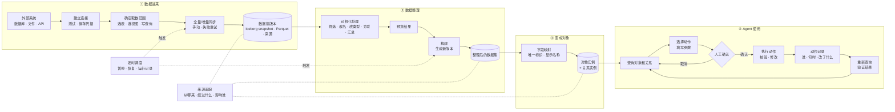

# 数据集成与 Agent 闭环总体设计

- 日期：2026-10-17
- 状态：实施中（P1 完成，P2 技术设计待启动）
- 范围：本项目从「本体与动作定义」走向「真实数据接入与 Agent 闭环」的总体规划
- 维护方式：每次讨论形成结论后，更新「待讨论」状态，并在「决策记录」追加一行

## 1. 背景与目标

项目已经完成对象类型、属性、关系、动作类型、参数、规则和提交校验的定义层。
下一阶段不再只描述业务，而是要把真实业务数据接进来，并让 Agent 能基于这些数据完成一次可验证的操作闭环。

用业务语言说，目标是：

> 让外部业务系统的数据稳定进来，经过整理和定时更新，最后变成 Agent 能查询、能执行动作、能看到结果的真实对象。

整体链路是：

`外部系统 → 同步成数据集 → 可视化整理 → 定时运行 → 变成对象和关系 → Agent 查询 → 执行动作 → 回读结果`

## 2. 总体流程图

实线表示数据和处理流程，虚线表示定时控制与来源追踪。

「确定取数范围」不是单独的一层，而是「批量同步」节点内部的配置：先说明同步哪些数据，再执行同步。

## 3. 需要实现的能力

### 3.1 第一层：数据进来

| 能力 | 说明 |
|---|---|
| 接外部数据 | 新建连接，配置地址、账号和密码，测试连通性；选择表后支持一次性快照和持续增量同步；支持手动同步、失败重试和错误查看；凭据加密保存且不回显。 |
| 管理数据集 | 每次成功同步或发布生成一个不可变版本，不覆盖旧版本；能查看字段、预览数据、行数和来源；能回看历史版本。 |

### 3.2 第二层：数据整理

| 能力 | 说明 |
|---|---|
| 可视化整理数据 | 把多个数据集放进一条处理流程；支持筛选、改字段名、改类型、合并、关联和汇总；边改边预览；流程可保存、修改、重复运行。 |
| 构建 | 手动运行整条处理流程，生成新的数据集版本；能查看进度、日志、成功或失败原因。 |
| 定时调度 | 定时运行同步和处理流程；支持暂停、恢复；记录每次运行结果；没有新数据时可以跳过。 |
| 看清数据来源 | 查看一份数据从哪个系统来、经过哪些处理、影响了哪些下游数据。 |

处理流程的输入只能是数据连接同步生成的数据集，不直接访问外部数据库；输出是新的派生数据集版本，不覆盖原始数据集。

### 3.3 第三层：变成对象

| 能力 | 说明 |
|---|---|
| 映射为对象和关系 | 把整理好的数据集字段映射成对象属性；指定唯一标识和显示名称；生成对象实例和关系实例，并支持查询。 |

### 3.4 第四层：Agent 使用

| 能力 | 说明 |
|---|---|
| 执行动作 | 用已经定义好的动作修改真实对象数据；提交前检查条件，失败时不能只改一半；记录谁、什么时候、改了什么。 |
| Agent 闭环 | Agent 能查对象和关系，能选择合适的动作并填写参数；改数据前可以人工确认；执行后重新查询，并告诉用户实际结果。 |

### 3.5 统一交互方式

- 系统所有功能都采用 Agent 对话方式，而不是传统的一层层菜单表单。
- 首页提供功能入口；数据连接从首页的“数据连接”按钮进入。
- 数据连接页面采用与建模工作台一致的三栏布局：
  - 左侧：已经创建的数据连接列表。
  - 中间：Agent 对话框。
  - 右侧：当前步骤需要的信息，包括数据源信息输入表单和数据源详情。
- 后续的数据集、处理流程、构建、调度和对象实例也复用同一套交互骨架，避免每个功能各做一套页面。
- 对话负责理解意图、引导步骤、解释结果和请求确认；右侧表单负责精确输入、表选择和操作按钮。
- 密码只在表单中填写，不在对话中传递；测试连接、保存和同步由用户点击按钮触发，Agent 读取结果后继续对话。
- 每个数据连接对应一个独立对话，对话与该数据连接一对一绑定。
- 右侧的关键操作以结构化事件写入中间对话记录，例如测试连接、选择表、创建同步和同步结果；Agent 通过这段完整上下文判断当前连接还缺什么、下一步该做什么。
- 密码等敏感信息不写入对话记录；对话中只记录“连接信息已保存”“测试成功或失败”等结果。

### 3.6 对话事件

对话事件是用户操作和系统结果在对话中的统一记录。每个数据连接绑定一个对话，事件按时间插入对话流，Agent 和用户看到同一段历史。

- 记录范围：连接草稿创建、连接保存或修改、连接测试结果、表结构加载、选表变更、同步任务创建、同步成功或失败、数据集新版本生成；后续构建、调度等能力按同一机制扩展。
- 显示方式：中间对话显示为操作卡片，不作为用户或 AI 消息；卡片默认显示一行摘要，展开后显示表名、行数、耗时、错误摘要等详情。
- 写入方式：只由后端写入，前端不直接写事件；每个事件使用 `event_id` 作为唯一键，刷新或重试不会重复记录，`operation_id` 用来归组同一次用户命令。
- 状态更新：同一操作只保留一张卡片，状态由“进行中”更新为“成功”或“失败”，不重复追加。
- 敏感信息：按事件类型白名单记录字段；密码、Token、完整连接串不进入事件；错误信息落库前脱敏。
- 缺失判断：后端维护连接状态（已保存、已测通、已选表、已建同步、最近同步结果），由固定状态机计算缺失步骤；Agent 读取状态和事件历史进行解释与引导，不自行推断。
- 绑定时机：点击“新建连接”时创建草稿连接及对应对话，保存后转为正式连接，保证一对一关系从第一步成立。

### 3.7 数据集详情

第一版数据集详情放在数据连接对话内，不单独新建对话。同步成功的事件卡片可以打开数据集，右侧从连接详情切换为数据集详情，左侧仍然是连接列表。

- 基本信息：名称、来源连接与源表、当前版本、行数、列数、存储大小、创建与更新时间、最近同步结果。
- 字段：字段名、类型、是否可空、源字段、空值率、样例值；第一版只读，字段改名和改类型放到后续处理流程。
- 预览：只读表格，默认展示前 100 行，按所选版本读取；第一版不做筛选、排序和图表。
- 版本历史：每次成功快照或 CDC 版本发布生成一个版本（CDC 默认一天一次，可配置），记录版本号、时间、触发方式、行数、耗时；可切换旧版本查看当时的字段和预览；失败运行只进入运行历史，不生成版本。
- 第一版边界：单分支；`snapshot` 模式生成一次性全量版本，`cdc` 模式在初始化快照完成后持续生成新版本；不做分支、版本对比、回滚和跨版本合并。
- 元数据存储：数据集、版本、schema、来源和行数等元数据存放在 Postgres。
- 数据存储：Flink CDC 把数据写入 Iceberg，Iceberg 默认以 Parquet 保存；每个版本引用一张 Iceberg 表上的不可变 snapshot。
- 存储抽象：Java 通过 `IcebergCatalogClient` 读取元数据和 snapshot；第一版用 Hadoop catalog + 本地共享卷，后续可替换为 REST catalog + MinIO/S3。
- 预览读取：按版本记录的 Iceberg 表和 snapshot 读取前 N 行，不直接拼接 Parquet 文件路径。

## 4. 实施顺序

1. **数据进来**：外部连接、同步、数据集版本。
2. **数据整理**：可视化处理、预览、构建、调度、来源追踪。
3. **变成对象**：数据集映射为对象类型，生成对象实例和关系实例。
4. **Agent 使用**：动作执行、执行记录、Agent 查询与操作闭环。

第一阶段的完成标准是：外部系统的数据能够按计划同步进来，经过保存好的处理流程生成新版本，并且能查看每次同步和构建的运行结果。

## 5. 已确认边界

- 先做数据集成底座，再做对象实例、动作执行和 Agent 闭环。
- 数据集成底座依次覆盖：外部连接器、可视化数据处理、构建与调度。
- 不接受跳过数据集成层、直接用 CSV 快照进入实例层的最小方案。
- 连接器只负责把数据原样接进来；清洗、整理和业务转换放在数据处理流程中。
- 每次同步和处理结果都保留版本，不能直接覆盖历史数据。
- 调度和构建必须有运行记录，并能区分成功、失败和无变化跳过。
- 第一版连接器从 MySQL 开始；后续再加入 PostgreSQL、Hive、MongoDB 和 Kafka。
- MySQL、PostgreSQL、Hive、MongoDB 先按批量数据源设计；Kafka 属于流式数据源，后续单独设计流式接入链路。
- MySQL 第一版支持一次勾选多张表；每张表生成一条独立同步任务和一个独立数据集，分别记录成功或失败，单表失败不影响其他表。
- MySQL 第一版同时支持一次性全量快照和“初始化快照 + 持续增量”的 CDC；同步引擎为 Flink CDC，存储为 Iceberg。
- MySQL 第一版只支持有主键表；无主键表直接拒绝，后续如需支持，单独设计 append-only 通路。
- MySQL 第一版按 8.x 设计，覆盖 8.0 和 8.4；5.7 尽量兼容但不承诺完整支持；MariaDB 暂不纳入第一版。
- MySQL 第一版连接信息包括：连接名称、主机、端口（默认 3306）、数据库名、用户名、密码、是否启用加密连接，并提供测试连接。
- MySQL 连接账号使用只读权限：能读取表结构和执行查询，不需要新增、修改、删除权限；超时先使用系统默认值。
- 数据集采用不可变版本：每次成功快照、CDC 版本发布或构建生成一个新版本，当前版本指向最新成功版本；失败不改变当前版本，只记录失败运行。
- 每个数据连接只对应一个对话；新建连接时先创建草稿连接和对话，保存后转为正式连接。
- 右侧关键操作以后端写入的结构化事件进入对话，显示为可展开的操作卡片。
- 对话事件只由后端写入，按 `event_id` 去重；同一操作更新同一张卡片，不重复追加。
- 事件字段按类型白名单记录；密码、Token、完整连接串不进入事件，错误信息落库前脱敏。
- 连接缺失步骤由后端状态机计算，Agent 只负责解释和引导，不自行推断。
- 数据集详情先放在数据连接对话内展示，不单独新建对话；同步成功后从事件卡片进入。
- 数据集详情包含基本信息、字段、前 100 行预览、版本历史和运行结果；第一版只读。
- 第一版数据集只做单分支；`snapshot` 生成一次性全量版本，`cdc` 持续产生版本；不做分支、版本对比、回滚和跨版本合并。
- 数据集元数据存 Postgres；数据体由 Flink CDC 写入 Iceberg，Iceberg 以 Parquet 保存；版本引用不可变 snapshot。
- 每次快照或 CDC 启动写一张新 Iceberg 表，首次发布版本时切换数据集当前表指针；旧表保留给旧版本。
- Java 通过 `IcebergCatalogClient` 读取版本和预览；第一版用 Hadoop catalog + 本地共享卷，后续可替换为 REST catalog + MinIO/S3。
- 数据连接与同步相关服务用 Docker Compose 部署：MySQL、Postgres、RabbitMQ、Flink、Java 数据服务、Python 和前端都容器化；本地不安装原生 MySQL/Flink。
- 可视化处理只读取同步生成的数据集，不直连外部数据库；输出新的派生数据集版本，不覆盖原始数据集。

## 6. 待讨论

以下事项尚未形成最终结论，后续按顺序讨论并回填：

1. 可视化处理：暂缓。等数据连接和同步完成后，再讨论处理动作、预览和字段错误。
2. 构建：手动构建、失败重试、运行日志、无变化跳过如何定义。
3. 调度：支持哪些触发方式，暂停和恢复如何工作，运行记录包含什么。
4. 来源追踪：展示到什么粒度，是否要能按单个字段追踪。
5. 对象映射：数据集字段如何对应对象属性，唯一标识和关系如何确定。
6. 动作执行：哪些动作先支持，校验失败、并发修改和回滚如何处理。
7. Agent 闭环：Agent 能看到哪些数据，什么时候需要人工确认，执行后如何验证和汇报。

## 7. 决策记录

| 日期 | 议题 | 结论 | 状态 |
|---|---|---|---|
| 2026-10-17 | 总体方向 | 先建数据集成底座，再做对象实例、动作执行与 Agent 闭环。 | 已确认 |
| 2026-10-17 | 旧的最小方案 | 不采用「CSV 快照 + 仅修改对象 + 人工确认」的跳层方案。 | 已否决 |
| 2026-10-17 | 总体流程 | 外部系统 → 数据集 → 可视化整理 → 构建与调度 → 对象关系 → Agent 操作。 | 已确认 |
| 2026-10-17 | 连接器方向 | 优先考虑开源数据库；首批候选包括 PostgreSQL、MySQL/MariaDB、TiDB、openGauss、OceanBase、ClickHouse、Doris/StarRocks。 | 待确认 |
| 2026-10-17 | 数据进入原则 | 连接器原样接入，整理和转换放在数据处理流程中。 | 已确认 |
| 2026-10-17 | 连接器范围 | 第一版先做 MySQL；后续加入 PostgreSQL、Hive、MongoDB 和 Kafka。 | 已确认 |
| 2026-10-17 | 流式边界 | Kafka 单独作为流式数据源设计，不与 MySQL 等批量同步混在一起。 | 已确认 |
| 2026-10-17 | MySQL 多表选择 | 支持一次勾选多张表；每张表生成独立同步任务和独立数据集，分别记录结果，单表失败互不影响。 | 已确认 |
| 2026-10-17 | MySQL 同步方式 | 第一版同时支持 `snapshot` 一次性快照和 `cdc` 初始化快照 + 持续增量。 | 已确认 |
| 2026-10-17 | MySQL 主键要求 | 第一版只支持有主键表；无主键表直接拒绝，后续如需支持单独设计 append-only 通路。 | 已确认 |
| 2026-10-17 | CDC 版本节奏 | 初始化快照完成后按间隔发布版本，默认 24 小时（一天一次）、可配置；正常停止补最终版本。 | 已确认 |
| 2026-10-17 | MySQL 版本 | 支持 MySQL 5.7、8.0.x、8.4+；MariaDB 暂不纳入第一版。 | 已确认 |
| 2026-10-17 | MySQL 连接参数 | 填写连接名称、主机、端口、数据库名、用户名、密码和是否加密，并提供测试连接；账号只读，超时使用系统默认值。 | 已确认 |
| 2026-10-17 | 数据集版本 | 每次成功快照或 CDC 版本发布生成一个不可变版本，当前版本指向最新成功版本；失败只记录运行，不改变当前版本。 | 已确认 |
| 2026-10-17 | 统一交互方式 | 所有功能采用 Agent 对话方式；首页提供功能入口，后续功能复用同一套对话工作台。 | 已确认 |
| 2026-10-17 | 数据连接页面 | 从首页“数据连接”进入三栏布局：左侧连接列表，中间对话，右侧表单与数据源详情。 | 已确认 |
| 2026-10-17 | 对话与表单分工 | 对话负责意图、引导、解释和确认；表单负责精确输入、选表和操作按钮；密码只填表单，用户点击执行，Agent 读取结果。 | 已确认 |
| 2026-10-17 | 连接与对话关系 | 每个数据连接对应一个独立对话，二者一对一绑定。 | 已确认 |
| 2026-10-17 | 操作写入对话 | 右侧关键操作以结构化事件写入中间对话记录，Agent 依据完整操作历史判断缺失项和下一步。 | 已确认 |
| 2026-10-17 | 敏感信息边界 | 密码等敏感信息不进入对话记录，只记录脱敏后的操作结果。 | 已确认 |
| 2026-10-17 | 对话事件范围 | 记录连接草稿、保存、测试、表结构加载、选表、同步任务与结果、数据集新版本；后续能力按同一机制扩展。 | 已确认 |
| 2026-10-17 | 对话事件显示 | 事件以可展开的操作卡片插入对话，不作为用户或 AI 消息；同一操作只保留一张卡片并更新状态。 | 已确认 |
| 2026-10-17 | 对话事件写入与去重 | 只由后端写入，按 `event_id` 去重；`operation_id` 归组同一次命令；字段按类型白名单记录，敏感信息落库前脱敏。 | 已确认 |
| 2026-10-17 | 缺失步骤判断 | 后端用固定状态机计算连接缺失步骤，Agent 读取状态和事件历史进行解释与引导。 | 已确认 |
| 2026-10-17 | 新建连接绑定 | 点击“新建连接”时创建草稿连接和对应对话，保存后转为正式连接。 | 已确认 |
| 2026-10-17 | 数据集详情入口 | 第一版放在数据连接对话内，不单独新建对话；同步成功事件可打开数据集详情。 | 已确认 |
| 2026-10-17 | 数据集详情内容 | 展示基本信息、字段、前 100 行只读预览、版本历史与运行结果；第一版不支持筛选、排序和图表。 | 已确认 |
| 2026-10-17 | 数据集版本边界 | 单分支；`snapshot` 生成一次性全量版本，`cdc` 持续产生版本；不做分支、版本对比、回滚和跨版本合并。 | 已确认 |
| 2026-10-17 | 同步引擎 | 使用 Flink CDC 3.7.0 做快照和 binlog 增量，数据写入 Iceberg；不再使用 SeaTunnel 或自研同步。 | 已确认 |
| 2026-10-17 | 数据集存储 | 元数据存 Postgres；数据由 Flink CDC 写入 Iceberg，Iceberg 以 Parquet 保存；版本引用不可变 snapshot。 | 已确认 |
| 2026-10-17 | 运行物理表 | 每次快照或 CDC 启动写新 Iceberg 表，首次发布版本时切换当前表指针，旧表保留给旧版本。 | 已确认 |
| 2026-10-17 | Iceberg 存储 | 第一版用 Hadoop catalog + 本地共享卷；多节点时改为 REST catalog + MinIO/S3。 | 已确认 |
| 2026-10-17 | 部署方式 | 第一版用 Docker Compose 起 MySQL、Postgres、RabbitMQ、Flink、Java 数据服务、Python 和前端；本地不安装原生服务。 | 已确认 |
| 2026-10-17 | 可视化处理输入 | 只读取数据连接同步生成的数据集，不直接访问外部数据库；输出新的派生数据集版本，不覆盖原始数据集。 | 已确认 |
| 2026-10-17 | 实施顺序调整 | 先完成数据连接和同步的技术设计与实现，再讨论可视化处理。 | 已确认 |
| 2026-10-18 | Agent 运行时复用 | 数据连接 Agent 独立定义、按会话 `kind` 装配；共享流式、会话、检查点、中断和工具调用底座，领域提示词与工具隔离。 | 已确认 |
| 2026-10-18 | Flink 作业提交 | Java 用受控子进程调用 `flink-cdc.sh` 提交 pipeline YAML；临时文件放 tmpfs、权限 `0600`、提交后删除。 | 已确认 |
| 2026-10-18 | CDC 停止与恢复 | 停止优先 stop-with-savepoint 并记录路径；第一版不支持从 savepoint 恢复，重新同步创建新运行和新表。 | 已确认 |
| 2026-10-18 | 数据连接设计定稿 | 数据连接、同步、Agent 与前端三栏设计已完成，进入实施阶段。 | 已确认 |

## 8. 下一步

P1「数据进来」已完成并合并到 `main`（基线 `7c8e240`），实施记录见 `2026-10-17-data-connection-sync-technical-design.md` 第 12 节。

P2「数据整理」已完成并通过 2026-10-22 端到端验收，技术设计见 `2026-10-19-data-preparation-technical-design.md`，验收报告见 `../checks/2026-10-20-p2-data-preparation-smoke.md`。下一步进入 P3「变成对象」，先确定字段映射、对象唯一标识、显示名称和关系生成方式，再写实施计划。

阶段目标、执行状态和沟通记录索引见 [`../ROADMAP.md`](../ROADMAP.md) 与 [`../phases/`](../phases/)。

## 附录：设计依据

本设计参考以下 Palantir 官方文档原文：

- [Data Connection](https://www.palantir.com/docs/foundry/data-connection/overview/)
- [Data Connection core concepts](https://www.palantir.com/docs/foundry/data-connection/core-concepts/)
- [Set up a batch sync](https://www.palantir.com/docs/foundry/data-connection/set-up-sync/)
- [Datasets](https://www.palantir.com/docs/foundry/data-integration/datasets/)
- [Dataset Preview](https://www.palantir.com/docs/foundry/dataset-preview/overview/)
- [Pipeline Builder](https://www.palantir.com/docs/foundry/pipeline-builder/overview/)
- [Builds](https://www.palantir.com/docs/foundry/data-integration/builds/)
- [Schedules](https://www.palantir.com/docs/foundry/data-integration/schedules/)
- [Object types](https://www.palantir.com/docs/foundry/object-link-types/object-types-overview/)
- [Action types](https://www.palantir.com/docs/foundry/action-types/overview/)
