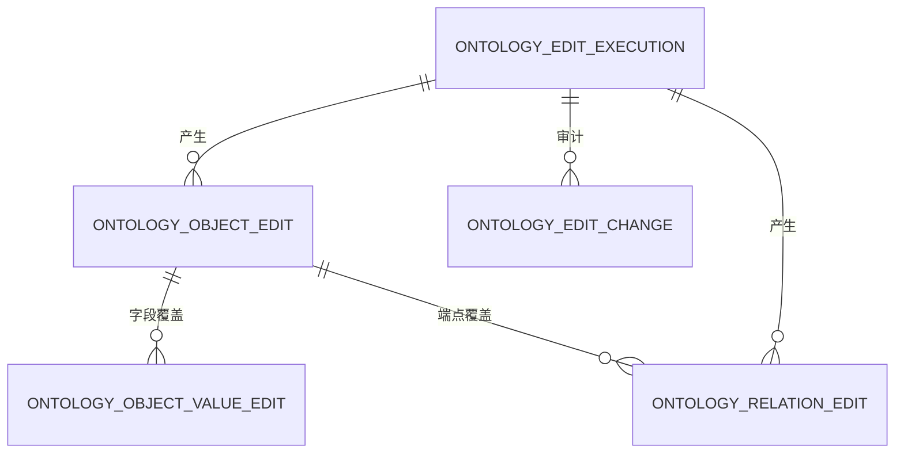

# 业务行动编辑覆盖层设计（主体已确认）

- 日期：2026-10-30
- 状态：设计已确认；物化快照确认 P4 不做，不进入实现
- 范围：运行时 Action 产生的对象/属性/关系变更如何落到数据服务
- 不在范围：动作定义层、Agent 提示词、前端执行页、物化快照、图历史版本
- 上游：`docs/superpowers/phases/p4-agent-loop.md`、`docs/superpowers/specs/2026-10-16-action-layer-design.md`

## 0. 结论先行

采用 Palantir 式“基础索引 + 编辑覆盖层”：

1. 基础索引表只读，Action 不直接改 `ontology_object_instance`、`ontology_object_value`、`ontology_relation_instance`。
2. 用户/Action 产生的变更写入独立覆盖表；查询时按“当前基础索引版本 + 覆盖层”合并出 effective state。
3. 覆盖层按本体身份挂载，不按 `version_id`、也不按 `graph_id`：
   - 对象：`owner_id + object_type_id + primary_key_value`
   - 关系：`owner_id + relation_id + from_object_type_id + from_primary_key + to_object_type_id + to_primary_key`
4. 覆盖层跨索引重建保留。基础索引重建后，未编辑字段继续接收数据源更新，已编辑字段保持覆盖值。
5. 覆盖层同时保存“当前状态”和“变更历史”：当前状态供查询合并，历史供审计与回放；两者不混用。
6. 不新增独立执行面。运行时 Action 仍是现有业务 Agent 的一个受控工具，覆盖层只是数据服务内部的存储与查询能力。

需要特别区分的两种“对象不存在”：

| 情况 | 对象是否可见 | 之前的编辑是否保留 |
|---|---|---|
| 数据源行消失 | 不可见 | 保留；行重新出现后继续生效 |
| 用户执行删除 Action | 不可见 | 不保留；之后重建是全新对象 |

这是 Palantir 的默认语义，见 [How user edits are applied](https://www.palantir.com/docs/foundry/object-edits/how-edits-applied/) 中的 T0–T14 示例。

## 1. 现状与为什么要覆盖层

当前数据服务把数据源索引到以下表，全部以 `version_id` 分区：

- `data.ontology_object_instance`：对象主键、标题、`properties` JSONB
- `data.ontology_object_value`：属性值，供筛选与排序
- `data.ontology_relation_instance`：关系实例

查询通过 `ontology_object_binding.current_index_version_id` 找到当前版本，见
`/Users/haobenkun/WorkSpace/OntoWeave/data-service/src/main/java/com/ontoweave/data/ontology/query/repository/JdbcObjectQuery.java:21`。

三种方案对比：

| 方案 | 做法 | 问题 |
|---|---|---|
| 直接改基础表 | Action 直接更新三张实例表 | 索引一重建就丢；与数据源刷新冲突；无法区分数据源值与用户值 |
| 全量快照 | 每次编辑复制整行到另一张表 | 存储膨胀；未编辑字段无法继续接收数据源更新；需要额外合并 |
| 字段级覆盖层 | 只记录被编辑的字段、对象状态和关系状态 | 读取需要合并；但能跨版本保留、支持审计、与 Palantir 语义一致 |

选择字段级覆盖层。

## 2. 概念模型

| 概念 | 定义 |
|---|---|
| 基础索引 | 数据源经索引构建得到的当前版本数据，只读 |
| 覆盖层 | Action 产生的对象生命周期、字段值和关系状态 |
| effective state | 基础索引与覆盖层合并后的查询结果；所有查询接口只暴露 effective state |
| edit set | 后端根据 Action 参数、规则、提交校验计算出的具体变更集合 |
| execution | 一次 Action 提交的执行记录，包含幂等键、变更集、结果与审计上下文 |

数据流：

```text
数据源 → 索引构建 → 基础索引（只读）
                         ↓
业务 Agent → Action 工具 → 领域校验 → edit set → 数据服务事务 → 覆盖层
                                                              ↓
查询工具 ← 数据服务 effective query（基础索引 + 覆盖层）←────┘
```

覆盖层不改变数据源，也不改变索引构建逻辑。索引构建仍只写三张基础表。

## 3. 覆盖层身份键

### 3.1 对象

```text
owner_id + object_type_id + primary_key_value
```

不使用 `version_id`：否则索引重建后编辑丢失。

不使用 `graph_id`：对象实例属于本体，不属于某张业务图。同一个对象类型可以同时出现在多张图中，Action 从图 A 修改对象后，图 B 查询也必须看到同一份新状态。`graph_id` 放在 execution 记录里，用于权限与审计，不进入覆盖层主键。

### 3.2 关系

```text
owner_id + relation_id + from_object_type_id + from_primary_key
         + to_object_type_id + to_primary_key
```

多对多关系直接使用该键。外键型关系（一对一/一对多）不单独维护关系覆盖，而是由 effective 外键属性派生，见 §5.3。

### 3.3 主键不可编辑

v1 不允许 Action 修改对象主键。主键是覆盖层身份的一部分，改主键等价于“删旧建新”，应拆成两条 Action，避免合并语义和关系引用同时变化。

标题键允许修改，使用单独的 `title_edited` 标记。标题被清空时，effective title 回退到主键，不回退到数据源标题；否则用户清空标题后，基础索引的旧标题会重新出现。

## 4. 数据模型

覆盖层放在数据服务的 `data` schema；动作定义仍在后端 `app` schema。建模态 changeset 与运行时覆盖层是两套东西，不复用。

### 4.1 ER 图



### 4.2 `data.ontology_object_edit`

对象级当前状态。一个对象最多一行。

```sql
CREATE TABLE data.ontology_object_edit (
    owner_id                    UUID NOT NULL,
    object_type_id              UUID NOT NULL,
    primary_key_value           TEXT NOT NULL,
    origin                      TEXT NOT NULL,
    state                       TEXT NOT NULL,
    title_edited                BOOLEAN NOT NULL DEFAULT FALSE,
    title_value                 TEXT,
    properties_patch            JSONB NOT NULL DEFAULT '{}'::jsonb,
    properties_cleared          TEXT[] NOT NULL DEFAULT '{}',
    primary_key_num             NUMERIC,
    primary_key_date            DATE,
    primary_key_ts              TIMESTAMPTZ,
    source_binding_id           UUID NOT NULL,
    source_dataset_id           UUID NOT NULL,
    source_primary_key_attr_id  UUID NOT NULL,
    source_title_key_attr_id    UUID,
    version                     BIGINT NOT NULL DEFAULT 1,
    created_at                  TIMESTAMPTZ NOT NULL DEFAULT now(),
    updated_at                  TIMESTAMPTZ NOT NULL DEFAULT now(),
    updated_by                  UUID NOT NULL,
    last_execution_id           UUID,
    stale_at                    TIMESTAMPTZ,
    stale_reason                TEXT,
    PRIMARY KEY (owner_id, object_type_id, primary_key_value),
    CONSTRAINT ck_object_edit_origin CHECK (origin IN ('BASE', 'USER')),
    CONSTRAINT ck_object_edit_state CHECK (state IN ('ACTIVE', 'DELETED'))
);

CREATE INDEX ix_object_edit_type_state
    ON data.ontology_object_edit (owner_id, object_type_id, state);
```

字段含义：

| 字段 | 作用 |
|---|---|
| `origin` | `BASE`：覆盖数据源对象；`USER`：Action 创建的用户对象，完全忽略数据源 |
| `state` | `ACTIVE`：参与合并；`DELETED`：对象不可见 |
| `title_edited` / `title_value` | 标题是否被用户改过；未改时继续用基础索引标题；已改但为空时回退到主键 |
| `properties_patch` | 只存被改字段，键为属性 ID 字符串；不是整对象快照 |
| `properties_cleared` | 被显式置空的属性 ID；JSONB 的 `null` 不能表达“删除键”，所以单列 |
| `primary_key_*` | 用户创建对象时用于排序；基对象已有，覆盖行可空 |
| `source_*` | 记录编辑时的绑定/数据源/主键映射；用于绑定变化后的失效判断 |
| `version` | 对象级乐观锁，用于并发 Action 冲突检测 |
| `last_execution_id` | 最近一次修改该对象的执行记录 |
| `stale_at` / `stale_reason` | 覆盖因绑定/映射变化失效的时间与原因；stale 行不参与合并 |

`origin` 与 `state` 的组合决定可见性：

| origin | state | 基础对象存在 | effective 可见性 |
|---|---|---|---|
| BASE | ACTIVE | 是 | 可见：基础对象 + 字段覆盖 |
| BASE | ACTIVE | 否 | 不可见：覆盖保留，等待数据源行回来 |
| USER | ACTIVE | 是/否 | 可见：只读覆盖值，忽略基础对象 |
| BASE/USER | DELETED | 是/否 | 不可见：删除墓碑 |

### 4.3 `data.ontology_object_value_edit`

字段级当前值，供筛选、排序使用；与 `properties_patch` 对应，但按数据类型拆列。

```sql
CREATE TABLE data.ontology_object_value_edit (
    owner_id            UUID NOT NULL,
    object_type_id      UUID NOT NULL,
    primary_key_value   TEXT NOT NULL,
    attribute_id        UUID NOT NULL,
    value_state         TEXT NOT NULL,
    text_value          TEXT,
    num_value           NUMERIC,
    date_value          DATE,
    ts_value            TIMESTAMPTZ,
    bool_value          BOOLEAN,
    updated_at          TIMESTAMPTZ NOT NULL DEFAULT now(),
    updated_by          UUID NOT NULL,
    last_execution_id   UUID,
    stale_at            TIMESTAMPTZ,
    stale_reason        TEXT,
    PRIMARY KEY (owner_id, object_type_id, primary_key_value, attribute_id),
    CONSTRAINT ck_object_value_edit_state CHECK (value_state IN ('SET', 'CLEAR'))
);

CREATE INDEX ix_object_value_edit_text
    ON data.ontology_object_value_edit (owner_id, object_type_id, attribute_id, text_value);
CREATE INDEX ix_object_value_edit_num
    ON data.ontology_object_value_edit (owner_id, object_type_id, attribute_id, num_value);
CREATE INDEX ix_object_value_edit_date
    ON data.ontology_object_value_edit (owner_id, object_type_id, attribute_id, date_value);
CREATE INDEX ix_object_value_edit_ts
    ON data.ontology_object_value_edit (owner_id, object_type_id, attribute_id, ts_value);
CREATE INDEX ix_object_value_edit_bool
    ON data.ontology_object_value_edit (owner_id, object_type_id, attribute_id, bool_value);
```

规则：

- `value_state='SET'`：恰好一个类型列非空；text 同时承载普通字符串和 enum。
- `value_state='CLEAR'`：所有值列为空，表示有效值为 null，并遮蔽基础索引中的同名属性。
- v1 不支持 Action 修改数组属性；遇到 `is_array=true` 的赋值/参数，在 preview 阶段直接拒绝。
- 一个属性同时有基础值和覆盖值时，覆盖值优先。
- `stale_at` 非空的行不参与合并，查询回退到基础索引值或视为无覆盖。

### 4.4 `data.ontology_relation_edit`

多对多关系当前状态。基础关系 + 覆盖层合并后得到 effective 关系。

```sql
CREATE TABLE data.ontology_relation_edit (
    owner_id             UUID NOT NULL,
    relation_id          UUID NOT NULL,
    from_object_type_id  UUID NOT NULL,
    from_primary_key     TEXT NOT NULL,
    to_object_type_id    UUID NOT NULL,
    to_primary_key       TEXT NOT NULL,
    state                TEXT NOT NULL,
    version              BIGINT NOT NULL DEFAULT 1,
    created_at           TIMESTAMPTZ NOT NULL DEFAULT now(),
    updated_at           TIMESTAMPTZ NOT NULL DEFAULT now(),
    updated_by           UUID NOT NULL,
    last_execution_id    UUID,
    stale_at             TIMESTAMPTZ,
    stale_reason         TEXT,
    PRIMARY KEY (
        owner_id, relation_id, from_object_type_id, from_primary_key,
        to_object_type_id, to_primary_key
    ),
    CONSTRAINT ck_relation_edit_state CHECK (state IN ('ACTIVE', 'DELETED'))
);

CREATE INDEX ix_relation_edit_from
    ON data.ontology_relation_edit (owner_id, relation_id, from_object_type_id, from_primary_key);
CREATE INDEX ix_relation_edit_to
    ON data.ontology_relation_edit (owner_id, relation_id, to_object_type_id, to_primary_key);
```

规则：

- `ACTIVE`：覆盖新增关系；即使基础关系不存在也可见。
- `DELETED`：遮蔽基础关系。
- 关系两端对象必须 effective 可见；任一端删除/不可见时，关系不参与遍历。
- 删除对象时，清理与该对象相关的覆盖关系；审计历史保留在 `ontology_edit_change`。
- 关系映射变化导致覆盖无法解释时，将行标记为 stale，查询忽略该覆盖。

### 4.5 `data.ontology_edit_execution`

一次成功 Action 提交的事务记录。它既是幂等边界，也是审计入口。

```sql
CREATE TABLE data.ontology_edit_execution (
    id                     UUID PRIMARY KEY,
    owner_id               UUID NOT NULL,
    conversation_id        UUID,
    graph_id               UUID NOT NULL,
    action_type_id         UUID NOT NULL,
    action_snapshot        JSONB NOT NULL,
    action_definition_hash TEXT NOT NULL,
    parameters             JSONB NOT NULL,
    status                 TEXT NOT NULL,
    idempotency_key        TEXT NOT NULL,
    base_versions          JSONB NOT NULL DEFAULT '{}',
    diff                   JSONB,
    error                  JSONB,
    created_at             TIMESTAMPTZ NOT NULL DEFAULT now(),
    applied_at             TIMESTAMPTZ,
    CONSTRAINT uq_edit_execution_idempotency UNIQUE (owner_id, idempotency_key),
    CONSTRAINT ck_edit_execution_status CHECK (status IN ('APPLIED', 'REVERTED'))
);
```

`base_versions` 记录本次执行看到的各对象类型基础版本，例如
`{"object_type_id":"index_version_id"}`。`action_snapshot` 保存执行时的动作定义快照，避免动作定义后续被改导致审计无法复现。

### 4.6 `data.ontology_edit_change`

追加式变更历史，供审计、回放和未来的 edit history 查询；不参与 effective 查询。

```sql
CREATE TABLE data.ontology_edit_change (
    execution_id         UUID NOT NULL,
    seq                  INTEGER NOT NULL,
    change_kind          TEXT NOT NULL,
    object_type_id       UUID,
    primary_key_value    TEXT,
    attribute_id         UUID,
    relation_id          UUID,
    from_object_type_id  UUID,
    from_primary_key     TEXT,
    to_object_type_id    UUID,
    to_primary_key       TEXT,
    before_value         JSONB,
    after_value          JSONB,
    created_at           TIMESTAMPTZ NOT NULL DEFAULT now(),
    PRIMARY KEY (execution_id, seq)
);
```

`change_kind` 至少包括：`OBJECT_CREATE`、`OBJECT_MODIFY`、`OBJECT_DELETE`、`VALUE_SET`、`VALUE_CLEAR`、`RELATION_CREATE`、`RELATION_DELETE`。

## 5. 合并规则

### 5.1 对象合并

记当前基础对象为 `B`，覆盖行为 `E`。`E` 为 stale 时视为不存在：

```text
if E is null or E.stale_at != null: 走基础对象逻辑
else if E.state = DELETED:        不可见
else if E.origin = USER:          可见，properties = E.properties_patch
else if B exists:                 可见，properties = (B.properties - E.cleared) || E.patch
else:                             不可见
```

标题：

```text
if E.title_edited and E.title_value non-empty:  E.title_value
else if E.title_edited and E.title_value empty: primary_key
else if E.origin=USER: E.properties_patch[title_key] 或 primary_key
else:               B.title_value
```

用户创建对象（`origin=USER`）完全忽略数据源，包括数据源之后更新同主键对象的情况。这与 Palantir 的 T9–T13 行为一致：Create object 之后，数据源变化不再覆盖该对象。

### 5.2 字段合并

筛选、排序使用的 effective 字段值按属性逐个合并：

```text
基础值存在 + 覆盖 SET   → 覆盖值
基础值存在 + 覆盖 CLEAR → null
基础值存在 + 无覆盖     → 基础值
基础值不存在 + 覆盖 SET → 覆盖值
基础值不存在 + 无覆盖   → null
```

对象级 `properties_patch` 与字段级覆盖必须一致：同一个 `attribute_id` 不能出现“JSON 有值但 value edit 为 CLEAR”或反过来。写入时由数据服务在同一事务内生成两者，避免两套逻辑漂移。

### 5.3 关系合并

多对多：

```text
基础关系 - DELETED 覆盖 + ACTIVE 覆盖
```

外键型关系（一对一/一对多）：

```text
effective 关系 = 由 effective 外键属性值派生
```

原因是动作层规定外键关系通过 `modify_object` 改外键属性，而不是走 `create_link`。如果关系查询继续读静态 `ontology_relation_instance`，外键改了但关系仍是旧的。数据服务需要为 FK 关系提供单独查询分支：从 effective 对象值取外键，再定位对端对象。

### 5.4 删除与重建

采用 Palantir 语义：

1. 数据源行消失：对象不可见，覆盖值保留；行重新出现后覆盖值继续生效。
2. 用户执行 Delete object：写 `state=DELETED`，清空该对象的字段覆盖和关系覆盖；对象不可见。
3. 之后执行 Create object：写一条新的 `origin=USER`、`state=ACTIVE` 覆盖，只有本次 Action 提供的属性；未提供属性为 null，不继承删除前的值。
4. 已删除对象上的 Modify object 必须失败；不能对墓碑做字段修改。

“数据源行消失”和“用户删除”必须是两个状态，不能都用一个 `deleted=true` 表示，否则无法区分“编辑保留”和“编辑清空”。

## 6. 查询集成

所有查询入口必须切到 effective state，不能只改对象列表而漏掉详情、关系遍历、筛选、排序和计数。

### 6.1 effective 对象 CTE 示意

```sql
WITH effective_object AS (
    SELECT
        b.primary_key_value,
        CASE WHEN e.title_edited THEN e.title_value ELSE b.title_value END AS title_value,
        (b.properties - COALESCE(e.properties_cleared, '{}')) || COALESCE(e.properties_patch, '{}') AS properties
    FROM data.ontology_object_instance b
    LEFT JOIN data.ontology_object_edit e
      ON e.owner_id = ?
     AND e.object_type_id = b.object_type_id
     AND e.primary_key_value = b.primary_key_value
     AND e.stale_at IS NULL
    WHERE b.version_id = ?
      AND COALESCE(e.state, 'ACTIVE') <> 'DELETED'
      AND COALESCE(e.origin, 'BASE') <> 'USER'

    UNION ALL

    SELECT
        e.primary_key_value,
        e.title_value,
        e.properties_patch
    FROM data.ontology_object_edit e
    WHERE e.owner_id = ?
      AND e.object_type_id = ?
      AND e.origin = 'USER'
      AND e.state = 'ACTIVE'
      AND e.stale_at IS NULL
)
```

实际实现需要处理 `origin=USER` 且基础对象也存在时“忽略基础对象”的情况；上面的 `LEFT JOIN + UNION ALL` 只是结构示意，最终应由一个共享 SQL 构造器生成，避免列表、详情、计数各写一遍。

### 6.2 effective 字段 CTE 示意

```sql
WITH effective_value AS (
    SELECT 0 AS source_rank, v.attribute_id, v.primary_key_value,
           v.text_value, v.num_value, v.date_value, v.ts_value, v.bool_value
    FROM data.ontology_object_value v
    WHERE v.version_id = ?

    UNION ALL

    SELECT 1 AS source_rank, e.attribute_id, e.primary_key_value,
           e.text_value, e.num_value, e.date_value, e.ts_value, e.bool_value
    FROM data.ontology_object_value_edit e
    WHERE e.owner_id = ? AND e.object_type_id = ?
      AND e.stale_at IS NULL
)
SELECT DISTINCT ON (attribute_id, primary_key_value) *
FROM effective_value
ORDER BY attribute_id, primary_key_value, source_rank DESC
```

`FilterParser` 目前生成的是针对 `data.ontology_object_value` 的 SQL 片段；保持其输出结构不变，把执行时的表名替换成 effective CTE 即可。排序子查询同样改为 effective CTE。

### 6.3 关系查询

- 多对多：`JdbcRelationQuery` 在基础关系上叠加 `ontology_relation_edit` 的删除/新增。
- 外键：按 effective 外键属性派生，不读静态关系实例。
- 对端对象标题、可见性必须用 effective object，不能用基础 `ontology_object_instance`；否则会出现“对端对象已改名/已删除但关系列表还是旧值”。
- 关系覆盖行 `stale_at` 非空时按不存在处理。

### 6.4 代码触点

建议新增数据服务内部模块：

```text
ontology/edit/
  model/          覆盖层记录与 edit set
  store/          JdbcObjectEditStore / JdbcRelationEditStore
  query/          EffectiveObjectSql / EffectiveValueSql / EffectiveRelationSql
  service/        EditSetPreviewService / EditSetApplyService
  api/            内部 preview/apply 接口
```

查询仓库 `JdbcObjectQuery`、`JdbcRelationQuery` 只依赖 effective SQL 构造器，不直接拼覆盖表。这样列表、详情、计数、排序、关系遍历共用同一套合并语义。

查询响应建议增加两个非敏感字段：

```text
index_version_id    # 基础索引版本，沿用现有语义
has_user_edits      # 当前结果中是否包含覆盖层数据
```

`has_user_edits` 只用于 Agent 解释与前端标识，不暴露覆盖层内部结构。

### 6.5 性能边界

- 覆盖表按 `owner_id + object_type_id` 前缀索引；查询只 join 当前对象类型，不扫描全表。
- 分页与 `total` 必须基于 effective 结果计算；不能先分页基础数据再合并覆盖，否则总数和页内容都会错。
- 覆盖数据量预计远小于基础索引；如果后续出现大图/大表场景，再引入 effective 物化视图，不改变覆盖层语义。
- 所有查询改造前后用 `EXPLAIN ANALYZE` 对比列表、筛选、排序、关系遍历四条主路径。

## 7. 写入路径

### 7.1 edit set 契约

后端负责 Action 语义：参数校验、提交条件、规则赋值、对象/关系定位。数据服务只接收已解析的 edit set，负责存储与事务，不理解 Action 规则。

```json
{
  "execution_id": "uuid",
  "owner_id": "uuid",
  "graph_id": "uuid",
  "action_type_id": "uuid",
  "idempotency_key": "string",
  "expected": {
    "objects": [
      {"object_type_id": "uuid", "primary_key": "C001", "version": 3}
    ],
    "relations": [
      {"relation_id": "uuid", "from_primary_key": "C001", "to_primary_key": "P001", "version": 1}
    ]
  },
  "object_creates": [
    {"object_type_id": "uuid", "primary_key": "C002", "values": {"attr_id": "value"}}
  ],
  "object_updates": [
    {"object_type_id": "uuid", "primary_key": "C001", "set": {"attr_id": "value"}, "clear": ["attr_id"]}
  ],
  "object_deletes": [
    {"object_type_id": "uuid", "primary_key": "C003"}
  ],
  "relation_creates": [
    {"relation_id": "uuid", "from_primary_key": "C001", "to_primary_key": "P001"}
  ],
  "relation_deletes": [
    {"relation_id": "uuid", "from_primary_key": "C001", "to_primary_key": "P002"}
  ]
}
```

`values` 的键是属性 ID；数据服务根据当前映射把值编码成 `properties_patch` 和 `ontology_object_value_edit`，保证两套表示一致。v1 不支持数组属性编辑，`is_array=true` 在 preview 阶段直接拒绝。

### 7.2 preview → 人工确认 → apply

不新增执行面，流程仍在现有业务 Agent 内：

```text
Agent 选择动作并填参数
  → 后端校验动作、参数、提交条件
  → 后端构造 edit set
  → 数据服务 preview（只读）：返回 before/after、受影响对象、冲突
  → Agent 调 ask_user 做人工确认
  → 数据服务 apply（单事务）
  → 数据服务返回 effective readback
  → Agent 用回读结果回答
```

`preview` 不写覆盖层，也不创建 execution；它只做当前 effective state 下的可行性检查。`apply` 必须重新校验 expected version，不能信任 preview 的结果。

### 7.3 apply 事务步骤

1. 校验 `idempotency_key`：已存在且成功则直接返回原 execution 的 readback，不重复写。
2. 解析当前 `current_index_version_id`、映射快照和绑定；无可用索引则返回 `NOT_INDEXED`。
3. 锁定/读取目标覆盖行，比较 `expected.version`；对象创建检查 effective 对象是否已存在。
4. 校验关系端点 effective 可见、关系属于当前映射、外键规则一致。
5. 写 `ontology_edit_execution`（`APPLIED`）。
6. 写对象覆盖、字段覆盖、关系覆盖；更新 `version` 与 `last_execution_id`。
7. 写 `ontology_edit_change` 审计记录。
8. 提交事务。
9. 在同一事务提交后读取 effective state，作为 apply 响应。

任何一步失败都回滚整个事务，不能出现“对象改了但关系没改”或“execution 成功但覆盖没写”的半状态。

### 7.4 并发与冲突

- 数据源更新不与用户编辑冲突：默认策略是用户编辑优先，未编辑字段继续接收数据源更新。
- 并发 Action 以对象/关系覆盖行的 `version` 做乐观锁；两个 Action 改同一对象时，后提交者收到 `EDIT_CONFLICT`。
- `ontology_edit_execution(owner_id, idempotency_key)` 唯一约束保证网络重试不会重复执行。
- 同一 Action 内的多对象修改必须在一个事务内完成；不要求跨 Action 串行。

### 7.5 外键关系

- `modify_object` 改外键属性：只写对象字段覆盖，关系查询从 effective 外键派生。
- `create_link` / `delete_link` 只用于多对多：写关系覆盖。
- 外键型关系不写 `ontology_relation_edit`，避免“外键值”和“关系覆盖”两个真相源。

## 8. 生命周期

### 8.1 索引重建

覆盖层不依赖 `version_id`。索引从 v1 切到 v2 后：

- 未编辑字段读 v2 的新值；
- 已编辑字段继续读覆盖值；
- 数据源行消失的对象不可见，但覆盖保留；
- 数据源行重新出现的对象恢复可见，覆盖继续生效。

### 8.2 绑定/映射变化

覆盖行记录 `source_binding_id`、`source_dataset_id`、`source_primary_key_attr_id`。已确认策略是“保留覆盖行，标记 stale，不自动删除”：

- 同一 dataset、同一主键映射，只新增/修改普通属性：覆盖继续生效。
- 数据源 dataset 被替换：`origin=BASE` 的对象覆盖标记 stale；`origin=USER` 的对象不依赖数据源行，继续保留，除非主键/属性映射不兼容。
- 主键映射变化：所有对象/关系覆盖标记 stale，因为旧覆盖无法按新身份安全解释。
- 被编辑属性在新映射中不存在：对应的 `ontology_object_value_edit` 标记 stale，其他字段覆盖继续生效；不要静默套到同名新属性。
- 关系定义/端点映射变化：`ontology_relation_edit` 标记 stale。
- stale 行保留在覆盖表里供审计和人工处理，但查询不合并；管理端需要能列出 stale 原因。
- stale 不会被自动清除；重新建立兼容映射后，由显式迁移/确认操作清除 stale 标记，或由用户重新编辑生成新覆盖。

### 8.3 对象类型解绑/删除

对象类型解绑后没有当前索引版本，覆盖不可见但保留。重新绑定同一数据源和主键映射时可继续使用；绑定到不同数据源时按 §8.2 处理。

### 8.4 清理

- 删除对象的字段/关系覆盖立即清理，历史留在 `ontology_edit_change`。
- 解绑对象类型的覆盖不自动删除；设置保留期或由管理操作清理。
- 历史表按审计保留策略清理，不与当前覆盖表共用 TTL。

## 9. 权限与安全

- 所有覆盖行必须带 `owner_id`；查询和 apply 都校验 owner。
- Action 必须属于选中图、处于 `confirmed`/`approved`，且参数/规则/提交校验完整。
- 目标对象类型、关系、属性必须在当前图中且可查；不允许跨图拼接。
- 覆盖层内部接口只允许后端服务调用，使用现有内部 token；不对前端暴露。
- 删除/修改权限沿用 Action 的提交条件与权限检查；覆盖层不绕过领域校验。

## 10. 审计

覆盖层与审计分开：

| 数据 | 用途 | 是否参与查询 |
|---|---|---|
| `ontology_object_edit` / `value_edit` / `relation_edit` | 当前 effective state | 是 |
| `ontology_edit_execution` | 一次 Action 的决策上下文、参数、动作快照、结果 | 否 |
| `ontology_edit_change` | 每次字段/关系变更的 before/after | 否 |

`ontology_edit_execution` 记录 `graph_id`、`conversation_id`、操作者、动作定义快照和基础版本；这对应 Palantir 的 action log。`ontology_edit_change` 对应 edit history。失败的 Action 不写成功 execution，只记录失败原因/指标，避免把失败尝试混入成功日志。

## 11. 验证矩阵

至少覆盖以下场景：

| 场景 | 预期 |
|---|---|
| 基础 v1 修改字段后查询 | 立即看到覆盖值 |
| 重建到 v2，数据源更新未编辑字段 | 新值可见；已编辑字段保持覆盖值 |
| 数据源行消失后查询 | 对象不可见；覆盖保留 |
| 数据源行重新出现后查询 | 对象可见；之前的字段覆盖仍生效 |
| Create object 后数据源同主键更新 | 用户对象保持；数据源值不覆盖 |
| Create object 后数据源行消失 | 用户对象仍可见 |
| Delete object 后 Modify | 返回失败，不产生覆盖 |
| Delete 后 Create 同主键 | 新对象只有本次 Create 的属性；旧覆盖不继承 |
| 清空标题 | effective title 回退到主键，不回退到数据源标题 |
| Action 写数组属性 | preview 直接拒绝，不产生覆盖 |
| 多对多 link create/delete | 关系遍历与实例列表都按 effective 关系 |
| 外键属性修改 | 对象详情与关系遍历同时变化 |
| 覆盖后筛选/排序/分页/total | 与 effective 结果一致，不漏不重 |
| 两个 Action 并发改同一对象 | 一个成功，一个 `EDIT_CONFLICT` |
| 同一 idempotency_key 重试 | 不重复写，返回同一结果 |
| apply 中途失败 | 对象/字段/关系/审计全部回滚 |
| 绑定/主键映射变化 | 覆盖行标记 stale；查询忽略 stale 覆盖，历史保留 |
| 每次成功 apply | 同一事务写入 execution 与 change 明细 |

## 12. 实施顺序

建议按可验证的最小闭环推进：

1. **读取合并**：建覆盖表 + effective SQL，先不写；用测试数据验证合并、筛选、排序、分页。
2. **修改对象**：实现 `modify_object` 的 preview/apply、字段覆盖、execution 与 change log。
3. **关系**：多对多 link create/delete；外键关系改为 effective 派生。
4. **创建/删除**：对象生命周期、删除清理、重建语义。
5. **Agent 工具**：在现有业务 Agent 内接入 `execute_graph_action`，完成确认与回读。
6. **审计查询**：`ontology_edit_change` 与 execution 查询接口；审计属于 v1 必做，物化快照另行评估。

这与 P4 的 4.5–4.7 对应，但顺序更保守：先把读合并跑通，再开写。

## 13. 已确认决策

1. **删除后重建**：严格采用 Palantir 语义。删除墓碑；之后只能通过 Create object 重新出现；旧编辑不继承。
2. **v1 范围**：全部覆盖 `modify_object` / `create_object` / `delete_object` / `create_link` / `delete_link`。
3. **覆盖范围**：本体级，不加 `graph_id`；图只作为执行上下文与审计字段。
4. **主键/标题**：主键不可改；标题可改；标题清空时回退到主键，不回退到数据源标题。
5. **绑定变化**：保留覆盖行并标记 stale，不自动删除；stale 行不参与查询。
6. **外键关系**：FK 关系由 effective 外键属性派生，不写关系覆盖。
7. **数组属性**：v1 不支持 Action 修改数组属性，preview 阶段直接拒绝。
8. **审计**：`ontology_edit_execution` 与 `ontology_edit_change` 均为 v1 必做。
9. **物化快照**：P4 不做；后续出现明确下游消费者或查询性能需求时再评估。

## 14. 已确认：P4 不做物化快照

### 14.1 是什么

物化快照（materialized snapshot）是把“基础索引 + 覆盖层”的 effective state 在某个时间点计算好，写成一份独立的、可直接读取的数据副本。它可以是：

- 一张物化表，例如 `data.ontology_object_effective_materialized`；
- 一个物化视图；
- 一份导出数据集/文件，供下游 pipeline、分析、下载使用。

它不是覆盖层的一部分，也不改变 Action 的执行语义。当前查询可以实时合并 base + overlay，不需要物化快照。

### 14.2 为什么 Palantir 需要它

Palantir 的 materialized dataset 主要给两类场景用：

1. 下游 Foundry pipeline 需要读取“包含用户编辑的最新对象状态”，但下游不能直接查对象数据库；
2. 用户需要下载/分析一份包含编辑结果的完整数据。

它是“下游消费”能力，不是 Action 执行或在线查询的前置条件。OSv2 不需要 OSv1 那种 writeback dataset。

### 14.3 OntoWeave 是否现在做

已确认 **P4 不做**，原因：

- 在线查询已经通过 effective SQL 合并，物化不是必需；
- 物化会引入刷新时机、增量/全量、存储成本、权限继承、版本一致性等一整套问题；
- 当前没有明确的下游数据集消费者；先做会把范围从“行动闭环”扩成“数据发布平台”。

后续真要做时，建议作为独立能力：

- 触发方式：定时、Action 后、手动；
- 范围：整对象类型或整图；
- 形式：先做物化表，再做导出数据集；
- 必须定义刷新延迟和 stale 语义，不能让下游误以为永远实时。

结论：物化快照明确不进 P4，留到后续有下游消费者或性能需求时再做。

## 15. Palantir 依据

- [Object edits and materializations • How user edits are applied](https://www.palantir.com/docs/foundry/object-edits/how-edits-applied/)
  - 用户编辑立即进入对象数据库索引，后台经 Funnel 持久化；
  - 编辑与数据源冲突默认“用户编辑优先”；
  - 数据源行消失与用户删除是不同语义；
  - Create object 后对象由用户拥有，数据源更新不再覆盖。
- [Materializations](https://www.palantir.com/docs/foundry/object-edits/materializations/)
  - materialized dataset 是“数据源 + 用户编辑”的合并快照，属于下游消费能力，不是执行必需。
- [Action log](https://www.palantir.com/docs/foundry/action-types/action-log/)
  - 成功提交的 Action 记录为审计对象，与 edit history 分离。
